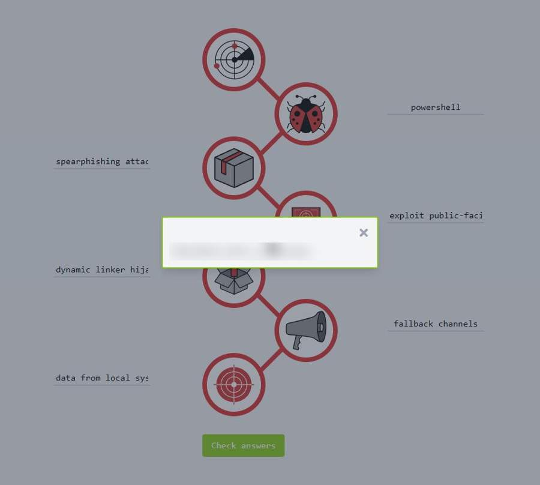

# Cyber Kill Chain — Mapping the Target 2013 Breach

| Item | Detail |
|------|--------|
| Platform | TryHackMe — SOC Level 1 path (Cyber Defence Frameworks) |
| Room | [Cyber Kill Chain](https://tryhackme.com/room/cyberkillchainzmt) |
| Category | Threat modelling · Frameworks |
| Difficulty | Easy |
| Date | 23 Nov 2026 |
| Status | ✅ Completed — 10/10 tasks |

> **Goal:** learn Lockheed Martin's 7-phase Cyber Kill Chain and apply it to a real breach. Defenders win by breaking **any** link in the chain.

---

## The 7 phases

| # | Phase | What happens | Room example |
|---|-------|--------------|--------------|
| 1 | Reconnaissance | Research the target | **OSINT Framework**, **email harvesting** (theHarvester, Hunter.io) |
| 2 | Weaponization | Build the payload | Malicious Office **macro** (VBA) |
| 3 | Delivery | Send it to the victim | Phishing, USB, **watering hole attack** |
| 4 | Exploitation | Trigger the vulnerability | **Zero-day**, user executes attachment |
| 5 | Installation | Persistence | **Web shell**, services, Run keys, **timestomping** to hide |
| 6 | Command & Control | Remote control channel | HTTP/HTTPS, **DNS tunneling** |
| 7 | Actions on Objectives | The goal | Exfiltration, ransomware, deleting **Shadow Copies** |

### Answers

| Question | Answer |
|----------|--------|
| Web-based OSINT tool collection | `OSINT Framework` |
| Collecting emails during recon | `Email harvesting` |
| Automated scripts in Office documents | `Macro` |
| Infecting a site the victims visit | `Watering hole attack` |
| Exploit unknown to the vendor | `Zero-day` |
| Modifying file time attributes | `Timestomping` |
| Script on web server for remote access | `Web shell` |
| C2 via regular DNS requests | `DNS Tunneling` |
| Windows backup/snapshot technology | `Shadow Copy` |

---

## Practice — Target (Nov–Dec 2013, ~40 M cards)

Six ATT&CK techniques had to be placed on the correct phase:

| Phase | Technique |
|-------|-----------|
| Weaponization | PowerShell |
| Delivery | Spearphishing attachment (sent to HVAC contractor Fazio Mechanical) |
| Exploitation | Exploit public-facing application |
| Installation | Dynamic linker hijacking |
| Command & Control | Fallback channels |
| Actions on Objectives | Data from local system (POS card data) |

**First attempt** I entered the phase names themselves — wrong: the exercise asks for the *techniques* in each phase. Re-reading the task fixed it.

Flag: `THM{...}` *(redacted)*

## Key takeaways

1. The Kill Chain is linear and malware-centric; combine it with ATT&CK/Unified Kill Chain for insider and post-exploitation detail.
2. A third-party supplier (Fazio) was the entry point — supply-chain/vendor access must be monitored.
3. Each phase is a detection opportunity: recon (web logs), delivery (email gateway), C2 (DNS/proxy), actions (DLP).
