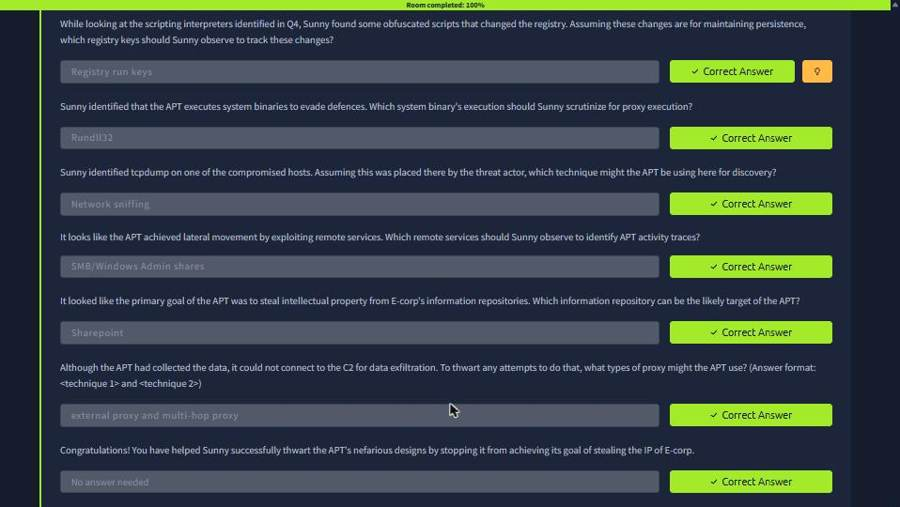

# Eviction — Hunting APT28 with the MITRE ATT&CK Navigator

| | |
|---|---|
| **Platform** | TryHackMe — SOC Level 1 › Cyber Defence Frameworks |
| **Room** | [Eviction](https://tryhackme.com/room/eviction) |
| **Year** | 2026 |
| **Difficulty** | Medium |
| **Focus** | Threat intelligence, MITRE ATT&CK Navigator, TTP-driven hunting |

## Scenario

Sunny, a SOC analyst at E-corp (a rare-earth-metals manufacturer), receives a classified
intelligence report: **APT28** may target organisations like E-corp. Using the APT28 layer
in the **MITRE ATT&CK Navigator**, the job is to map the group's TTPs across the kill chain
and decide what to hunt for at each stage — before or after the adversary is inside.

## Method

1. Open the ATT&CK Navigator layer for APT28 linked in the task.
2. For each question, go to the relevant **tactic column** (Reconnaissance, Resource
   Development, Initial Access, Execution, Persistence, Defense Evasion, Discovery,
   Lateral Movement, Collection, Command and Control).
3. Look only at the **highlighted** techniques (used by APT28) and expand the
   sub-techniques (the `⋮` handle) to get the exact name.
4. Turn each technique into a hunting hypothesis (what log source / artefact to check).

## Walkthrough

| # | Question (stage) | Tactic column | Answer | What to hunt for |
|---|---|---|---|---|
| 1 | Technique used for both recon and initial access | Reconnaissance + Initial Access | **Spearphishing Link** | Mail gateway logs, URL clicks, proxy logs |
| 2 | Accounts compromised while developing resources | Resource Development › Compromise Accounts | **Email Accounts** | Look-alike/compromised senders, partner mailbox abuse |
| 3 | User-execution techniques | Execution › User Execution | **Malicious File and Malicious Link** | Office spawning child processes, downloads from mail links |
| 4 | Scripting interpreters | Execution › Command and Scripting Interpreter | **PowerShell and Windows Command Shell** | 4104 script-block logs, `cmd.exe`/`powershell.exe` with encoded args |
| 5 | Registry persistence | Persistence › Boot or Logon Autostart Execution | **Registry Run Keys** | Sysmon 13 on `...\CurrentVersion\Run`/`RunOnce` |
| 6 | System binary for proxy execution | Defense Evasion › System Binary Proxy Execution | **Rundll32** | `rundll32.exe` with unusual DLL paths / no arguments |
| 7 | `tcpdump` found on a host | Discovery | **Network Sniffing** | New capture tools, NIC in promiscuous mode |
| 8 | Remote services for lateral movement | Lateral Movement › Remote Services | **SMB/Windows Admin Shares** | 4624 type 3 + `ADMIN$`/`C$` access, 5140/5145 |
| 9 | Target information repository | Collection › Data from Information Repositories | **Sharepoint** | Bulk downloads, unusual SharePoint access patterns |
| 10 | Proxy types for C2/exfiltration | Command and Control › Proxy | **External Proxy and Multi-hop Proxy** | Outbound to VPS/Tor, chained proxies, unusual egress |

## Key takeaways

- The Navigator turns a threat-intel report into a **hunting checklist**: one highlighted
  technique ≈ one hypothesis with a concrete log source.
- Always drill down to the **sub-technique** — "User Execution" is too broad to hunt;
  "Malicious File" tells you to watch Office child processes.
- Thinking along the kill chain lets you check both *"are they already in?"* (persistence,
  lateral movement) and *"can we stop the goal?"* (collection, C2/exfil).
