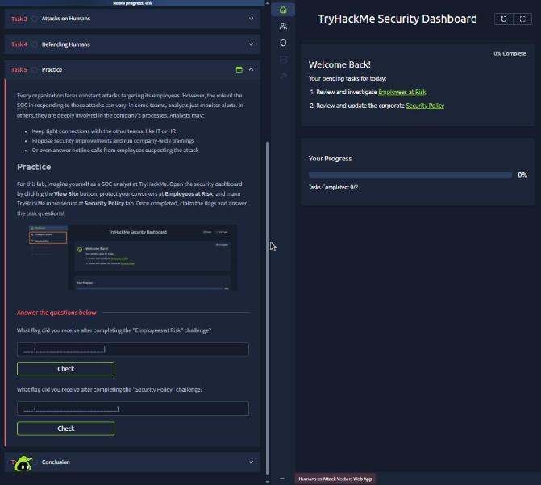
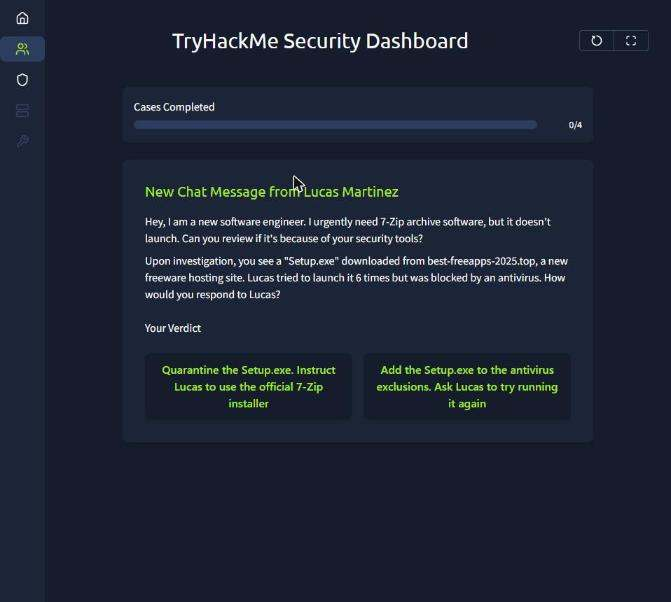
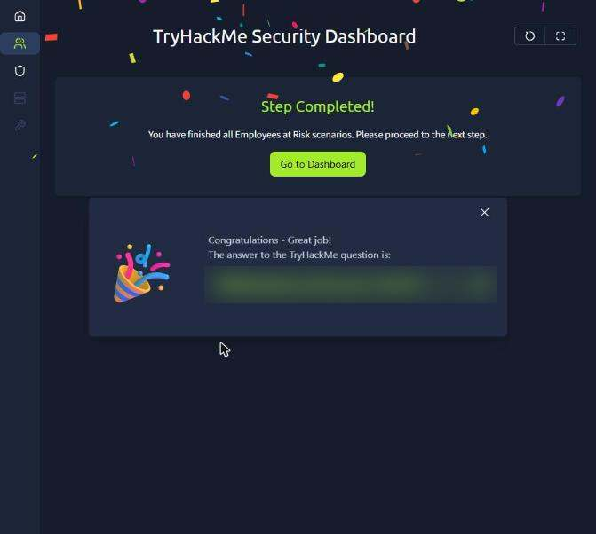
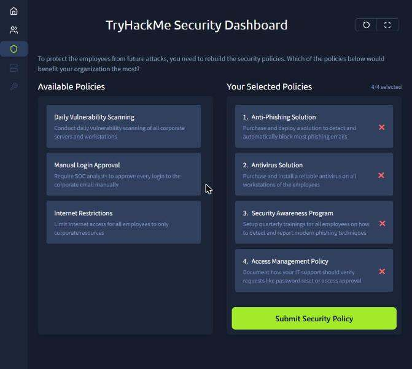
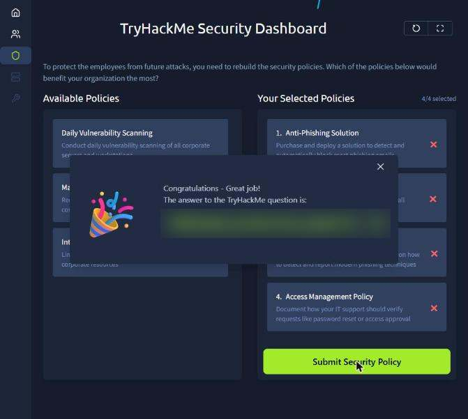

# Humans as Attack Vectors — Social Engineering Triage & Mitigation

| Item | Detail |
|------|--------|
| Platform | TryHackMe — SOC Level 1 path |
| Room | [Humans as Attack Vectors](https://tryhackme.com/room/humansattackvectors) |
| Category | Blue Team · Social engineering · Phishing |
| Difficulty | Medium |
| Year | 2026 |
| Status | ✅ Completed — 6/6 tasks |

> **Goal:** understand why attackers target people instead of systems, recognise the main social engineering techniques, and practise responding to real-looking employee incidents as a SOC analyst.

---

## Theory in one page

**Why humans?** Breaking through a firewall takes days; one convincing email to an administrator can give the same access in minutes. Humans are the *weakest link* because they hold **access** — mailboxes, websites, databases.

**Social engineering** = manipulating human psychology (urgency, authority, fear, curiosity) to make the victim act. Common methods:

| Method | What it looks like |
|--------|--------------------|
| Phishing | Fake emails with malicious links/attachments |
| **Impersonation** | Pretending to be someone else (CEO, IT, a vendor) — including voice deepfakes |
| Fake software | Trojanised installers from "free download" sites |
| Credential harvesting | Look-alike login pages |

**Defence = Mitigation + Detection**
- **Mitigation** prevents or reduces the chance/impact of an attack (training, anti-phishing, clear IT procedures).
- **Detection** is the SOC's job when mitigation is bypassed.

### Answers

| Task | Question | Answer |
|------|----------|--------|
| 2 | Weakest link in cyber security? | `Humans` |
| 2 | What do attackers seek when targeting humans? | `Access` |
| 3 | Attack tactic that manipulates human psychology? | `Social Engineering` |
| 3 | Method of pretending to be someone else? | `Impersonation` |
| 4 | Process aimed at preventing/reducing the chance of an attack? | `Mitigation` |
| 4 | Mitigation measure about training employees? | `Security Awareness Training` |

---

## Task 5 — Practice: TryHackMe Security Dashboard

### Part 1 — Employees at Risk (4 cases)

| # | Situation | Decision | Why it is correct |
|---|-----------|----------|-------------------|
| 1 | New engineer downloaded `Setup.exe` ("7-Zip") from `best-freeapps-2025.top`; antivirus blocked it 6 times | **Quarantine the file, send him to the official 7-Zip installer** | Unknown freeware domain + repeated AV blocks = malware. Never add exclusions to "make it work" — it was a data stealer |
| 2 | "Stripe" invoice for $23,650 from `noreply@stripe-payments.xyz` with password-protected `Invoice.rar` | **Block the email and analyse** | Look-alike domain, password-protected archive (evades scanning), financial urgency aimed at the Finance Director |
| 3 | IT reset the CEO's Gmail password after a 9 PM call from a hidden number; CEO now unreachable | **Disable the account until the CEO confirms** | Classic vishing/deepfake impersonation; contain first, verify out-of-band |
| 4 | HR assistant logged in from London (normally Oxford) right after visiting `login.micrsoft365-online.ru` | **Disable the account and investigate** | The location alone looks fine — the **visited URLs** reveal a credential-phishing page (typosquat of Microsoft) |

> 🔑 **Analyst lesson from case 4:** never close an alert on a single "looks normal" indicator. Correlate with other evidence (browser history, proxy logs).

### Part 2 — Security Policy (choose 4)

| Selected ✅ | Rejected ❌ |
|------------|------------|
| Anti-Phishing Solution — blocks most phishing before it reaches users | Daily Vulnerability Scanning — protects systems, not people |
| Antivirus Solution — stops stealers/trojans like case 1 | Manual Login Approval — doesn't scale, blocks the business |
| Security Awareness Program — trains users to spot and report phishing | Internet Restrictions — overly disruptive |
| Access Management Policy — defines how IT verifies resets/approvals (prevents case 3) | |

| Question | Answer |
|----------|--------|
| Flag after "Employees at Risk" | `THM{...}` *(redacted)* |
| Flag after "Security Policy" | `THM{...}` *(redacted)* |

---

## Key takeaways

1. **Contain first, confirm later** — disabling an account is reversible; a stolen mailbox is not.
2. **Verify identity out-of-band** for password resets (exactly what an access management policy enforces).
3. **Look-alike domains** (`stripe-payments.xyz`, `micrsoft365-online.ru`) are the #1 phishing indicator.
4. **Never whitelist** a file just because the user insists.
5. Good policy = a mix of **technology** (anti-phishing, AV) and **people/process** (training, verification procedures).

## MITRE ATT&CK mapping

| Technique | ID | Seen in |
|-----------|----|---------|
| Phishing: Spearphishing Attachment | T1566.001 | Fake Stripe invoice |
| Phishing: Spearphishing Link | T1566.002 | Fake Microsoft login |
| Phishing for Information: Spearphishing Voice | T1598.004 | CEO deepfake call |
| User Execution: Malicious File | T1204.002 | Fake 7-Zip `Setup.exe` |
| Valid Accounts | T1078 | Stolen M365 / Gmail credentials |
