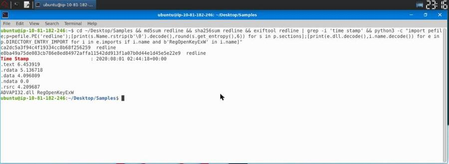
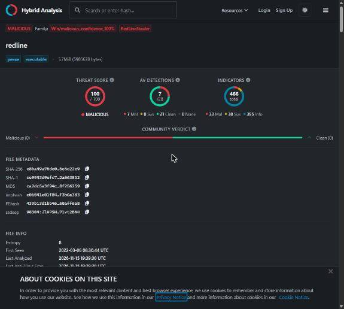

# Intro to Malware Analysis — Static & Dynamic Analysis of RedLine

| Item | Detail |
|------|--------|
| Platform | TryHackMe — SOC Level 1 path |
| Room | [Intro to Malware Analysis](https://tryhackme.com/room/intromalwareanalysis) |
| Category | Malware analysis · REMnux |
| Difficulty | Easy |
| Date | 23 Nov 2026 |
| Status | ✅ Completed — 8/8 tasks |

> **Goal:** learn the malware-analysis workflow a SOC uses when it finds a suspicious file — basic static analysis (hashes, PE header, sections, imports), basic dynamic analysis (sandbox reports) and the anti-analysis tricks malware uses.

---

## 1. Concepts

- The **Threat Hunt Team** uses malware analysis to extract IOCs and hunt across the network.
- **Static analysis** = examine without executing. **Dynamic analysis** = run in a controlled sandbox and observe.
- Always work in an isolated, snapshotted VM (here: **REMnux**, a Linux distro for reverse engineering).

## 2. Lab — basic static analysis of `redline`

Sample location in the lab VM: `~/Desktop/Samples/redline` (RedLine Stealer).

One command collects everything the tasks ask for — hashes, compile timestamp, per-section entropy and the DLL that imports a given API:

```bash
cd ~/Desktop/Samples
md5sum redline
sha256sum redline
exiftool redline | grep -i 'time stamp'
python3 -c "import pefile;p=pefile.PE('redline');
[print(s.Name.rstrip(b'\0').decode(), round(s.get_entropy(),6)) for s in p.sections];
[print(e.dll.decode(), i.name.decode()) for e in p.DIRECTORY_ENTRY_IMPORT
  for i in e.imports if i.name and b'RegOpenKeyExW' in i.name]"
```



| Field | Value |
|-------|-------|
| MD5 | `ca2dc5a3f94c4f19334cc8b68f256259` |
| SHA-256 | `e8ba49a75de083cb786e8ed84972affa11542dd913f1a07b0d44e1d45e5e22e9` |
| PE timestamp | `2020-08-01 02:44:18 UTC` |
| Sections | `.text` (6.453919), `.rdata`, `.data`, **`.ndata`**, `.rsrc` |
| `RegOpenKeyExW` imported from | `ADVAPI32.dll` |

**Reading the results**
- **Entropy** close to 8 = compressed/encrypted data (packing). `.text` at ~6.45 is normal code.
- **`.ndata`** is the uninitialised-data section of an **NSIS installer** — the real payload is unpacked at runtime.
- Registry APIs from `ADVAPI32.dll` hint at persistence or config/credential theft.
- Tools covered: `md5sum`/`sha256sum`, `exiftool`, `strings`/`floss`, `pecheck`, `pe-tree`, `pefile`.

## 3. Basic dynamic analysis — sandbox report

Searching the SHA-256 on Hybrid Analysis shows **100/100 malicious, family RedLineStealer**. In the *Windows 7 64 bit, 2022-03-14* report:

- First process launched by the sample: **`setup_installer.exe`**
- Abused Windows utilities (LOLBins): **`cmd.exe` and `powershell.exe`**



Other sandboxes: Any.run, Joe Sandbox, Cuckoo/CAPE, VirusTotal behaviour tab.

## 4. Anti-analysis techniques

| Technique | Purpose |
|-----------|---------|
| **Packing** / obfuscation | Defeat static analysis and signatures |
| **Long sleep calls** | Outlast the sandbox's execution time |
| VM / debugger detection | Behave benignly when analysed |
| User-activity checks | Wait for real mouse/keyboard input |

The Hybrid Analysis report confirms several: *"tries to sleep for a long time"*, *"queries kernel debugger information"*, *"anti-virtualization using MAC address"*.

### Answers

| Question | Answer |
|----------|--------|
| Team that uses MA to hunt IOCs | `Threat Hunt Team` |
| Analysis without executing | `Static Analysis` |
| Analysis by executing in a sandbox | `Dynamic Analysis` |
| MD5 / creation time | see table above |
| `.text` entropy / 5th section / DLL | `6.453919` / `.ndata` / `ADVAPI32.dll` |
| First process / 2 utilities | `setup_installer.exe` / `cmd.exe and powershell.exe` |
| Bypass static analysis | `Packing` |
| Time out a sandbox | `Long sleep calls` |

---

## Key takeaways

1. Start with **hashes** — they let you pivot to existing sandbox and TI reports without running anything.
2. The PE header tells a story: sections, entropy and imports reveal packing and intent.
3. Combine static + dynamic: each covers the other's blind spots (packing vs sandbox evasion).
4. Never analyse live malware on a production or personal machine.
