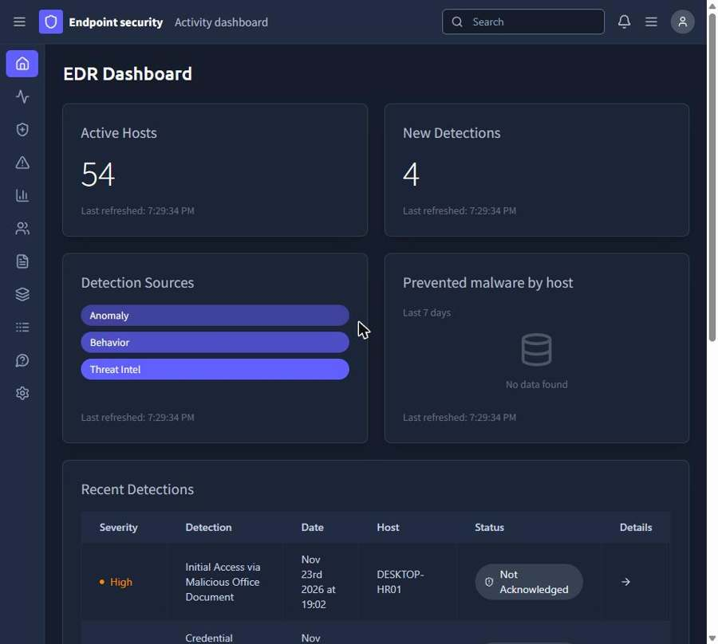
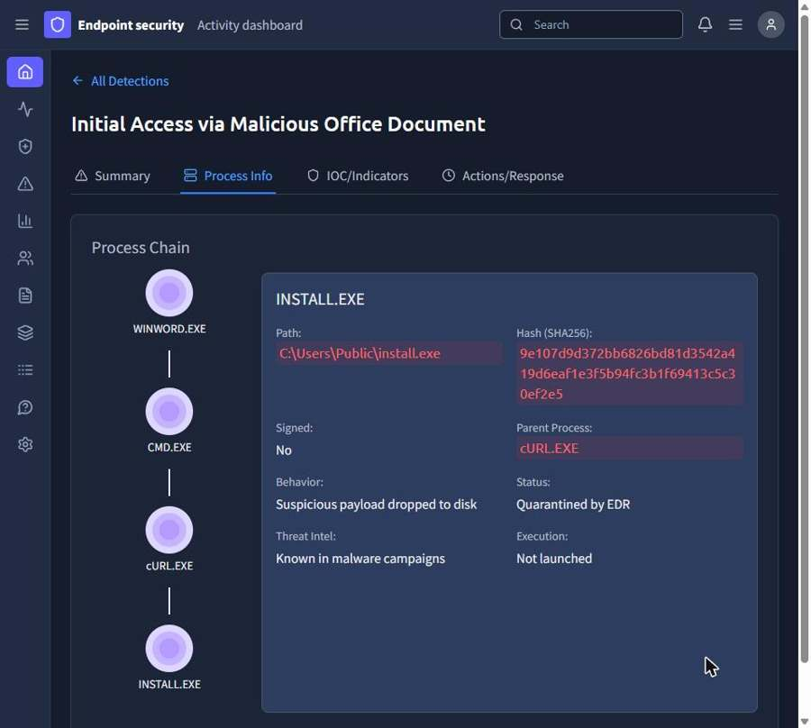
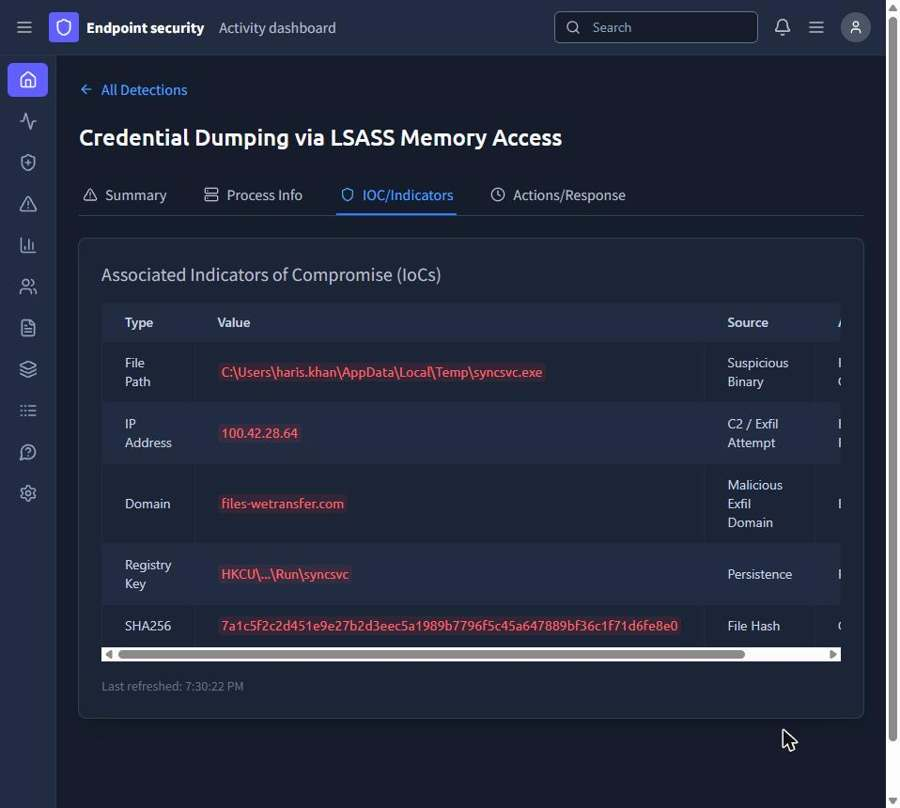
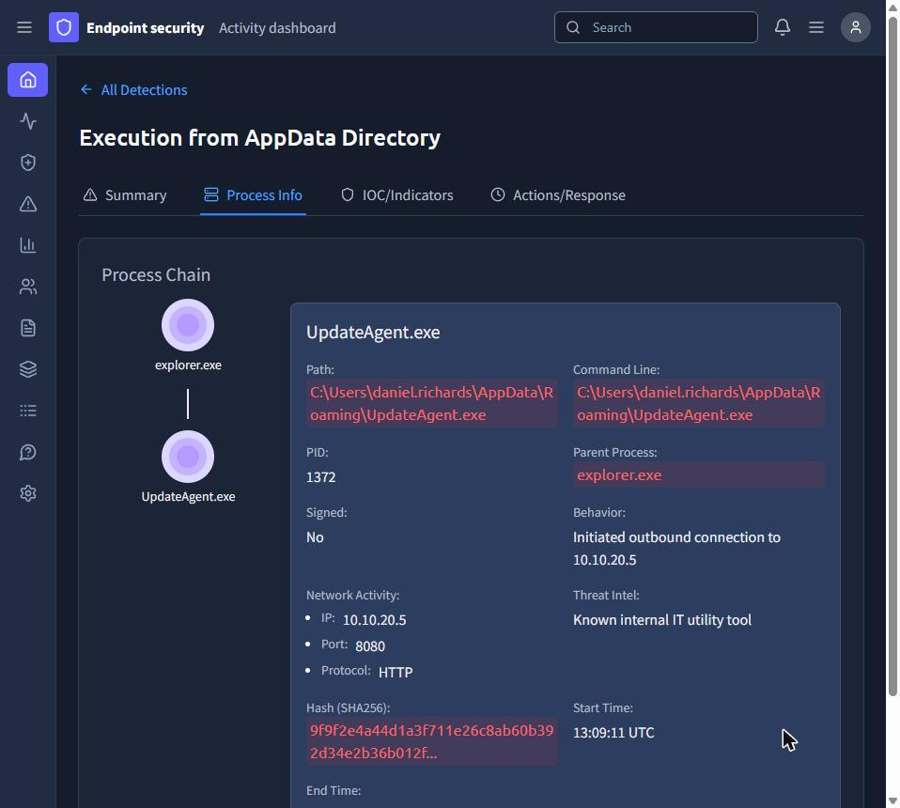

# Introduction to EDR — Endpoint Detection & Response

| Item | Detail |
|------|--------|
| Platform | TryHackMe — SOC Level 1 path |
| Room | [Introduction to EDR](https://tryhackme.com/room/introductiontoedrs) |
| Category | Blue Team · Endpoint security |
| Difficulty | Easy |
| Date | 23 Nov 2026 |
| Status | ✅ Completed — 8/8 tasks |

> **Goal:** understand what an EDR does beyond antivirus, what telemetry it collects, how it detects and responds, and then investigate four real-looking detections in an EDR console.

---

## 1. Concepts

**EDR pillars:** Visibility (full context — process trees, parent/child, network, registry) · Detection · Response.

**AV vs EDR (airport analogy):** the AV is the **immigration check** — it only compares passports (signatures) at the door. The EDR is the officers *inside* the airport watching behaviour.

Example attack the AV misses: phishing `.docm` → macro → PowerShell → second stage injected into **svchost.exe** → remote access. Every step uses legitimate binaries, so an **Antivirus** marks it clean; the EDR records and correlates the whole chain.

**Architecture:** an **agent** (a.k.a. **sensor**) on each endpoint streams telemetry to a central console.

**Telemetry:** process execution/termination, **network connections** (C2 detection), command lines, file/folder changes, **registry** modifications (Windows config + persistence).

**Detection techniques:** behavioural detection, anomaly detection (baseline), **IOC matching**, MITRE ATT&CK mapping, machine learning.

**Response:** isolate host, kill process, quarantine file, remote shell (live response), artefact collection.

### Answers (tasks 2–6)

| Question | Answer |
|----------|--------|
| Feature giving complete context | `Visibility` |
| Process that spawned `sc.exe` | `cmd.exe` |
| What represents an AV in the analogy | `Immigration check` |
| Legitimate process hijacked | `svchost.exe` |
| Solution that might mark it clean | `Antivirus` |
| Component collecting telemetry | `Agent` |
| Agent is also known as | `Sensor` |
| Telemetry for C2 | `Network Connections` |
| Where Windows config lives | `Registry` |
| Detection by known malicious indicators | `IOC Matching` |

---

## 2. Practice — investigating alerts in the EDR

Four new detections. Workflow for each: **Summary → Process Info (process chain) → IOC/Indicators → decide.**

### Detection 1 — Initial Access via Malicious Office Document (DESKTOP-HR01, High)
- `WINWORD.EXE /n "invoice.docm"` → `CMD.EXE` → **`curl.exe`** downloads payload
- Dropped to **`C:\Users\Public\install.exe`** — unsigned, known in malware campaigns, quarantined, never executed
- Verdict: **True Positive** — malware staging (T1566.001 → T1105)

### Detection 2 — Credential Dumping via LSASS (WIN-ENG-LAPTOP03, High)
- `explorer.exe` → **`C:\Users\haris.khan\AppData\Local\Temp\syncsvc.exe`** → reads `lsass.exe` memory
- Command line `syncsvc.exe -ma lsass.exe C:\Users\Public\dump_2025.dmp` (procdump-style)
- Persistence: service + `HKCU\...\Run\syncsvc`
- Exfil attempt: `https://files-wetransfer.com/upload/session/.../dump_2025.dmp` (look-alike of WeTransfer) → **blocked by EDR**
- Verdict: **True Positive** — T1003.001, escalate + reset haris.khan credentials

### Detection 3 — Execution from AppData (DESKTOP-DEV01, Medium)
- `C:\Users\daniel.richards\AppData\Roaming\UpdateAgent.exe`, unsigned, HTTP to internal `10.10.20.5:8080`
- Threat Intel: **Known internal IT utility tool**
- Verdict: likely **False Positive** — confirm with IT, then tune the rule

### Answers (task 7)

| Question | Answer |
|----------|--------|
| Tool launched by CMD on DESKTOP-HR01 | `curl.exe` |
| Path of downloaded malware | `C:\Users\Public\install.exe` |
| Path of syncsvc.exe on WIN-ENG-LAPTOP03 | `C:\Users\haris.khan\AppData\Local\Temp\syncsvc.exe` |
| Exfiltration URL | `https://files-wetransfer.com/upload/session/ab12cd34ef56/dump_2025.dmp` |
| Threat Intel label of UpdateAgent.exe | `Known internal IT utility tool` |

---

## Key takeaways

1. AV matches signatures; EDR watches **behaviour and relationships** — the process tree is the analyst's best friend.
2. "Unsigned binary in `AppData`/`Temp`/`Public`" is suspicious, but **context (threat intel, asset owner) decides** the verdict.
3. LSASS access + dump file + external upload = credential theft in progress; contain immediately.
4. Look-alike domains (`files-wetransfer.com`) are a classic exfil/phishing trick.

## MITRE ATT&CK mapping

| Technique | ID |
|-----------|----|
| Spearphishing Attachment | T1566.001 |
| Command and Scripting Interpreter | T1059 |
| Ingress Tool Transfer | T1105 |
| OS Credential Dumping: LSASS Memory | T1003.001 |
| Boot/Logon Autostart: Run Keys | T1547.001 |
| Exfiltration Over Web Service | T1567 |
