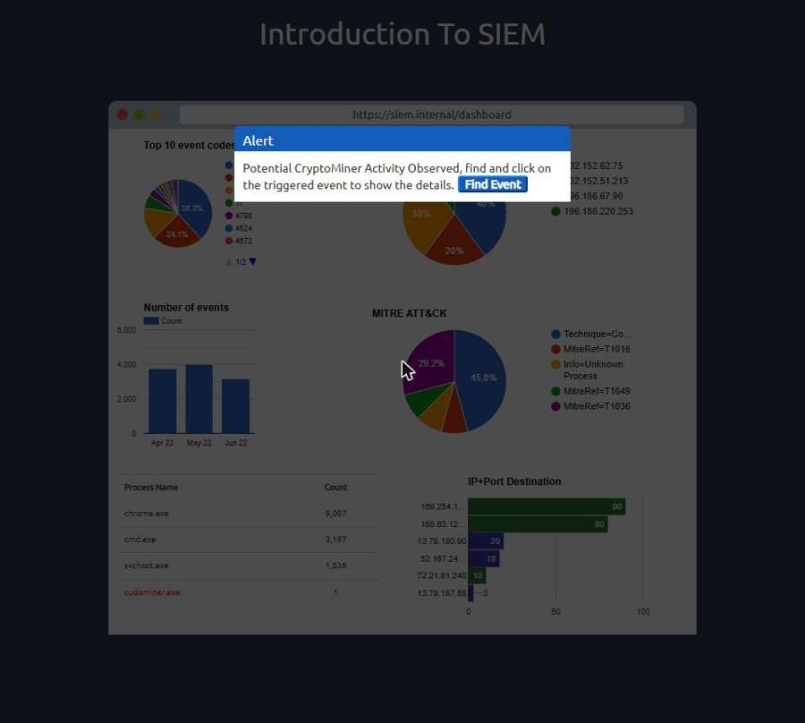
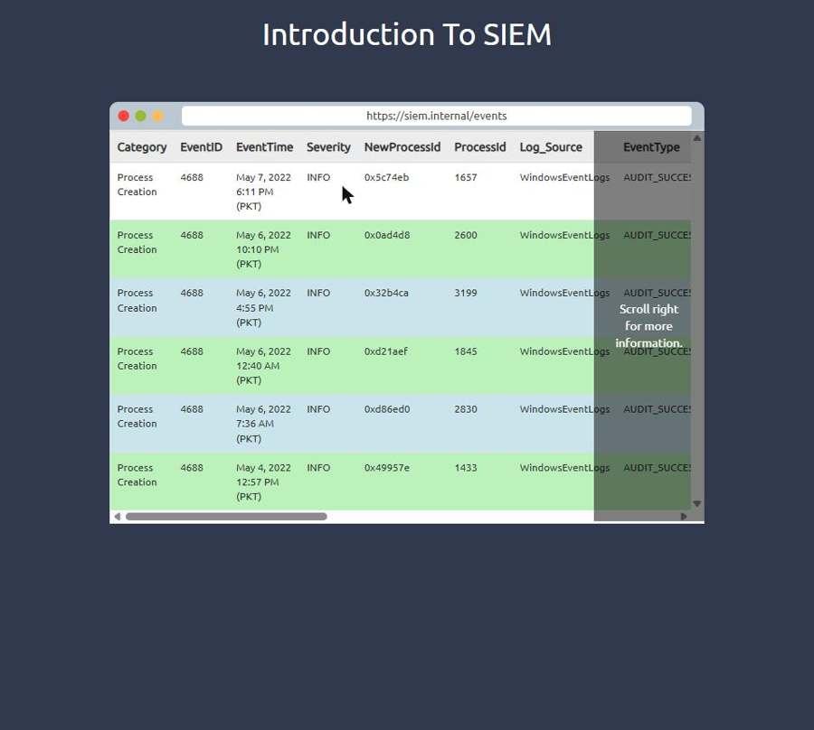
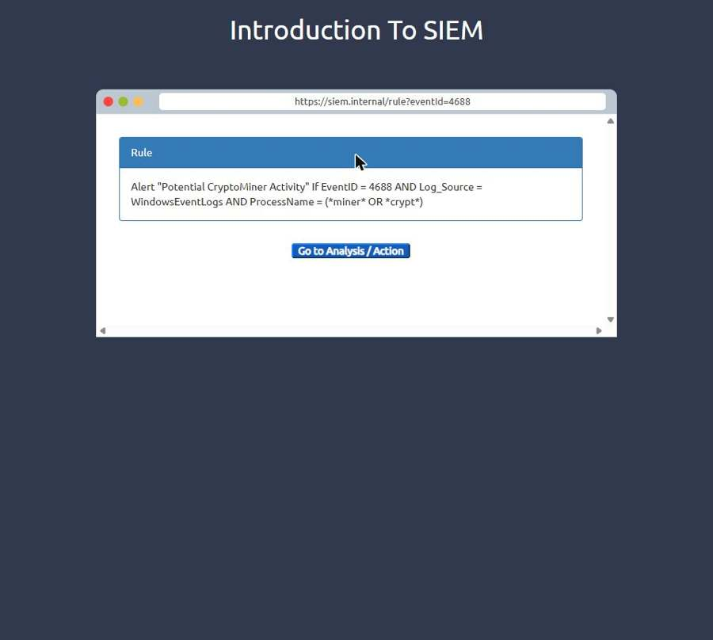
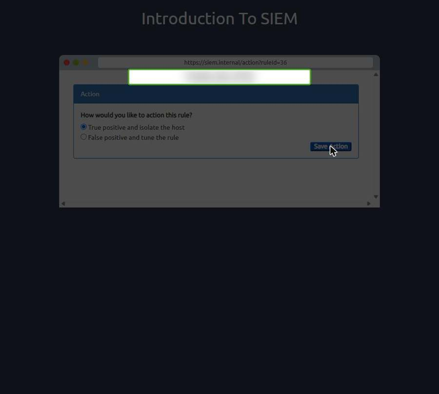

# Introduction to SIEM — From Logs to Alerts

| Item | Detail |
|------|--------|
| Platform | TryHackMe — SOC Level 1 path |
| Room | [Introduction to SIEM](https://tryhackme.com/room/introtosiem) |
| Category | Blue Team · SIEM · Log analysis |
| Difficulty | Medium |
| Year | 2026 |
| Status | ✅ Completed — 7/7 tasks |

> **Goal:** understand why a SOC needs a SIEM, where logs come from, how they are ingested and correlated into alerts, and triage a real alert end-to-end (event → rule → verdict → action).

---

## 1. Concepts

**SIEM = Security Information and Event Management system.** It centralises logs from every device, normalises them, correlates them in real time and raises alerts.

**Log sources**
| Host-centric | Network-centric |
|--------------|-----------------|
| File access, process execution, **registry** changes, PowerShell, user logons | **VPN**, SSH, firewall, proxy, IDS/IPS, web traffic |

**Where logs live**
- Windows → Event Viewer (event IDs, e.g. 4624 logon, 4625 failed logon, 4688 process creation)
- Linux → `/var/log/` (`/var/log/httpd` web, `/var/log/auth.log`, `/var/log/syslog`…)
- Web servers → access/error logs

**Ingestion:** agents/forwarders, Syslog, manual upload, port forwarding.

**Alerting:** correlation rules (e.g. *"Event ID 104 – event log cleared"*, *"5 failed logins in 10 s"*). Analysts triage alerts; noisy **False Positive** rules need tuning.

### Answers (tasks 1–5)

| Question | Answer |
|----------|--------|
| SIEM stands for | `Security Information and Event Management system` |
| Registry activity is | `host-centric` |
| VPN activity is | `network-centric` |
| Linux HTTP logs location | `/var/log/httpd` |
| Event ID when event logs are removed | `104` |
| Alert type that may require tuning | `False Positive` |

---

## 2. Lab — triaging a CryptoMiner alert

**Step 1 – Alert fires.** After *Start Suspicious Activity*, the dashboard raises **"Potential CryptoMiner Activity"**. The process table shows a single, unusual `cudominer.exe`.



**Step 2 – Find the event.** In the event log (Event ID **4688 – process creation**) the matching row is:

| Field | Value |
|-------|-------|
| Hostname | **HR_02** |
| User | **Chris** |
| Process | `C:\Users\Chris\temp\cudominer.exe` |



**Step 3 – Read the rule.**
```
Alert "Potential CryptoMiner Activity" IF EventID = 4688
  AND Log_Source = WindowsEventLogs
  AND ProcessName = (*miner* OR *crypt*)
```
The process name matched the term **`miner`**.



**Step 4 – Verdict & action.** An HR user running a miner from a `temp` folder has no business justification → **True Positive → isolate the host**. Saving the action reveals the flag.



| Question | Answer |
|----------|--------|
| Process that caused the alert | `cudominer.exe` |
| User | `Chris` |
| Hostname | `HR_02` |
| Matched term | `miner` |
| Verdict | `True Positive` |
| Flag | `THM{...}` *(redacted)* |

---

## Key takeaways

1. A SIEM's value is **centralisation + correlation** — individual logs rarely tell the story.
2. Always walk the chain: **alert → raw event → rule logic → context → verdict → action**.
3. Wildcard rules (`*miner*`) are simple but can be noisy — know exactly which term matched.
4. Executables in user `temp`/`AppData` folders on non-IT hosts are a strong red flag.

## MITRE ATT&CK mapping

| Technique | ID |
|-----------|----|
| Resource Hijacking (cryptomining) | T1496 |
| User Execution | T1204 |
| Indicator Removal: Clear Windows Event Logs | T1070.001 |
