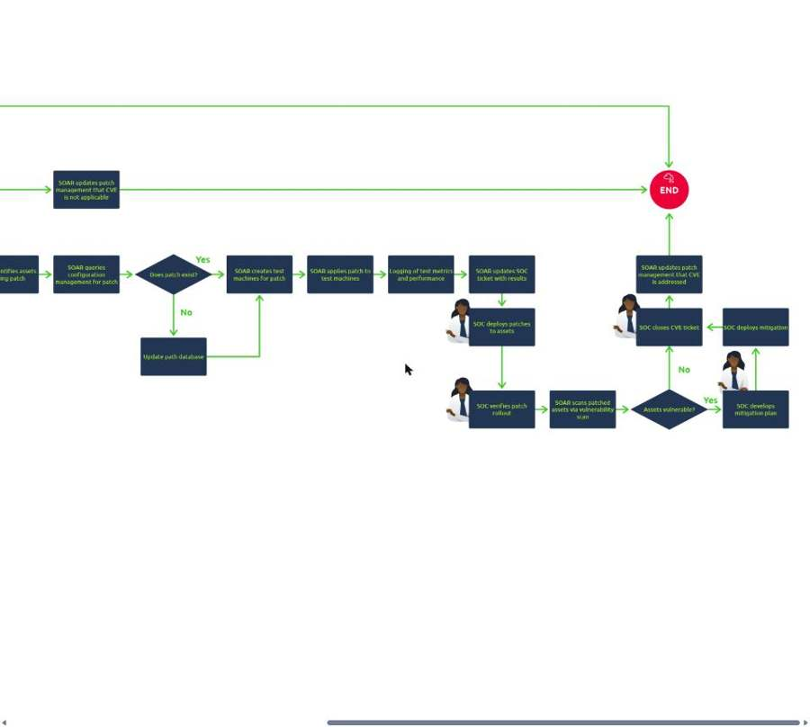
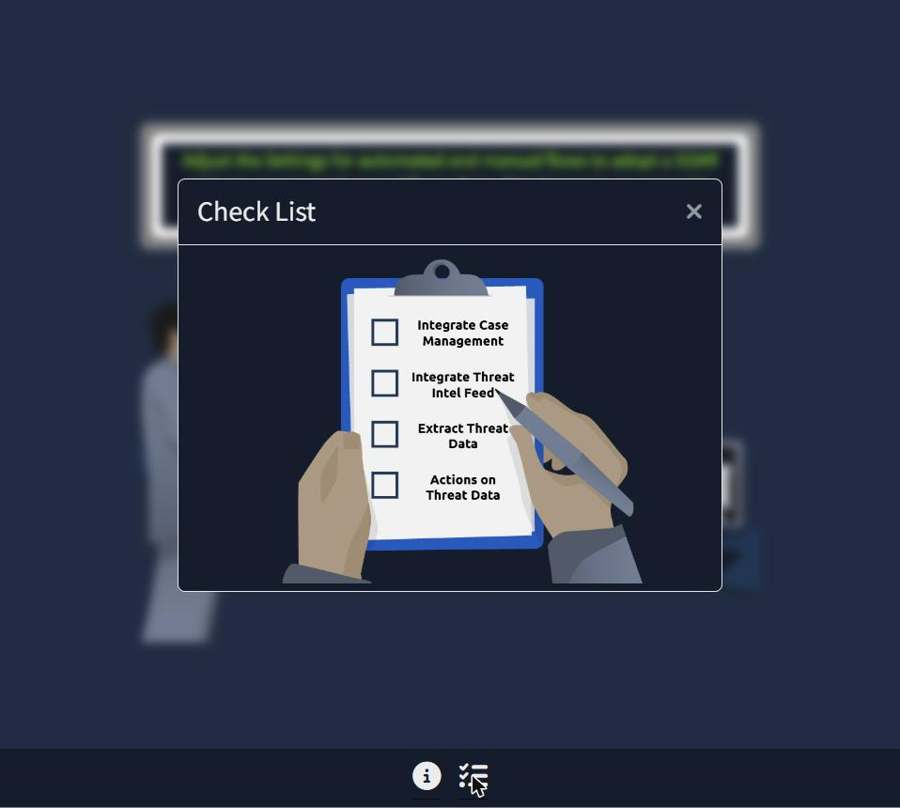
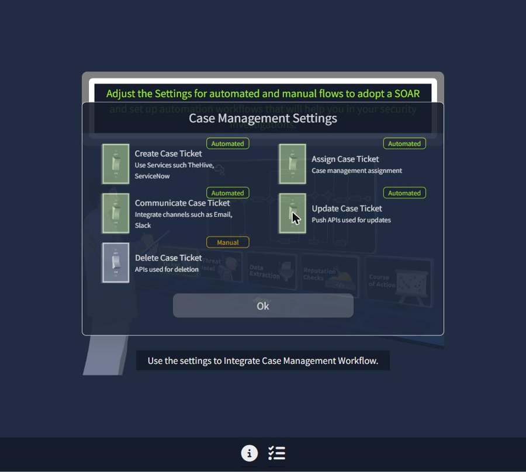
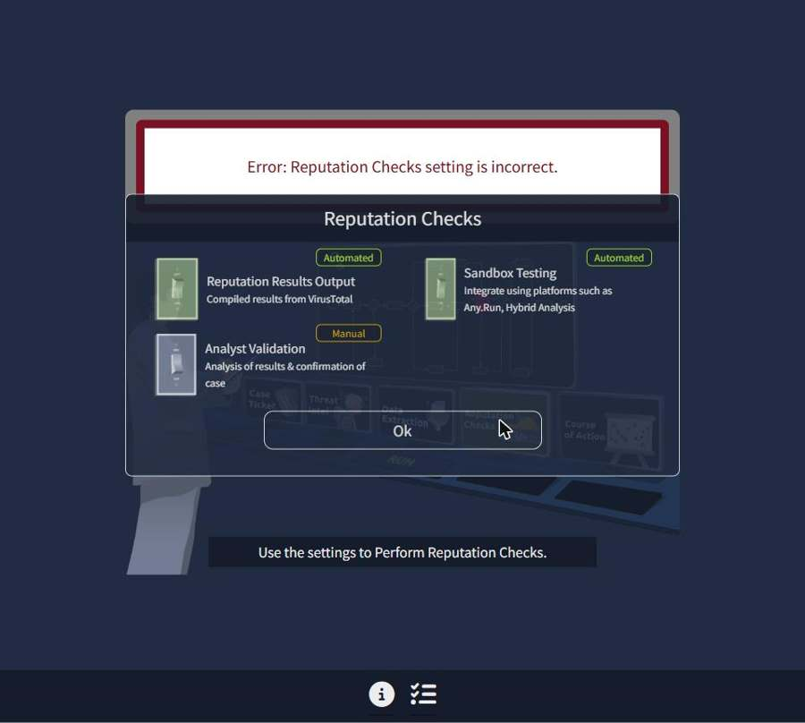
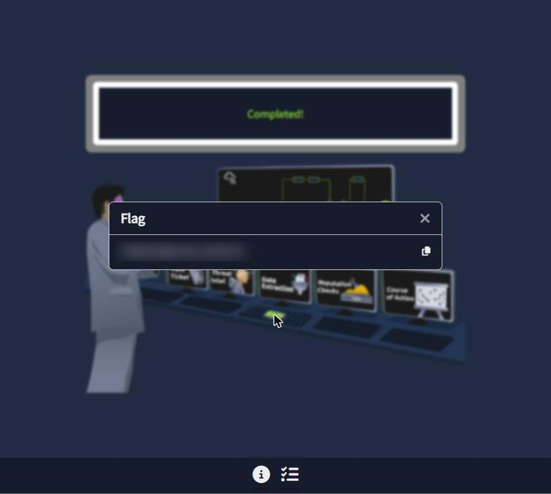

# Introduction to SOAR — Automating the SOC

| Item | Detail |
|------|--------|
| Platform | TryHackMe — SOC Level 1 path |
| Room | [Introduction to SOAR](https://tryhackme.com/room/soar) |
| Category | Blue Team · SOAR · Automation |
| Difficulty | Easy |
| Date | 23 Nov 2026 |
| Status | ✅ Completed — 6/6 tasks |

> **Goal:** understand the problems of a traditional SOC, how SOAR (Security Orchestration, Automation and Response) solves them with playbooks, and build a Threat Intel workflow deciding which steps are automated and which stay manual.

---

## 1. Why SOAR?

Traditional SOC pain points: **alert fatigue**, too many disconnected tools, manual repetitive processes, and talent shortage.

SOAR provides three capabilities:
| Capability | Meaning |
|------------|---------|
| **Orchestration** | Connecting/integrating security tools into seamless workflows |
| **Automation** | Running repetitive steps (enrichment, lookups, ticketing) without humans |
| **Response** | Executing containment actions (block, isolate, notify) from one place |

A **playbook** is a predefined list of actions to handle a type of incident.

## 2. Playbooks

**Phishing playbook:** receive email → extract URLs/attachments → reputation checks → analyst reviews → block / close.

**CVE patching playbook** (*Monitor Advisory Lists* → extract CVE → check patch management → create ticket → test patch → deploy → re-scan). If assets are **still vulnerable** after patching, the SOC **develops a mitigation plan**.

Notice that analysts still appear at key decision points — **manual analysis remains vital**.

### Answers (tasks 2–4)

| Question | Answer |
|----------|--------|
| Overload of security events | `Alert Fatigue` |
| Integrating tools into workflows | `Orchestration` |
| Predefined list of actions for an incident | `Playbook` |
| Is manual analysis vital in SOAR? | `Yay` |
| Where the CVE playbook gets new CVEs | `Advisory Lists` |
| What the SOC develops if still vulnerable | `Mitigation Plan` |

---

## 3. Lab — Threat Intel workflow (manual vs automated)

McSkidy's checklist: integrate case management → integrate threat-intel feed → extract threat data → act on threat data.

Final working configuration:

| Panel | Automated | Manual |
|-------|-----------|--------|
| Case Management | Create, Assign, Communicate, Update ticket | **Delete ticket** |
| Threat Intel Feeds | Fetch new alerts, Set fetch intervals, Failed-fetch notifications | **Discard old alerts** |
| Data Extraction | Extract domains, URLs, IPs (VirusTotal lookups) | **Analyst extraction** of unknown/new threats |
| Reputation Checks | Reputation results output | **Sandbox testing**, **Analyst validation** |
| Course of Action | Block domains/IPs/URLs, Update tickets | **Analyst approves COA** |

**What went wrong first:** I automated sandbox testing and RUN returned *"Reputation Checks setting is incorrect"*. Detonating unknown samples in Any.Run/Hybrid Analysis is a judgement call (cost, data sharing, OPSEC), so it stays with the analyst. Switching it to manual completed the flow.

Flag: `THM{...}` *(redacted)*

---

## Key takeaways

1. Automate **repetitive, deterministic** steps (ticketing, lookups, enrichment, blocking known-bad).
2. Keep humans on **destructive or judgement steps** (deleting data, sandboxing unknowns, validating verdicts, approving the course of action).
3. Playbooks reduce MTTR and alert fatigue, but they don't replace the analyst.
