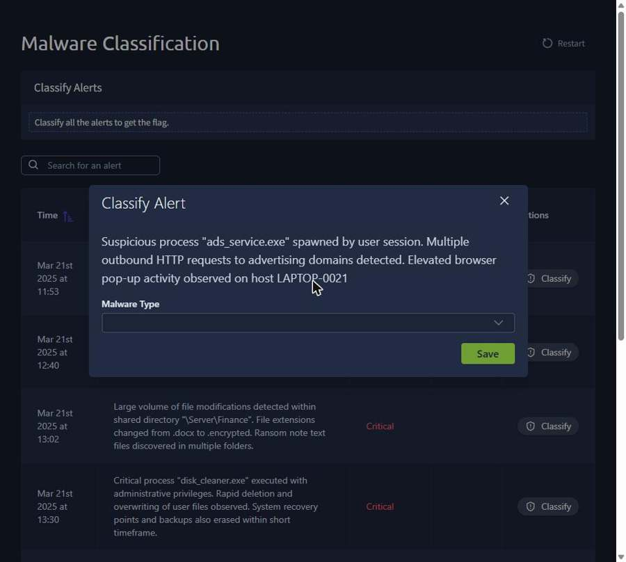
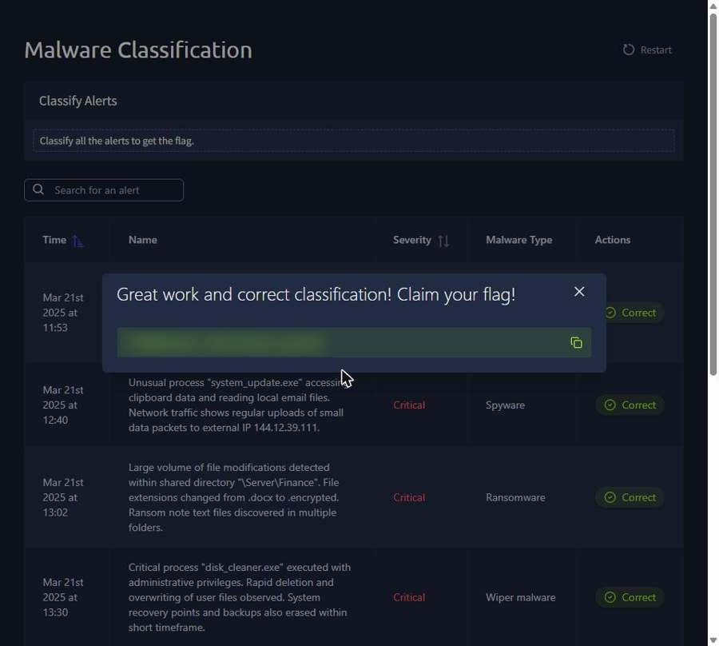

# Malware Classification — Naming the Threat from Its Behaviour

| Item | Detail |
|------|--------|
| Platform | TryHackMe — SOC Level 1 path |
| Room | [Malware Classification](https://tryhackme.com/room/malwareclassification) |
| Category | Blue Team · Malware · Triage |
| Difficulty | Easy |
| Date | 23 Nov 2026 |
| Status | ✅ Completed — 6/6 tasks |

> **Goal:** recognise the main malware families from the behaviour they show in alerts, connect them to real-world examples, and distinguish binary from script-based malware.

---

## 1. Malware types

| Type | Purpose | Typical behaviour | Example |
|------|---------|-------------------|---------|
| Adware | Show ads | Pop-ups, ad-domain traffic | Fireball |
| Spyware | Covert collection | Tracks browsing, keystrokes, clipboard, email | Hermit, Pegasus |
| Ransomware | Extortion | Encrypts files, ransom note | WannaCry, Akira |
| Wiper | Destruction | Overwrites/deletes data and backups | PathWiper, Shamoon |
| C2 malware | Remote control | Periodic beaconing to an attacker server | Emotet |
| Data stealer | Theft | Exfiltrates files/credentials | Lumma Stealer, Agent Tesla |
| Keylogger | Capture typing | Hooks keyboard APIs | Zeus |
| Cryptominer | Resource abuse | Sustained high CPU, mining-pool traffic | Coinhive |

## 2. Real-world cases

- **Agent Tesla** — data stealer delivered by phishing: keystrokes, screenshots, browser credentials.
- **Pegasus** — zero-click mobile spyware (calls, messages, location).
- **Akira** — ransomware that **steals data and threatens to leak it** (double extortion).
- **Shamoon** — wiper that hit Middle East energy companies (Saudi Aramco) by overwriting files.

## 3. Binary vs script malware

| | Binary | Script |
|-|--------|--------|
| Form | Compiled `.exe`, **`.dll`** | PowerShell, VBS, JS, macros |
| Detection | Leaves **byte patterns** → signature AV | Obfuscated text, often fileless |
| Common tooling | — | **PowerShell** to download payloads |

### Answers (tasks 2–4)

| Question | Answer |
|----------|--------|
| Slow system, constant high CPU | `Cryptominer` |
| Files locked + crypto ransom | `Ransomware` |
| Pop-ups, nothing stolen | `Adware` |
| Internal docs leaked from infected PC | `Data stealer` |
| Keystrokes, screenshots, browser creds | `Agent Tesla` |
| Zero-click mobile spyware | `Pegasus` |
| Ransomware that threatens to leak data | `Akira` |
| Wiper that targeted energy companies | `Shamoon` |
| CLI tool used by scripts to download payloads | `PowerShell` |
| Malicious Windows executable extension besides .exe | `.dll` |
| Type more likely to leave byte patterns | `Binary` |

---

## 4. Practice — classifying 8 SOC alerts

Each alert is classified by reading its **behaviour**, not its file name:

| Alert evidence | Classification |
|----------------|----------------|
| `ads_service.exe`, ad-domain HTTP, browser pop-ups | **Adware** |
| `system_update.exe` reading clipboard + local email, small regular uploads | **Spyware** |
| `.docx` → `.encrypted` on `\Server\Finance`, ransom notes | **Ransomware** |
| `disk_cleaner.exe` (admin) overwriting files, recovery points and backups erased | **Wiper malware** |
| `svchost32.exe` beaconing every 30 min to unseen host :443 | **C2 malware** |
| `docu_manager.exe` reading sensitive docs, large upload to remote server | **Data stealer** |
| DLL injected into `winlogon.exe` calling keyboard-input APIs | **Keylogger** |
| `svcupdate.exe` > 80% CPU, connections to mining pools | **Cryptominer** |

Flag: `THM{...}` *(redacted)*

---

## Key takeaways

1. File names lie (`system_update.exe`, `svchost32.exe`) — **behaviour** tells you the family.
2. Spyware vs data stealer: *small, regular* uploads of observed activity vs *bulk* exfiltration of files.
3. Ransomware encrypts for money; a wiper destroys **and kills backups** with no way back.
4. Regular-interval outbound connections = **beaconing** → think C2.
