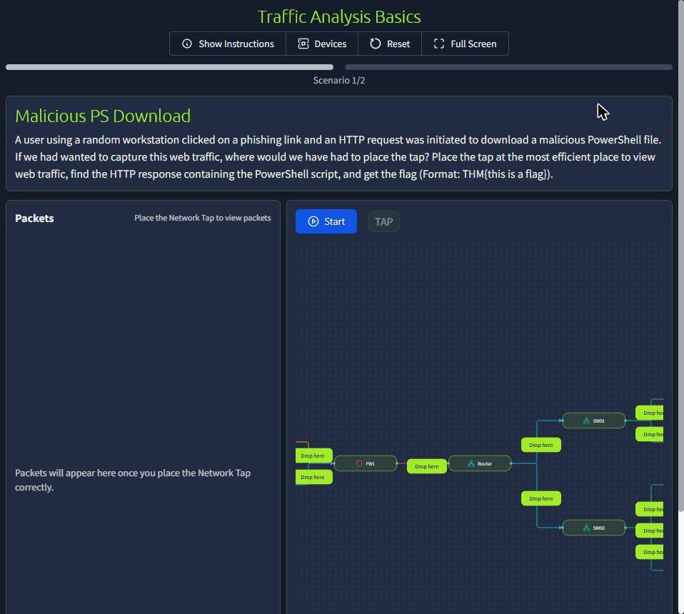

# Network Traffic Basics: What to Capture, Where and Why

| | |
|---|---|
| **Platform** | TryHackMe (SOC Level 1 › Network Traffic Analysis) |
| **Room** | [Network Traffic Basics](https://tryhackme.com/room/networktrafficbasics) |
| **Year** | 2026 |
| **Difficulty** | Medium |
| **Focus** | Traffic sources and flows, logs vs full packet capture vs statistics, tap placement |

## Key concepts

| Topic | What to remember |
|---|---|
| Why analyse traffic | Logs show what a device *chose* to record; packets show what actually crossed the wire (C2, exfiltration, lateral movement). |
| DNS abuse | **DNS tunneling** hides C2 commands or stolen data inside DNS queries and responses. |
| HTTP evidence | Headers give the payload type and size, e.g. a ZIP with `Content-Length: 10485760` bytes (10 MiB). |
| IDS evasion | **Fragmentation** splits a payload so signature-based IDS can't match it in one packet. |
| Session hijacking | Watch the TCP **sequence number**: an injected packet must guess or predict it. |
| Traffic sources | **Endpoints** generate most traffic; intermediary devices (switches, routers, firewalls) forward it. |
| SMB access flow | DNS → **Kerberos** ticket from the domain controller → SMB session to the share. |
| TLS | **Transport Layer Security**. Content is encrypted, but metadata (SNI, certificate, timing, volume) still tells a story. |

## Data sources compared

| Source | Gives you | Cost |
|---|---|---|
| Logs (firewall, proxy, DNS, Windows) | Who / when / where, cheap to keep long-term | Vendor decides the fields |
| Full packet capture (tap / SPAN) | Every byte, including payloads | Storage-heavy, kept short-term |
| Network statistics (NetFlow / IPFIX) | Conversations, volumes and trends | No payload |

## Practical: where do you put the tap?

The simulator shows an internet link → **FW1** → **Router** → two switches → servers and workstations.

- **Scenario 1 (malicious PowerShell download over HTTP from a random workstation):** the unknown host could be on either
  switch, so the single efficient point is the **chokepoint between the firewall and the router**, which carries all internet-bound traffic.
  The HTTP response with the PowerShell script holds the flag.
- **Scenario 2 (C2 command over DNS):** place the tap where queries to the **internal DNS server** pass, and read the TXT/query data.

> Note: the simulator's drag-and-drop didn't register through browser automation, so I recovered both flags by inspecting the
> application's client-side JavaScript bundle (`fetch` the script and search for `THM{`). That is itself a lesson:
> **any secret shipped to the browser is readable by the user.**

## Answers

| Question | Answer |
|---|---|
| C2 over DNS technique | DNS tunneling |
| ZIP size in the HTTP response | 10485760 bytes |
| IDS evasion attack | Fragmentation |
| TCP field to detect session hijacking | Sequence number |
| Devices that generate most traffic | Endpoint |
| Service contacted before an SMB session | Kerberos |
| TLS stands for | Transport Layer Security |
| Scenario flags | `THM{...}` (redacted) |

## Takeaways

1. **Chokepoints first:** firewall/router links and DNS servers see the most with one sensor.
2. Combine sources: statistics to spot *that* something is odd, logs to see *who*, packets to prove *what*.
3. Encrypted traffic still leaks metadata. Learn to read it.
