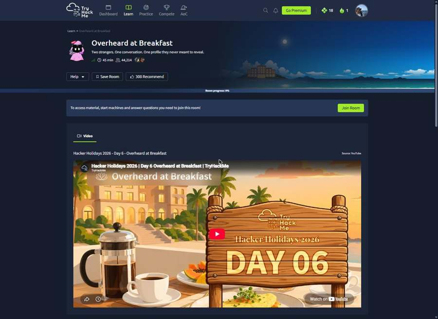
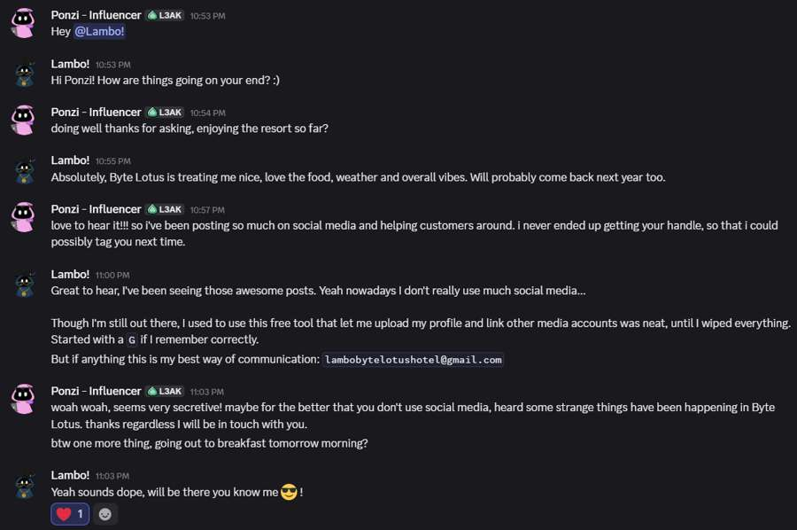

# Overheard at Breakfast — OSINT via Email Hash Pivoting

| Item | Detail |
|------|--------|
| Platform | TryHackMe — Hacker Holidays 2026, Day 6 |
| Room | [Overheard at Breakfast](https://tryhackme.com/room/hh-overheardatbreakfast-6f01793c) |
| Category | OSINT · Social Media · Hashing |
| Difficulty | Medium |
| Year | 2026 |
| Status | ✅ Flag recovered |

> **Goal:** from a leaked chat screenshot, locate a social profile that its owner believed was "wiped", and recover the flag hidden in it.



---

## 1. Read the evidence carefully

The room provides a screenshot of a chat between *Ponzi* and *Lambo*. The room hint says: *"READ what they said, not just skim it."*



Three details in Lambo's messages matter:

| Clue | Quote (paraphrased) | What it tells us |
|------|---------------------|------------------|
| 1 | Used a **free tool** to *upload a profile and link other media accounts* | A profile-aggregation service |
| 2 | The tool **started with a "G"** | Narrows the service down |
| 3 | Shared his email: `lambobytelotushotel@gmail.com` | A strong, unique identifier |
| 4 | Says he "wiped everything" | Data may still be reachable through an API |

**Conclusion:** a free service, starting with **G**, that holds a public profile with linked accounts and is keyed by email = **Gravatar**.

---

## 2. Understand how Gravatar identifies a user

Gravatar does not use a username in its lookup — it uses a **hash of the email address** (lower-case, trimmed). Modern Gravatar uses **SHA-256** (older integrations used MD5). This is why the room is tagged *Hashing*: if you know someone's email, you can compute the hash and find their profile without knowing their username.

---

## 3. Compute the hash

```bash
EMAIL="lambobytelotushotel@gmail.com"

# SHA-256 (current Gravatar identifier)
printf %s "$EMAIL" | sha256sum
# d43faafe9d7f056793bd037b8d6e321acad985c222d83775b10d6539e301e931

# MD5 (legacy identifier, still accepted on many endpoints)
printf %s "$EMAIL" | md5sum
# d4a5fc5d3128890778667e24617d7cc0
```

> ⚠️ Use `printf %s` (or `echo -n`) — a trailing newline changes the hash completely.

PowerShell equivalent:

```powershell
$e = "lambobytelotushotel@gmail.com"
[BitConverter]::ToString(
  [Security.Cryptography.SHA256]::Create().ComputeHash([Text.Encoding]::UTF8.GetBytes($e))
).Replace("-","").ToLower()
```

---

## 4. Query the public profile API

```bash
curl -s https://api.gravatar.com/v3/profiles/d43faafe9d7f056793bd037b8d6e321acad985c222d83775b10d6539e301e931 | jq
```

Relevant fields returned:

```json
{
  "display_name": "Lambo",
  "profile_url": "https://gravatar.com/cheerfullysongf28e3c3716",
  "location": "Byte Lotus Hotel",
  "description": "Funny thing about email hashes, they follow you places you didn't expect. ... Here is your prize: VEhNe1Mz...<redacted>",
  "pronunciation": "Lam-boh"
}
```

The profile still exists, and its location (**Byte Lotus Hotel**) confirms we found the right person. Note that the profile URL uses a random slug (`cheerfullysongf28e3c3716`) — guessing the username would never have worked; the **email hash was the only way in**.

---

## 5. Decode the prize

The `description` ends with a string made only of `A–Z a–z 0–9` and padding-like characters — a classic **Base64** pattern.

```bash
echo 'VEhNe1Mz...<full string from the API>' | base64 -d
# THM{S3creT_...}   <- flag (redacted here)
```

---

## Methodology summary

```
Chat screenshot ──► clues: "free tool", "starts with G", email address
        │
        ▼
Gravatar (profiles keyed by email hash)
        │
        ▼
sha256(lower(email)) ──► api.gravatar.com/v3/profiles/<hash>
        │
        ▼
Profile description ──► Base64 string ──► decode ──► flag
```

## Defensive takeaways

| Lesson | Practical control |
|--------|-------------------|
| An email address is an identifier that links accounts across services | Use separate addresses (aliases) for public profiles vs. private communication |
| "Deleting" content in the UI does not always remove it from APIs/caches | Delete the account itself, then verify via the public API |
| Hashing is **not** anonymisation — anyone with the email can compute the same hash | Treat email hashes as personal data (GDPR) |
| Base64 is encoding, not encryption | Never use it to "hide" secrets |

## MITRE ATT&CK mapping

| Technique | ID |
|-----------|----|
| Gather Victim Identity Information: Email Addresses | T1589.002 |
| Search Open Websites/Domains: Social Media | T1593.001 |

## Tools used

`sha256sum` · `md5sum` · `curl` / browser · `base64`
