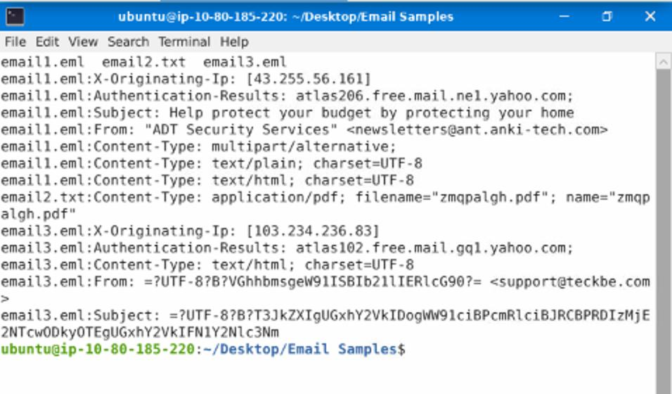
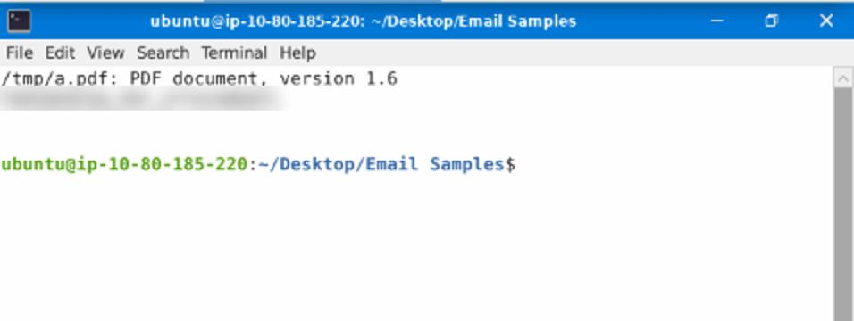

# Phishing Analysis Fundamentals — Email Headers, Bodies & Attachments

| | |
|---|---|
| **Platform** | TryHackMe — SOC Level 1 › Phishing |
| **Room** | [Phishing Analysis Fundamentals](https://tryhackme.com/room/phishingemails1tryoe) |
| **Year** | 2026 |
| **Difficulty** | Medium |
| **Tools** | Linux terminal (`grep`, `awk`, `base64`, `pdftotext`, `file`), Thunderbird |

## Objective

Learn how an email travels from sender to recipient and analyse three raw samples
(`email1.eml`, `email2.txt`, `email3.eml`) to pull out the indicators a SOC analyst needs:
sender, real origin IP, authentication results, attachments and spoofed brand.

## Theory recap

| Concept | Key point |
|---|---|
| Address anatomy | `user@domain` — `hatsalesman@tryhatme.com` → domain **tryhatme.com** (typosquat of a real brand) |
| SMTP | Sends mail client → server and server → server |
| DNS (MX) | The sending server queries DNS to find the recipient domain's mail server |
| POP3 vs IMAP | POP3 downloads and usually deletes; **IMAP** syncs, so it works across phone + laptop |
| Headers to check | `From`, `Reply-To`, `Return-Path`, `X-Originating-IP`, `Received`, `Authentication-Results` (SPF/DKIM/DMARC) |
| BEC | **Business Email Compromise**: a real but compromised mailbox used to trick staff into fraud |

## Walkthrough

### 1. Fast header triage from the terminal

Instead of opening each email one by one, I grepped the important headers across all samples at once:

```bash
cd ~/Desktop/Email\ Samples
grep -iE '^(subject|x-originating-ip|from|content-type|authentication-results):' * | cut -c1-110
```



From this single command:

- **email1.eml**: subject *"Help protect your budget by protecting your home"*, sent as "ADT Security Services" from
  an unrelated domain (`ant.anki-tech.com`); `X-Originating-IP` **43.255.56.161**.
- **email2.txt**: attachment of type **application/pdf**, named **zmqpalgh.pdf**.
- **email3.eml**: `X-Originating-IP` 103.234.236.83; `Authentication-Results` added by
  **atlas102.free.mail.gq1.yahoo.com**; the `From` display name and subject are RFC 2047 Base64-encoded.

### 2. Decoding the attachment (email2)

The PDF is embedded as Base64 (`Content-Transfer-Encoding: base64`). I stripped the MIME headers,
decoded it and extracted the text:

```bash
grep -n -A8 'application/pdf' email2.txt          # locate the MIME part
tail -n +6 email2.txt | grep -v '^--' | base64 -di > /tmp/a.pdf
file /tmp/a.pdf                                    # -> PDF document, version 1.6
pdftotext /tmp/a.pdf -                             # -> THM{...}
```



> In a real investigation, do this in an isolated VM or with CyberChef. Never open a suspicious attachment on a workstation.

### 3. Brand impersonation (email3)

The `From` header looked like `=?UTF-8?B?VGhhbmsgeW91ISBIb21lIERlcG90?= <support@teckbe.com>`.
Decoding the Base64 part of the display name:

```bash
grep -i '^from' email3.eml | grep -o '<.*>'                 # support@teckbe.com
grep -i '^from' email3.eml | cut -d'?' -f4 | base64 -d      # Thank you! Home Depot
```

The email impersonates **Home Depot** but comes from `support@teckbe.com`. Its origin IP, defanged for reporting, is
`103[.]234[.]236[.]83`.

## Answers

| Task | Question | Answer |
|---|---|---|
| 2 | Domain of `hatsalesman@tryhatme.com` | tryhatme.com |
| 3 | Client → server sending protocol | SMTP |
| 3 | Service to find recipient mail server | DNS |
| 3 | Access mail from several devices | IMAP |
| 4 | Subject of email1 | Help protect your budget by protecting your home |
| 4 | X-Originating-IP of email1 | 43.255.56.161 |
| 5 | Attachment Content-Type | application/pdf |
| 5 | Attachment name | zmqpalgh.pdf |
| 5 | Hidden flag | `THM{...}` (redacted) |
| 6 | Spoofed organisation | Home Depot |
| 6 | Sender address | support@teckbe.com |
| 6 | Defanged X-Originating-IP | 103[.]234[.]236[.]83 |
| 6 | Server that wrote Authentication-Results | atlas102.free.mail.gq1.yahoo.com |
| 7 | BEC | Business Email Compromise |

## Key takeaways

- **The display name is not the sender.** Always compare the brand in the display name with the actual address and domain.
- `X-Originating-IP` and the bottom-most `Received` header point to the real origin. **Defang** them (`[.]`) in reports.
- Encoded headers (`=?UTF-8?B?...?=`) are often used to hide the spoofed brand from simple filters. Decode them.
- One `grep` across all samples is faster than clicking through each email, and it is easy to repeat.
