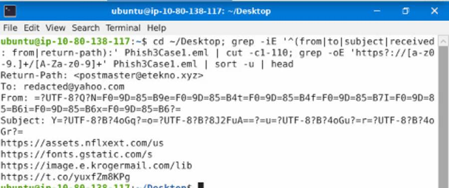
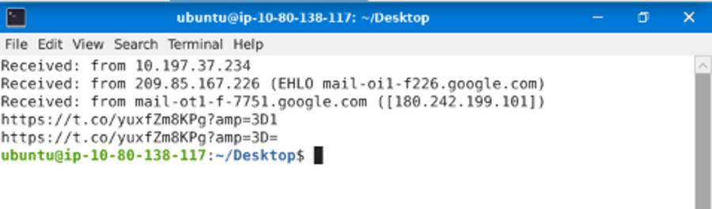
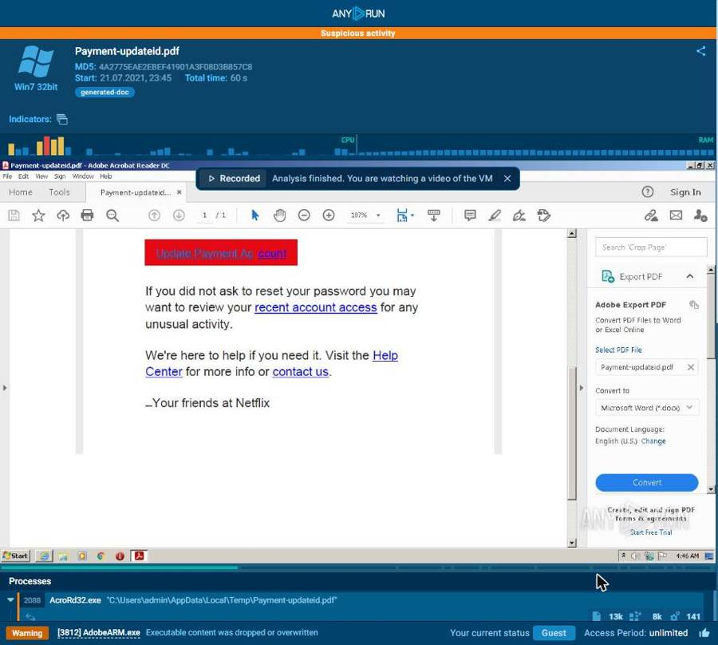
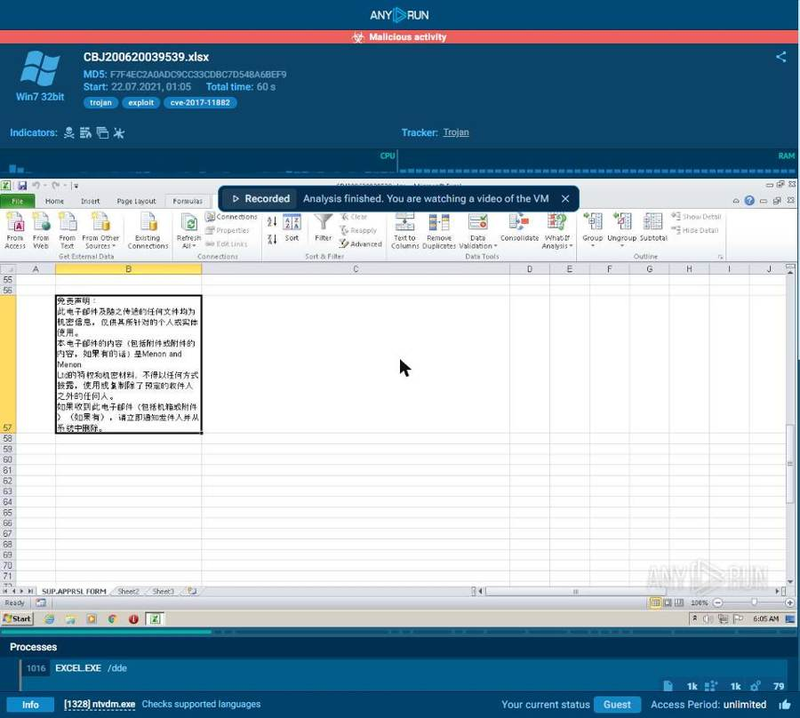

# Phishing Analysis Tools — Header Analysers, Reputation Services & Sandboxes

| | |
|---|---|
| **Platform** | TryHackMe — SOC Level 1 › Phishing |
| **Room** | [Phishing Analysis Tools](https://tryhackme.com/room/phishingemails3tryoe) |
| **Year** | 2026 |
| **Difficulty** | Medium |
| **Tools** | Google Messageheader, Message Header Analyzer, IPinfo, URLScan.io, Cisco Talos, PhishTool, VirusTotal, ANY.RUN, Linux CLI |

## Objective

Work through the toolkit a SOC L1 analyst uses on reported emails, then apply it to three cases:
a hands-on `.eml` on the lab VM and two sandbox (ANY.RUN) reports.

## Toolkit summary

| Stage | Tool | What it gives you |
|---|---|---|
| Headers | Google Messageheader / MHA | SPF/DKIM/DMARC verdicts, hop-by-hop delays |
| IP / domain | IPinfo, Talos | Geolocation, ASN, reputation |
| URL | URLScan.io | Safe screenshot, redirects, contacted hosts |
| Attachment | `sha256sum` → VirusTotal | Hash reputation without uploading the file |
| All-in-one | PhishTool | Parsed headers, URLs, attachments + VT, case resolution |
| Behaviour | ANY.RUN, Hybrid Analysis, Joe Sandbox | Processes, network, IOCs, verdict |

Example from the room: Google Messageheader showed **SPF = pass** while DKIM was `permerror`, which is
a reminder that a passing SPF alone does not make an email legitimate. In the PhishTool/VirusTotal
example, only one vendor (**SafeToOpen**) flagged the URLs as phishing.

## Case 1 — "Your account is on hold" (lab VM)

On the VM, I analysed `Phish3Case1.eml` from the terminal instead of clicking through Thunderbird:

```bash
cd ~/Desktop
grep -iE '^(from|to|subject|received: from|return-path):' Phish3Case1.eml | cut -c1-110
grep -oE 'https?://t\.co[^" <>]*' Phish3Case1.eml | sort -u
```




| Indicator | Value |
|---|---|
| Impersonated brand | **Netflix** (encoded display name, assets loaded from a look-alike `nflxext` host) |
| Recipient | redacted@yahoo.com |
| First `Received: from` IP | 10.197.37.234 |
| `Return-Path` (domain of interest) | `postmaster@`**etekno.xyz** |
| *UPDATE ACCOUNT NOW* button | `https://t.co/yuxfZm8KPg?amp=1` (`=3D` is quoted-printable for `=`) |

## Case 2 — Netflix "Payment-updateid.pdf" (ANY.RUN)



- Verdict: **Suspicious activity**.
- Attachment: `Payment-updateid.pdf`, MD5 `4a2775eae2ebef41901a3f08d3b857c8`.
- Processes tab: the PDF's *Update Payment Account* link opens `https://lihi1.com/JqdmJ` in Internet Explorer.
- DNS Requests: `lihi1.com` → **35.244.149.249**.

## Case 3 — DHL "CBJ200620039539.xlsx" (ANY.RUN)



- Verdict: **Malicious activity** (tags: trojan, exploit, cve-2017-11882).
- Opening the workbook spawns **EQNEDT32.EXE**
  (`C:\Program Files\Common Files\Microsoft Shared\EQUATION\EQNEDT32.EXE`), the legacy Equation Editor
  exploited through **CVE-2017-11882**.
- The exploit downloads `COVID19.exe` from **biz9holdings.com**.
- Suricata alert: **ET INFO Suspicious GET Request with Possible COVID-19 URI M1** (plus *ET TROJAN Possible Malicious Macro DL EXE*).

## Answers

| Task | Question | Answer |
|---|---|---|
| 3 | SPF result | pass |
| 4 | Linux SHA256 command | sha256sum |
| 6 | Vendor flagging URLs as phishing | SafeToOpen |
| 7 | Impersonated brand / recipient | Netflix / redacted@yahoo.com |
| 7 | Received: from IP | 10.197.37.234 |
| 7 | Return-Path domain / short URL | etekno.xyz / https://t.co/yuxfZm8KPg?amp=1 |
| 8 | ANY.RUN verdict / PDF name | Suspicious activity / Payment-updateid.pdf |
| 8 | PDF MD5 | 4a2775eae2ebef41901a3f08d3b857c8 |
| 8 | URL / resolved IP | https://lihi1.com/JqdmJ / 35.244.149.249 |
| 9 | Excel file / process | CBJ200620039539.xlsx / EQNEDT32.EXE |
| 9 | Binary path | C:\Program Files\Common Files\Microsoft Shared\EQUATION\EQNEDT32.EXE |
| 9 | CVE / download domain | CVE-2017-11882 / biz9holdings.com |
| 9 | Network threat | ET INFO Suspicious GET Request with Possible COVID-19 URI M1 |

## Key takeaways

- **Hash first, upload never** (for sensitive files): `sha256sum` + VirusTotal lookup tells you a lot without leaking the sample.
- Office spawning `EQNEDT32.EXE` is a classic, high-fidelity detection for CVE-2017-11882, and is worth a dedicated SIEM/EDR rule.
- Public sandbox reports (ANY.RUN) give you processes, DNS, HTTP and Suricata hits in one place, ready for IOC extraction.
