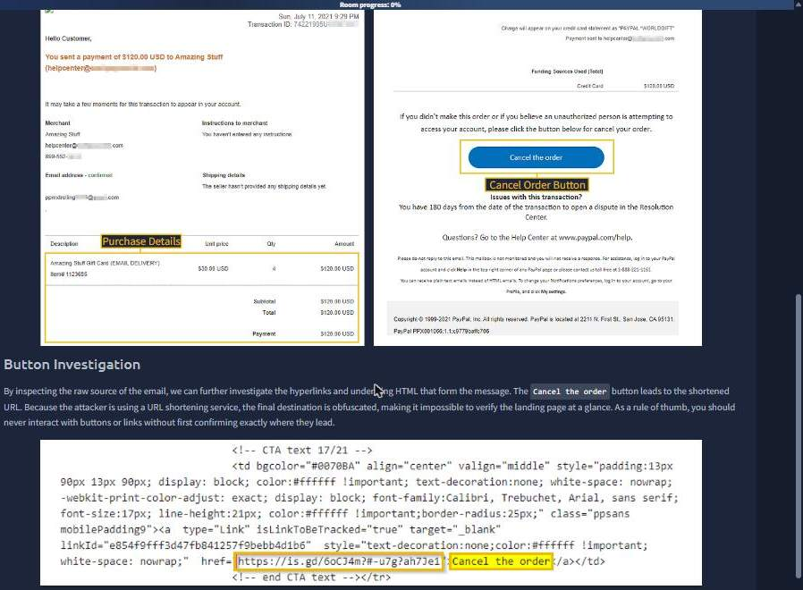
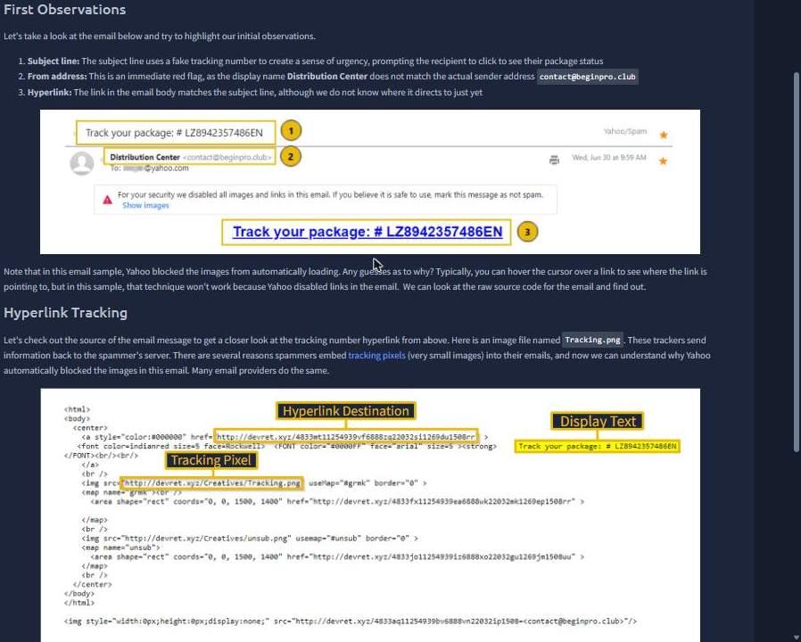
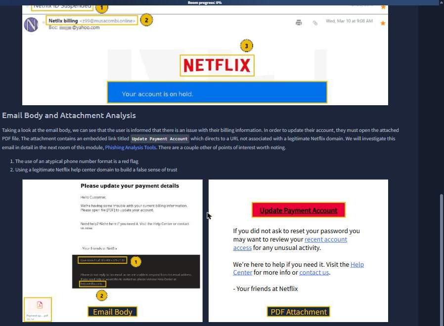
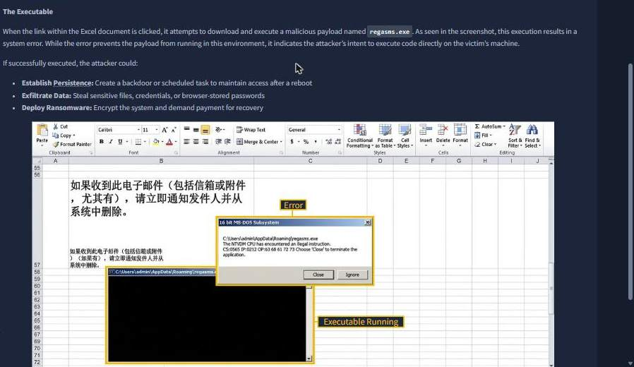

# Phishing Emails in Action — Six Real-World Phishing Samples

| | |
|---|---|
| **Platform** | TryHackMe — SOC Level 1 › Phishing |
| **Room** | [Phishing Emails in Action](https://tryhackme.com/room/phishingemails2rytmuv) |
| **Year** | 2026 |
| **Difficulty** | Medium |
| **Focus** | Recognising phishing techniques in headers, HTML source, links and attachments |

## Objective

Analyse six real phishing samples and, for each one, identify the technique the attacker used
and the indicator that gives it away.

## Method used for every sample

1. **Header first**: compare the display name with the real `From` address, check `To`/`Bcc`, and note subject-line urgency.
2. **Body second**: who is the "brand", what action is requested (click, open, log in)?
3. **Raw source**: read the real `href` behind buttons, look for tracking pixels and encoded data.
4. **Attachment**: note the type and extension, and what it tries to fetch or execute. Analyse only in a sandbox.

## Walkthrough

### Sample 1 — Fake PayPal receipt (spoofing + URL shortener)

- Display name *service@paypal.com*, but the real sender is on an unrelated domain (`sultanbogor.com`).
- The body is a gift-card "receipt" from merchant **Amazing Stuff**, sent to create panic.
- The **Cancel the order** button in the raw HTML points to a shortened `is.gd` URL. Expand it safely
  with a tool such as WhereGoes instead of clicking.

### Sample 2 — "Track your package" (tracking pixel + link manipulation)

- "Distribution Center" display name vs `contact@beginpro.club`.
- The tracking-number link and the hidden 0×0 `Tracking.png` image both point to
  **devret[.]xyz**. The pixel tells the spammer the email was opened, which is why Yahoo blocked images.

### Sample 3 — Fake document share (credential harvesting)

A "shared document" lure leads to a fake login portal. Whatever credentials the victim enters,
the page returns a generic error, because its only goal is to collect them: **Credential Harvesting**.

### Sample 4 — "Netflix ID Suspended" (typosquatted display name + PDF lure)

- Display name **Netllx billing** (two `l`s), real sender **z99@musacombi.online**, victim only in Bcc.
- The attached PDF contains an *Update Payment Account* link to a non-Netflix domain, plus an atypical phone number.

### Sample 5 — Apple App Store receipt (.dot attachment)

- "Apple Support" from a random `sumpremed.com` address, and the victim is in **Bcc** (**Blind Carbon Copy**).
- The body is blank; the only content is a **.dot** (Word template) attachment whose large image redirects through
  `t.tumblr.com/redirect` to a long `ios-games` phishing URL.

### Sample 6 — DHL shipment with .xlsx (malware delivery)

- German sender domain, invoice addressed to India, spreadsheet content in Mandarin: inconsistent geography is a red flag.
- The link inside the Excel file downloads and runs **regasms.exe** from `%AppData%\Roaming`. The point is
  code execution, which could lead to persistence, exfiltration or ransomware.

## Answers

| Task | Question | Answer |
|---|---|---|
| 2 | Merchant in the PayPal email | Amazing Stuff |
| 3 | Root domain of the tracking link (defanged) | devret[.]xyz |
| 4 | Attack type of the fake login portal | Credential Harvesting |
| 5 | Real sender behind "Netllx billing" | z99@musacombi.online |
| 6 | BCC stands for | Blind Carbon Copy |
| 6 | Attachment extension | .dot |
| 7 | Executable launched by the Excel file | regasms.exe |

## Detection cheat-sheet

| Technique | Indicator | Where to look |
|---|---|---|
| Sender spoofing | Display name ≠ address domain | `From`, `Return-Path`, SPF/DMARC result |
| URL shortener | `is.gd`, `bit.ly`, `t.co` behind buttons | Raw HTML `href` → expand in a sandbox |
| Tracking pixel | 0×0 / hidden `` on attacker domain | Raw HTML `` |
| Credential harvesting | Login page on non-brand domain, generic error | URL, TLS certificate, page source |
| Malicious attachment | `.dot`, `.xlsx`/`.xlsm`, PDF with links | Attachment type → sandbox (Any.Run, Hybrid Analysis) |
| Bcc delivery | Victim not in `To` | `Bcc`/`To` headers |
