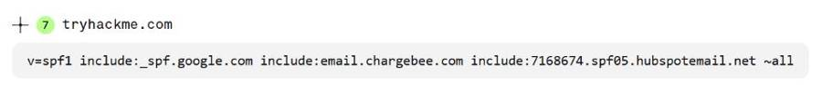
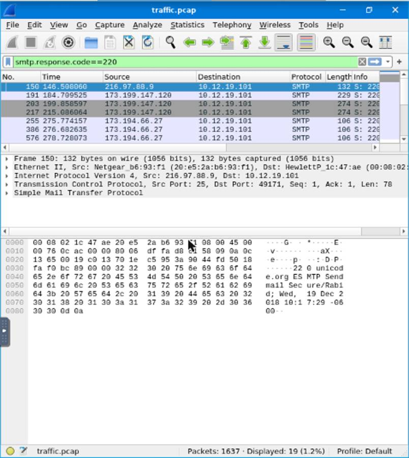
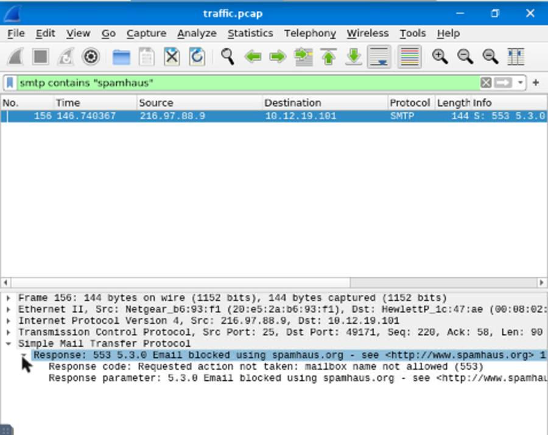
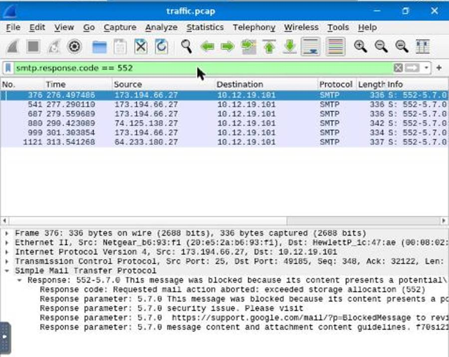
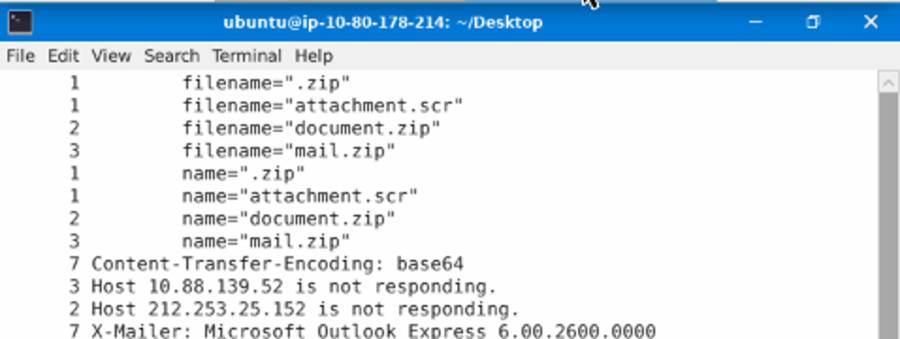

# Phishing Prevention — SPF, DKIM, DMARC, S/MIME & SMTP Traffic Analysis

| | |
|---|---|
| **Platform** | TryHackMe — SOC Level 1 › Phishing |
| **Room** | [Phishing Prevention](https://tryhackme.com/room/phishingemails4gkxh) |
| **Year** | 2026 |
| **Difficulty** | Medium |
| **Tools** | dmarcian SPF Surveyor, Google Messageheader, Wireshark, Linux `strings`/`grep` |

## Objective

Understand the email-authentication controls that stop spoofing (SPF, DKIM, DMARC), how S/MIME protects
content, and use Wireshark to investigate SMTP responses and attachments in a packet capture.

## 1. Email authentication

### SPF — who may send for a domain

```
v=spf1 include:_spf.google.com include:email.chargebee.com include:7168674.spf05.hubspotemail.net ~all
```



- `v=spf1` starts the record. Each `include:` authorises another domain's senders, and `ip4:`/`ip6:` authorise single IPs.
- TryHackMe authorises **3** domains (Google Workspace, Chargebee, HubSpot).
- `~all` is a **SoftFail** for everyone else, so the intended action is **Flag** (accept but mark as suspicious).
  `-all` is a hard Fail, so the receiver rejects the email.

| Result | Intended action |
|---|---|
| Pass / Neutral / None | Accept |
| SoftFail / PermError | **Flag** |
| Fail / TempError | Reject |

### DKIM — is the message signed and unchanged?

In the sample header, `dkim=permerror (no key for signature)` means the receiver could not find the
public key referenced by the `s=` selector in DNS, so the signature could not be validated.

### DMARC — what to do when SPF/DKIM fail

`p=none` only monitors, `p=quarantine` sends to spam, and **`p=reject`** blocks the email. Reject gives the most protection.

### S/MIME

S/MIME provides **digital signatures** (authenticity and integrity) and **encryption**. Encryption is what makes sure only the intended
recipient can read the message.

## 2. SMTP traffic analysis (`traffic.pcap`)

Key filter: **`smtp.response.code`**.

| Filter | Result |
|---|---|
| `smtp.response.code == 220` | **19** packets ("Service ready") |
| `smtp contains "spamhaus"` | Frame 156, code **553**: *Requested action not taken: mailbox name not allowed (553)*, "Email blocked using spamhaus.org" |
| `smtp.response.code == 552` | **6** messages blocked by Gmail because the content "presents a potential security issue" |
| `smtp` | **512** SMTP packets |





### Attachments and bounce messages

Frame 270 is a "delivery failed" bounce. To quickly list every attachment, mail client and
"host not responding" message, I ran `strings` on the capture:

```bash
strings -n 6 traffic.pcap | grep -iE 'not respond|filename=|name="|X-Mailer|Content-Transfer-Encoding: base64' \
  | sort | uniq -c
```



- Packet 270 carries **document.zip**. The undeliverable message names host **212.253.25.152** as not responding.
- The message with `attachment.scr` was sent with **Microsoft Outlook Express 6.00.2600.0000** (`imf` filter / `X-Mailer`).
- The attachment is **base64**-encoded. `.scr` (screensaver) files are executables, a classic malware disguise.

## Answers

| Task | Question | Answer |
|---|---|---|
| 2 | Domains authorised by TryHackMe's SPF | 3 |
| 2 | Intended action for SoftFail | Flag |
| 3 | Reason for DKIM permerror | no key for signature |
| 4 | Most protective DMARC policy | p=reject |
| 5 | S/MIME component for confidentiality | Encryption |
| 6 | Filter for SMTP response codes | smtp.response.code |
| 6 | Packets with 220 | 19 |
| 6 | Spamhaus response code / message | 553 / Requested action not taken: mailbox name not allowed (553) |
| 6 | Messages blocked with 552 | 6 |
| 7 | SMTP packets | 512 |
| 7 | Attachment in packet 270 / host not responding | document.zip / 212.253.25.152 |
| 7 | Client used for attachment.scr / encoding | Microsoft Outlook Express 6.00.2600.0000 / base64 |
| 8 | Safe behavioural analysis of attachments | Sandboxing |

## Key takeaways

- SPF says **who** can send, DKIM proves the message **wasn't altered**, and DMARC tells receivers **what to do** when those fail.
  All three should be configured, with DMARC moving towards `p=reject`.
- `smtp.response.code` quickly shows what the mail servers already blocked (5xx) and why.
- `strings | grep` on a pcap is a fast first pass for plaintext protocols before deep-diving in Wireshark.
