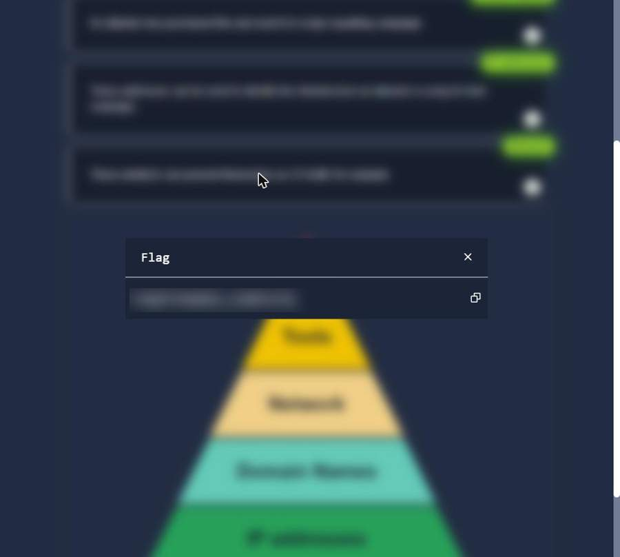

# Pyramid of Pain — Ranking IOCs by How Much They Hurt the Attacker

| Item | Detail |
|------|--------|
| Platform | TryHackMe — SOC Level 1 path (Cyber Defence Frameworks) |
| Room | [Pyramid Of Pain](https://tryhackme.com/room/pyramidofpainax) |
| Category | Threat intelligence · Detection engineering |
| Difficulty | Medium |
| Year | 2026 |
| Status | ✅ Completed — 10/10 tasks |

> **Goal:** understand David Bianco's Pyramid of Pain — the higher the indicator you detect and block, the more it costs the adversary to change it.

---

## The pyramid (bottom → top)

| Level | Difficulty for attacker | Example from the room |
|-------|------------------------|-----------------------|
| **Hash values** | Trivial | `b8ef959a…a35d` → `Sales_Receipt 5606.xls` |
| **IP addresses** | Easy | Malicious process PID 1632 → `50.87.136.52` |
| **Domain names** | Simple | `craftingalegacy.com`; **Punycode** homograph attacks; shortened URLs (`tinyurl.com/bw7t8p4u` → `https://tryhackme.com/`) |
| **Host artifacts** | Annoying | `regidle.exe` POSTing to `96.126.101.6:8080` (US), dropped `G_jugk.exe` |
| **Network artifacts** | Annoying | Emotet identified by its **User-Agent**; 6 POST requests in the PCAP |
| **Tools** | Challenging | Detected via **fuzzy hashing** (ssdeep = Context Triggered Piecewise Hashes) |
| **TTPs** | Tough | MITRE ATT&CK — 9 Exfiltration techniques; Chimera (China-based APT) uses **Cobalt Strike** |

**Why it matters:** blocking a hash or IP is trivial for the attacker to bypass (recompile, new VPS). Detecting **behaviour** (TTPs) forces them to change how they operate.

### Answers

| Task | Question | Answer |
|------|----------|--------|
| 2 | Sample filename | `Sales_Receipt 5606.xls` |
| 3 | First IP contacted by PID 1632 | `50.87.136.52` |
| 3 | First domain contacted | `craftingalegacy.com` |
| 4 | First suspicious domain (Any.run) | `craftingalegacy.com` |
| 4 | Term for an address used to access websites | `Domain Name` |
| 4 | Unicode look-alike domain attack | `Punycode attack` |
| 4 | Redirect of the short URL | `https://tryhackme.com/` |
| 5 | US IP on port 8080 (regidle.exe POST) | `96.126.101.6` |
| 5 | Dropped executable | `G_jugk.exe` |
| 5 | VirusTotal vendors flagging host | `9` |
| 6 | Network indicator that identified Emotet | `User-Agent` |
| 6 | POST requests in the PCAP screenshot | `6` |
| 7 | Method to determine file similarity | `Fuzzy Hashing` |
| 7 | Alternative name for fuzzy hashes | `Context Triggered Piecewise Hashes` |
| 8 | Techniques under Exfiltration | `9` |
| 8 | Chimera's commercial C2 tool | `Cobalt Strike` |

---

## Practical — match descriptions to levels

| Description | Level |
|-------------|-------|
| The attacker's plans and objectives | TTP |
| Used by the attacker to accomplish their objective | Tools |
| Can present themselves as C2 traffic | Network artifacts |
| Purchased and used in a typo-squatting campaign | Domain names |
| Identify the infrastructure used for a campaign | IP addresses |
| Signatures used to attribute payloads to an actor | Hash values |

Flag: `THM{...}` *(redacted)*

## Key takeaways

1. Indicators at the bottom expire fast; invest detection effort in **tools and TTPs**.
2. In reports (Any.run, VirusTotal, sandbox PDFs) pull every level of the pyramid, not just the hash.
3. Use fuzzy hashing (ssdeep) to catch variants that exact hashes miss.
