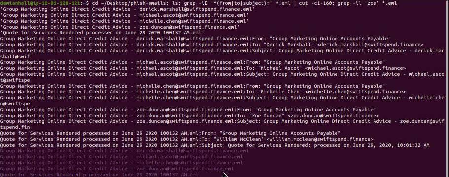
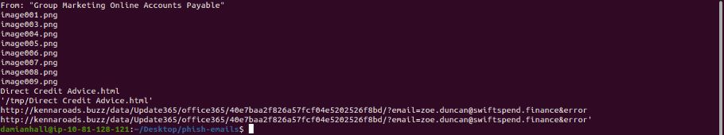
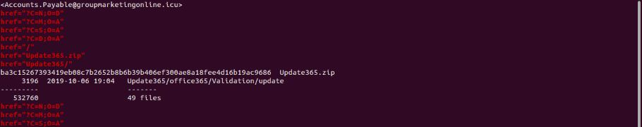

# Snapped Phish-ing Line: From Phishing Email to the Attacker's Kit

| | |
|---|---|
| **Platform** | TryHackMe (SOC Level 1 › Phishing, challenge) |
| **Room** | [Snapped Phish-ing Line](https://tryhackme.com/room/snappedphishingline) |
| **Year** | 2026 |
| **Difficulty** | Medium |
| **Tools** | Linux CLI (`grep`, Python `email`, `curl`, `unzip`, `sha256sum`, `base64`, `rev`), VirusTotal |

## Scenario

Several employees of a finance company reported suspicious "Direct Credit Advice" emails, and at least one of them
entered credentials. The task is to analyse the emails, follow the phishing link and pivot into the attacker's
infrastructure, which left its kit and the stolen-credentials log exposed.

## 1. Who was targeted and by whom

```bash
cd ~/Desktop/phish-emails
grep -iE '^(from|to|subject):' *.eml | cut -c1-160
grep -ihA1 '^from:' *.eml | grep -o '<[^>]*>' | sort -u
```



- Five emails were sent to five employees from one sender: **Accounts.Payable@groupmarketingonline.icu** (`.icu` is a cheap TLD often used for phishing).
- The "Quote for Services Rendered" email went to **William McClean**.

## 2. Follow the attachment without opening it

I carved the HTML attachment from Zoe Duncan's email and pulled the URLs out of it:

```bash
python3 -c "import email,glob
for f in glob.glob('*zoe*'):
    m=email.message_from_file(open(f))
    for p in m.walk():
        n=p.get_filename()
        if n: open('/tmp/'+n,'wb').write(p.get_payload(decode=True)); print(n)"
grep -oiE 'https?://[^\"<> ]+' /tmp/*.htm* | sort -u
```



The attachment redirects to `http://kennaroads.buzz/data/Update365/office365/...` with the victim's email
**pre-filled** in the URL. Root domain: **kennaroads.buzz**. Opened in the sandboxed VM browser, it shows a fake
**Microsoft** (Office 365) sign-in page.

## 3. Pivot: the attacker left directory listing on

```bash
cd /tmp
curl -s http://kennaroads.buzz/data/ | grep -oE 'href="[^"]+"'     # Update365.zip, Update365/
curl -s -o Update365.zip http://kennaroads.buzz/data/Update365.zip
sha256sum Update365.zip
unzip -Z1 Update365.zip | wc -l                                      # 49 entries
```



- Kit: **Update365.zip**, SHA256 `ba3c15267393419eb08c7b2652b8b6b39b406ef300ae8a18fee4d16b19ac9686`
- VirusTotal classes it as phishing **and Trojan**. The archive holds **49** entries (files and folders).

## 4. Stolen credentials and the collector

```bash
curl -s http://kennaroads.buzz/data/Update365/log.txt | grep -oiE '[a-z0-9._-]+@[a-z0-9.-]+' | sort | uniq -c | sort -rn
unzip -oq Update365.zip -d kit
grep -rhoiE '[a-z0-9._-]+@[a-z0-9.-]+\.[a-z]+' $(find kit -name submit.php) | sort -u
```


- **michael.ascot@swiftspend.finance** submitted credentials **twice** (often a sign the user retried after a fake "wrong password").
- `submit.php` emails every captured login to **m3npat@yandex.com**.
- `flag.txt` sits in the same folder. It is Base64 of a **reversed** string, so it decodes with `base64 -d | rev`: `THM{...}`.

## Answers

| Question | Answer |
|---|---|
| Recipient of "Quote for Services Rendered" | William McClean |
| Adversary sender | Accounts.Payable@groupmarketingonline.icu |
| Redirect root domain | kennaroads.buzz |
| Impersonated company | Microsoft |
| Kit archive / SHA256 | Update365.zip / ba3c1526…9686 |
| Other VirusTotal category | Trojan |
| Entries in the archive | 49 |
| User who submitted credentials twice | michael.ascot@swiftspend.finance |
| Credential collection address | m3npat@yandex.com |
| Flag | `THM{...}` (redacted) |

## Incident response actions (what a SOC would do next)

1. **Contain:** reset passwords and revoke sessions for every address in `log.txt`, starting with the user who submitted twice. Check for new MFA methods and inbox rules.
2. **Block:** the sender domain, `kennaroads.buzz`, the kit hash and the collector address at the mail gateway, proxy and EDR.
3. **Scope:** search the mail logs for any other recipient of the sender, and the proxy logs for anyone who visited the domain.
4. **Report:** the exposed kit and the collector to the hosting provider and the mail provider.

**Lesson:** attackers' infrastructure is often sloppy. Open directory listings give away the kit, the victims and the collector. Always look one folder up from the phishing page.
