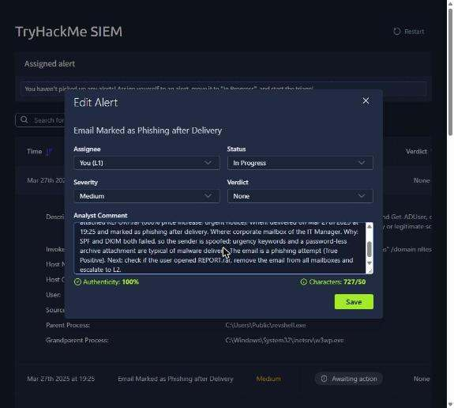
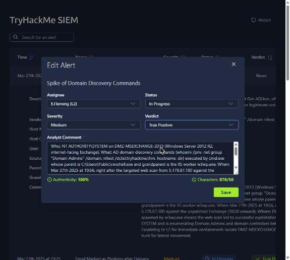

# SOC L1 Alert Reporting — Five Ws Reports & Escalation

| Item | Detail |
|------|--------|
| Platform | TryHackMe — SOC Level 1 path |
| Room | [SOC L1 Alert Reporting](https://tryhackme.com/room/socl1alertreporting) |
| Category | Blue Team · Reporting · Escalation |
| Difficulty | Easy |
| Date | 23 Nov 2026 |
| Status | ✅ Completed — 6/6 tasks |

> **Goal:** learn to document an alert so that anyone can understand it without re-investigating, decide when to escalate to L2, and communicate correctly during incidents.

---

## Theory in one page

**Alert funnel:** many alerts → L1 triage → few **reported** → fewer **escalated** to L2 → very few become incidents.
- **Alert Reporting** = formally describing alert details and findings.
- **Alert Escalation** = passing suspicious alerts to an L2 for review.

**The Five Ws report template**

| W | Question to answer |
|---|--------------------|
| **Who** | Which user/host/account is involved? |
| **What** | What happened (commands, email, file, connection)? |
| **When** | Exact time, and how it relates to other events |
| **Where** | Which system, network zone, mailbox, cloud service |
| **Why** | Why is it malicious or benign — the evidence behind the verdict |

**Escalate when:** it indicates a major attack, remediation is needed (isolation, malware removal, password reset), communication with customers/management/law enforcement is needed, or you simply don't fully understand it.
**How:** reassign to the L2 on shift, set an intermediate verdict, ping them.

**Communication:** for a critical threat call **L2 first, then L3, then the manager**. If you realise you missed an attack, tell your L2 **immediately**.

### Answers

| Task | Question | Answer |
|------|----------|--------|
| 2 | Passing suspicious alerts to L2 | `Alert Escalation` |
| 2 | Formally describing alert details/findings | `Alert Reporting` |
| 3 | User email that leaked the sensitive document | `m.boslan@tryhackme.thm` |
| 3 | Sender of the phishing email | `support@microsoft.com` |
| 4 | Current L2 to escalate to | `E.Fleming` |
| 5 | Contact the manager first for a critical threat? | `Nay` |
| 5 | Contact L2 immediately if you missed an attack? | `Yea` |

---

## Practice — TryHackMe SIEM

### Alert 1 — "Email Marked as Phishing after Delivery" (True Positive → escalated)

| Field | Value |
|-------|-------|
| Sender | `Microsoft Support <support@microsoft.com>` (spoofed) |
| Recipient | Eddie Huffman, IT Manager |
| Subject | *Important Update: Microsoft Teams Pricing Increase* |
| Checks | **SPF Fail, DKIM Fail** |
| Attachment | `REPORT.rar` |

Report written with the Five Ws (the lab scores report "authenticity" and length):

> **Why TP:** SPF and DKIM both fail → the "microsoft.com" sender is spoofed; urgency keywords ("600% price increase", "urgent notice") and an archive attachment are classic malware-delivery phishing.

Then escalated: **Assignee → E.Fleming (L2)**, **Verdict → True Positive**.

### Alert 2 — "Spike of Domain Discovery Commands" (True Positive → escalated)

| Field | Value |
|-------|-------|
| Host | `DMZ-MSEXCHANGE-2013` (Windows Server 2012 R2, internet-facing) |
| User | `NT AUTHORITY\SYSTEM` |
| Commands | `whoami /priv`, `net group "Domain Admins" /domain`, `nltest /dclist:tryhackme.thm` |
| Process tree | `w3wp.exe` (IIS) → `C:\Users\Public\revshell.exe` → `cmd.exe` |

> **Why TP — correlation is the key:** an earlier alert showed an aggressive web scan from `5.178.87.180` against the **unpatched Exchange**. 40 minutes later the IIS worker process spawns a reverse shell running as SYSTEM and enumerates Domain Admins and domain controllers. That is **successful exploitation followed by discovery**, right before lateral movement. Escalate for immediate containment.

Flags: `THM{...}` ×3 *(redacted)*

---

## Key takeaways

1. A good report lets L2 act **without redoing your work** — Five Ws every time.
2. **Correlate alerts across time and hosts**: the "Low" web-scan alert was the cause of the "Medium" discovery alert.
3. Parent/grandparent processes tell the story: `w3wp.exe → revshell.exe → cmd.exe` = web shell / RCE on IIS.
4. Escalation is not failure — it's the correct action whenever remediation or more expertise is needed.
5. Escalation path: **L2 → L3 → Manager**; own your mistakes quickly.

## MITRE ATT&CK mapping

| Technique | ID | Seen in |
|-----------|----|---------|
| Phishing: Spearphishing Attachment | T1566.001 | Fake Microsoft email |
| Exploit Public-Facing Application | T1190 | Exchange exploitation after web scan |
| Server Software Component: Web Shell | T1505.003 | `w3wp.exe` spawning shells |
| Permission Groups Discovery: Domain Groups | T1069.002 | `net group "Domain Admins" /domain` |
| Remote System Discovery | T1018 | `nltest /dclist` |
| System Owner/User Discovery | T1033 | `whoami /priv` |
| Exfiltration to Cloud Storage / personal email | T1567 | HR spreadsheet shared to Protonmail |
