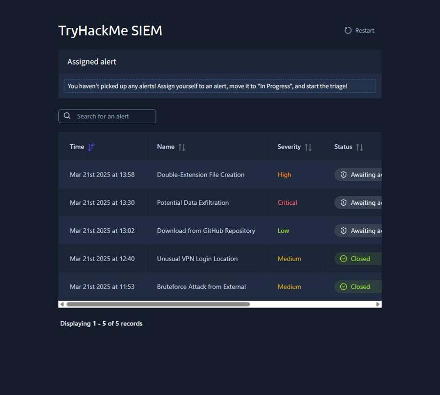
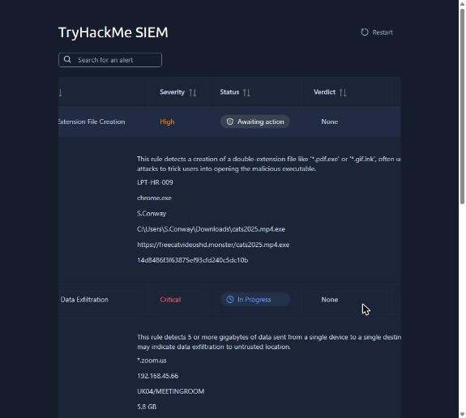
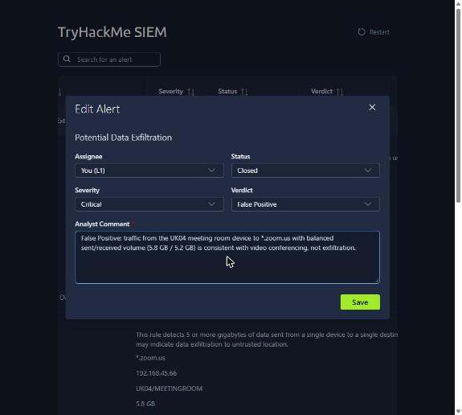
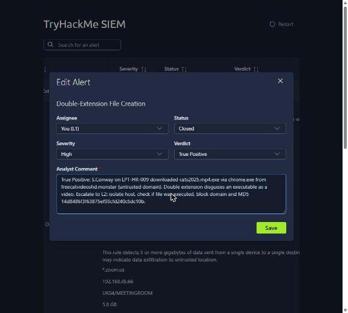

# SOC L1 Alert Triage — From Events to Verdicts

| Item | Detail |
|------|--------|
| Platform | TryHackMe — SOC Level 1 path |
| Room | [SOC L1 Alert Triage](https://tryhackme.com/room/socl1alerttriage) |
| Category | Blue Team · Alert triage · SIEM |
| Difficulty | Medium |
| Year | 2026 |
| Status | ✅ Completed — 6/6 tasks |

> **Goal:** understand the alert lifecycle (event → log → SIEM/EDR rule → alert → triage → verdict) and practise triaging real alerts in a simulated SIEM queue.

---

## Theory in one page

**From events to alerts:** an event happens (login, process start, download) → the system logs it → logs are shipped to a SIEM/EDR → a detection rule matches → an **alert** is raised and lands in the SOC queue (often tracked in an ITSM tool).

**Who does what**

| Role | Responsibility in triage |
|------|--------------------------|
| L1 analyst | Review alerts, separate bad from good, notify L2 of real threats |
| L2 analyst | Deep analysis and remediation of escalated alerts |
| SOC engineer | Make sure alerts contain enough context to triage |
| SOC manager | Track triage speed and quality |

**Key alert properties:** name, time, severity, status (New → In Progress → Closed), verdict (True/False Positive), assignee, analyst comment.

**Prioritisation rules**
1. **Severity first** — Critical → High → Medium → Low.
2. **Then the oldest first** — an older alert has given the attacker more time.
3. Assign the alert to yourself and move it to **In Progress** before you start, so nobody duplicates the work.

### Answers

| Task | Question | Answer |
|------|----------|--------|
| 2 | Number of alerts in the dashboard | `5` |
| 2 | Most recent alert | `Double-Extension File Creation` |
| 3 | Verdict of "Unusual VPN Login Location" | `False Positive` |
| 3 | User in that alert | `M.Clark` |
| 4 | Prioritise medium over low? | `Yea` |
| 4 | Newest alerts first? | `Nay` |
| 4 | First-priority alert | `Potential Data Exfiltration` |

---

## Task 5 — Practical triage in the TryHackMe SIEM

Workflow used for every alert:
1. **Pencil (edit)** → Assignee = *You (L1)*, Status = *In Progress* → Save.
2. Expand the alert (chevron), read all fields.
3. Decide the verdict, write an analyst comment explaining **why**, set Status = *Closed* → Save.

| Priority | Alert | Key evidence | Verdict |
|----------|-------|--------------|---------|
| 1 (Critical) | Potential Data Exfiltration | 5.8 GB sent / 5.2 GB received from `UK04/MEETINGROOM` to `*.zoom.us` | **False Positive** — balanced up/down traffic from a meeting-room device to Zoom = video calls, not exfiltration |
| 2 (High) | Double-Extension File Creation | `cats2025.mp4.exe` downloaded by S.Conway (HR) via Chrome from `freecatvideoshd.monster` | **True Positive** — executable disguised as a video from an untrusted domain; escalate to L2, isolate host, block domain + MD5 |
| 3 (Low) | Download from GitHub Repository | G.Chandler (developer, VPN/DEVELOPERS) opened `github.com/facebook/react` | **False Positive** — legitimate, well-known open-source project accessed by a developer |

Flags for the three triaged alerts: `THM{...}` *(redacted)*

---

## Key takeaways

1. **Severity, then age** — never pick the newest or the easiest alert first.
2. **Read every field before deciding** — the Zoom destination and balanced traffic volumes turned a "Critical exfiltration" into a false positive.
3. **Context about the user matters** — a developer opening a popular GitHub repo is normal; an HR user running `*.mp4.exe` is not.
4. **Always write the reasoning in the comment** (who, what, where, why), and for true positives list the next actions for L2.
5. Double extensions (`.pdf.exe`, `.mp4.exe`, `.gif.lnk`) are a classic phishing trick — check the **Mark-of-the-Web** URL to see where the file came from.

## MITRE ATT&CK mapping

| Technique | ID | Seen in |
|-----------|----|---------|
| Masquerading: Double File Extension | T1036.007 | `cats2025.mp4.exe` |
| User Execution: Malicious File | T1204.002 | Fake video download |
| Exfiltration Over Web Service | T1567 | What the exfiltration rule tries to detect |
| External Remote Services | T1133 | VPN login alert (historical FP) |
