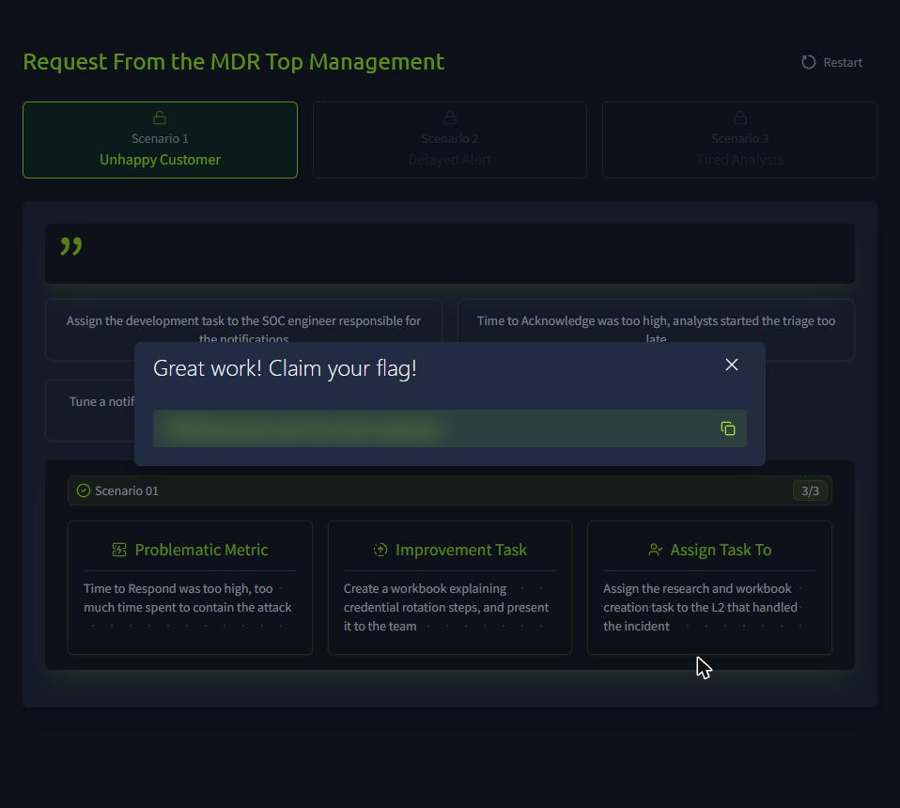
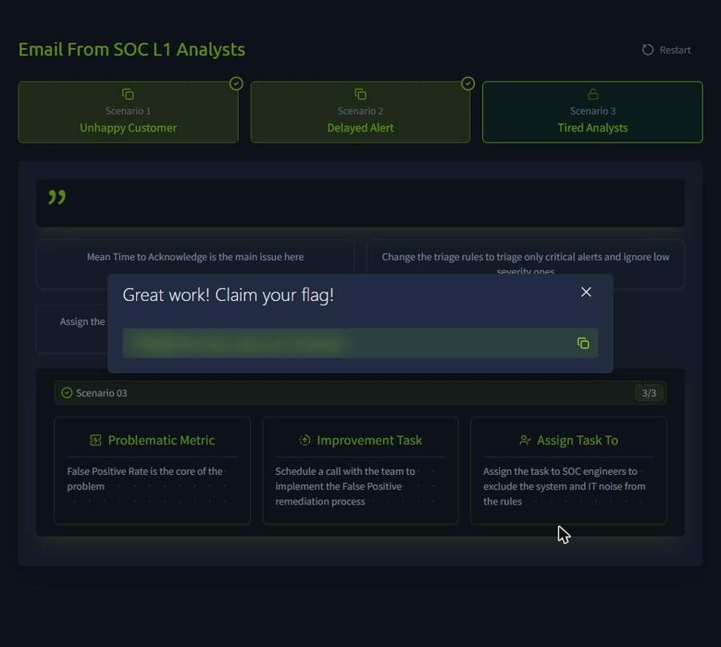

# SOC Metrics and Objectives — Measuring a SOC

| Item | Detail |
|------|--------|
| Platform | TryHackMe — SOC Level 1 path |
| Room | [SOC Metrics and Objectives](https://tryhackme.com/room/socmetricsobjectives) |
| Category | Blue Team · SOC Management · SLAs |
| Difficulty | Medium |
| Year | 2026 |
| Status | ✅ Completed — 6/6 tasks |

> **Goal:** understand the metrics used to judge a SOC (alert count, FPR, escalation rate, MTTD/MTTA/MTTR), spot which one is broken in a real complaint, and assign the right improvement to the right role.

---

## 1. Core metrics

| Metric | Formula | Measures |
|--------|---------|----------|
| Alerts Count (AC) | total alerts received | analyst workload |
| False Positive Rate (FPR) | FP / total alerts | noise in detections |
| Alert Escalation Rate (AER) | escalated / total alerts | L1 experience & autonomy |
| Threat Detection Rate (TDR) | detected threats / total threats | SOC reliability |

- **FPR** — 0% is unrealistic; **80%+ is a serious problem** (fix with detection tuning = *False Positive Remediation*). Aim for < 50%, ideally < 20%.
- **Zero alerts for a month is *not* a good sign** — it usually means broken log sources or rules.

**Worked example:** 10 of 50 alerts are real → 40 FP → FPR = 40/50 = **80%**.

## 2. Triage / time metrics (SLA)

| Metric | Typical SLA | Meaning |
|--------|-------------|---------|
| Availability | 24/7 or 8/5 | working schedule |
| MTTD | 5 min | attack → detection |
| MTTA | 10 min | alert → L1 starts triage |
| MTTR | 60 min | alert received → threat contained (**includes MTTA**) |

**Worked example (Redline Stealer):**
- Alert fired 12 min after infection → **MTTD = 12**
- L1 moved it to In Progress 10 min later → **MTTA = 10**
- Escalated after 6 min, L2 spent 35 min cleaning → **MTTR = 10 + 6 + 35 = 51**

Answer: `12,10,51`. A critical alert on **Saturday** in an **8/5** SOC is acknowledged on **Monday**.

### Answers

| Task | Question | Answer |
|------|----------|--------|
| 2 | Zero alerts for a month is good? | `Nay` |
| 2 | FPR when 10/50 alerts are real | `80%` |
| 3 | 8/5 team, alert on Saturday → acknowledged | `Monday` |
| 3 | MTTD, MTTA, MTTR | `12,10,51` |
| 4 | Highest acceptable FPR | `80%` |
| 4 | Should all SOC roles work together on metrics? | `Yea` |

---

## 3. Practice — acting as SOC manager

Each scenario: pick the **problematic metric → improvement task → owner** (drag & drop).

### Scenario 1 — Unhappy customer (MTTR)
CFO mailbox breached; alert was fast but it took **5 h** to properly reset the Entra ID password and MFA → emails dumped.

| Metric | Task | Owner |
|--------|------|-------|
| Time to Respond too high | Create a credential-rotation workbook and present it to the team | L2 who handled the incident |

### Scenario 2 — Delayed alert (MTTD)
Ransomware demo stopped in 40 min, but nobody saw anything for the first **20 min**.

| Metric | Task | Owner |
|--------|------|-------|
| Time to Detect of 20 min | Tune SIEM/detection rules to run every 5 min | Dedicated SOC engineer |

❌ Rejected: "L1 reviews raw logs instead of alerts" — doesn't scale.

### Scenario 3 — Tired analysts (FPR)
760 alerts per 8 h shift, **95% noise** from IT/automation → burnout.

| Metric | Task | Owner |
|--------|------|-------|
| False Positive Rate | Start a False Positive remediation process | SOC engineers exclude IT/system noise from rules |

❌ Rejected: "Triage only critical alerts and ignore low severity" — creates blind spots.

Flags: `THM{...}` ×3 *(redacted)*

---

## Key takeaways

1. Every complaint maps to **one metric** — identify it before proposing fixes.
2. **MTTR includes MTTA**; slow containment is usually a missing procedure → write a workbook.
3. Slow detection is an **engineering** problem (rule schedule, log latency), not an analyst problem.
4. High FPR burns out L1 — the fix is **tuning**, never ignoring alerts.
5. As an L1 you are the first to notice bad metrics: report them with numbers.
