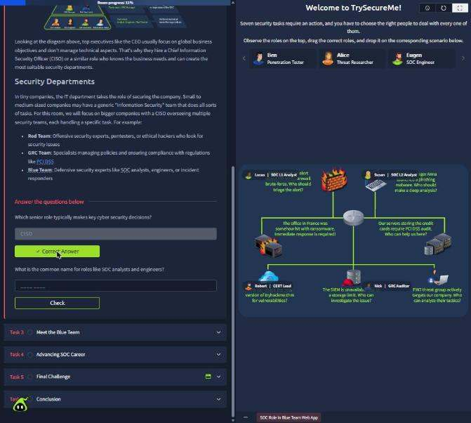
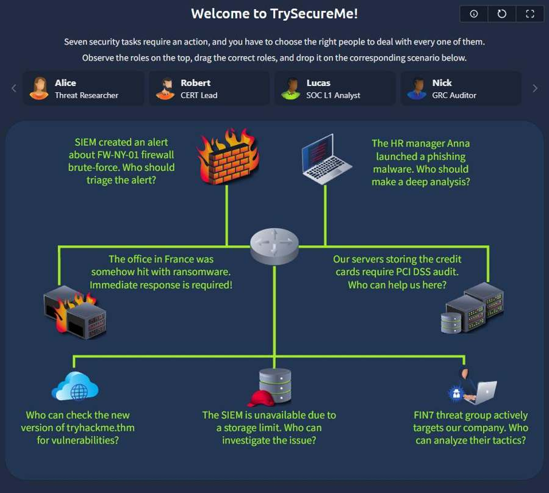
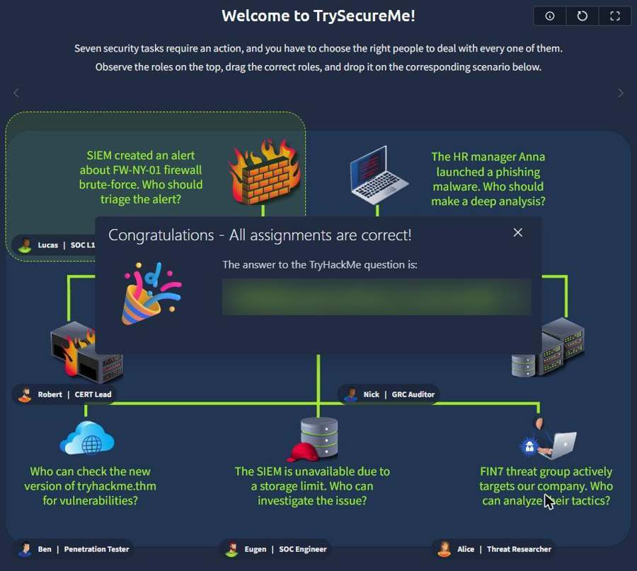
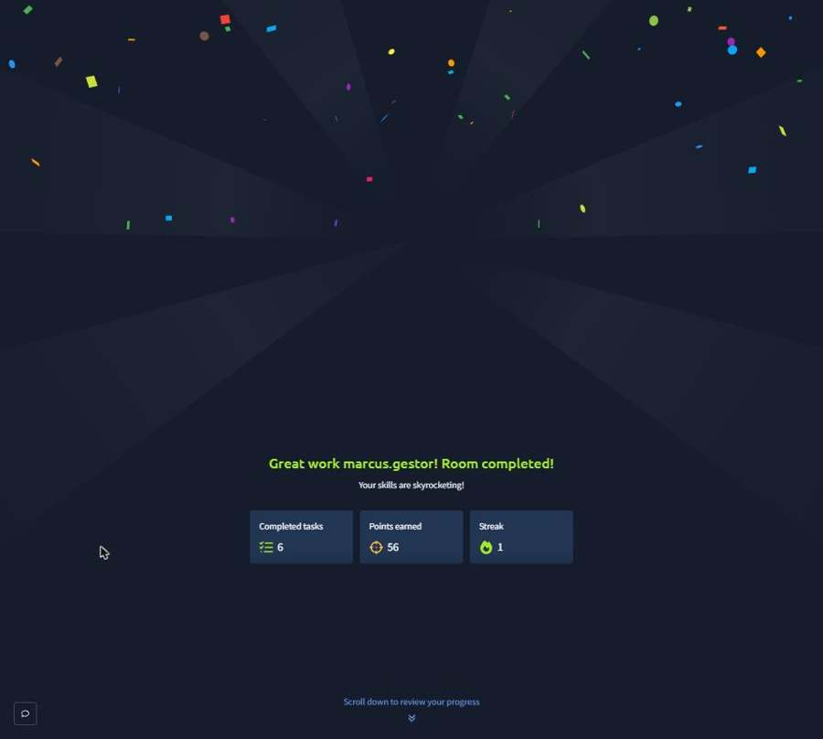

# SOC Role in Blue Team — Security Hierarchy & Career Path

| Item | Detail |
|------|--------|
| Platform | TryHackMe — SOC Level 1 path |
| Room | [SOC Role in Blue Team](https://tryhackme.com/room/socroleinblueteam) |
| Category | Blue Team · SOC fundamentals |
| Difficulty | Easy |
| Date | 23 Nov 2026 |
| Status | ✅ Completed — 6/6 tasks |

> **Goal:** understand where a SOC sits inside a company, which security teams exist around it, and how a SOC L1 analyst can grow from there.

---

## Task 1 — Introduction

No answer required. Prerequisites: *Junior Security Analyst Intro* and *SOC Roles and Processes*.

---

## Task 2 — Security Hierarchy

Every company protects different things first (a law firm → document privacy, a factory → production-line availability, a hospital → patient safety), so security structures differ. In larger companies:

- **CEO** focuses on business goals and hires a **CISO** (Chief Information Security Officer) to own security decisions.
- The CISO oversees several teams:
  - **Red Team** — offensive: pentesters / ethical hackers.
  - **GRC Team** — governance, risk and compliance (e.g. PCI DSS).
  - **Blue Team** — defensive: SOC analysts, engineers, incident responders.

| Question | Answer |
|----------|--------|
| Which senior role typically makes key cyber security decisions? | `CISO` |
| What is the common name for roles like SOC analysts and engineers? | `Blue Team` |

> 💡 **Tip:** TryHackMe shows the answer format as underscores (`____` = 4 characters, `____ ____` = two words of 4). Use it to check your answer before submitting.

---

## Task 3 — Meet the Blue Team

| Department | Role |
|------------|------|
| **SOC** | First line of defence; triages alerts and handles most attacks. L1 (triage) → L2 (deep investigation) → Engineers (SIEM/EDR) → Manager |
| **CIRT / CSIRT / CERT** | "Firefighters" for active, serious incidents. Examples: JPCERT, Mandiant, AWS CIRT |
| **Specialised roles** | Digital Forensics, Threat Intelligence, AppSec, AI security research |

| Question | Answer |
|----------|--------|
| Does Blue Team focus on defensive or offensive security? | `Defensive` |
| Which department handles active or urgent cyber attacks? | `CIRT` |

---

## Task 4 — Advancing SOC Career

**Internal SOC vs MSSP** (Managed Security Services Provider):

| Topic | Internal SOC | MSSP |
|-------|--------------|------|
| Example | Protects one bank | Protects ~60 customers |
| Pace | Calmer shifts | Starts with a queue of urgent alerts |
| Tools | Few tools, known in depth | Many diverse platforms |
| Incident exposure | A few major incidents per year | Attacks every week |

Natural progression: **SOC L1 → SOC L2**, then branch into engineering, CIRT, management or CISO track.

| Question | Answer |
|----------|--------|
| How would you call a cyber security company providing SOC services? | `MSSP` |
| Which role naturally continues your SOC L1 analyst journey? | `SOC L2 Analyst` |

---

## Task 5 — Final Challenge (TrySecureMe)

Acting as CISO of *TrySecureMe*, seven incidents happen at once. Drag each team member to the right incident.

### Reasoning for each assignment

| Incident | Assigned to | Why |
|----------|-------------|-----|
| SIEM alert: brute-force on firewall FW-NY-01 — who triages? | **Lucas — SOC L1 Analyst** | Alert triage is the core L1 task |
| HR manager launched phishing malware — who does deep analysis? | **Susan — SOC L2 Analyst** | Deep investigation of escalated cases is L2 |
| Office in France hit by ransomware — immediate response | **Robert — CERT Lead** | Active, urgent incidents go to CIRT/CERT |
| Credit-card servers need a PCI DSS audit | **Nick — GRC Auditor** | Compliance/regulation is GRC |
| Check new version of tryhackme.thm for vulnerabilities | **Ben — Penetration Tester** | Offensive testing is Red Team work |
| SIEM down due to a storage limit | **Eugen — SOC Engineer** | Engineers maintain SIEM/EDR platforms |
| FIN7 threat group targeting the company — analyse tactics | **Alice — Threat Researcher** | Threat intelligence tracks adversary TTPs |

| Question | Answer |
|----------|--------|
| What flag did you claim after completing the final challenge? | `THM{...}` *(redacted — complete the challenge to obtain it)* |

> 🛠️ **Troubleshooting note:** in the embedded split view the drag-and-drop zones did not register reliably. Opening the challenge in its own tab (full-screen button, top-right) gave enough space to drop each role inside its scenario area.

---

## Task 6 — Conclusion

Room completed. Next rooms in the path: *Humans as Attack Vectors* and *Systems as Attack Vectors*.

---

## Key takeaways for SOC interviews

1. **Know who does what** — routing an incident to the right team is a core SOC skill (triage → L2 → CIRT).
2. **L1 vs L2:** L1 triages and escalates; L2 investigates complex/confirmed cases.
3. **Engineers keep the tooling alive** — a SIEM outage is an engineering problem, not an analyst one.
4. **Internal SOC vs MSSP** — MSSP means more pressure but faster exposure to real attacks.
5. **Threat intelligence** (e.g. tracking FIN7 TTPs) feeds detections used by the whole Blue Team.
