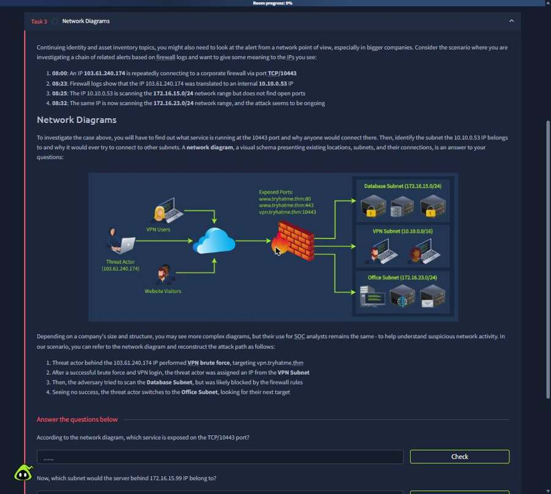
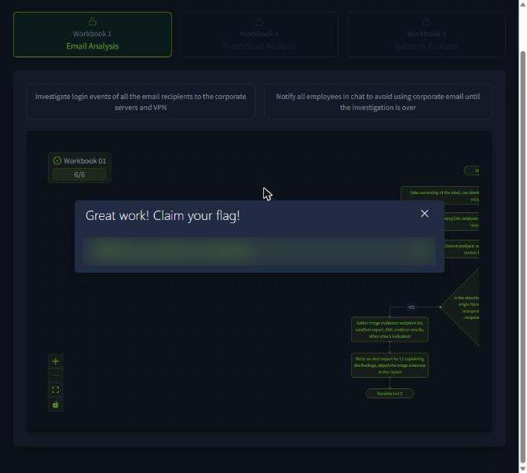
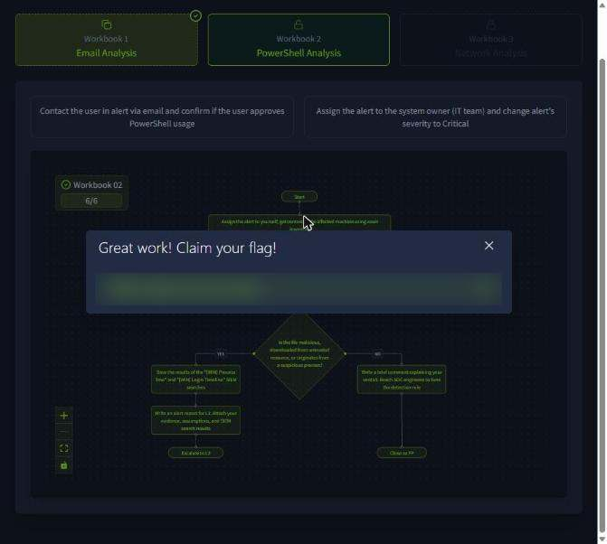
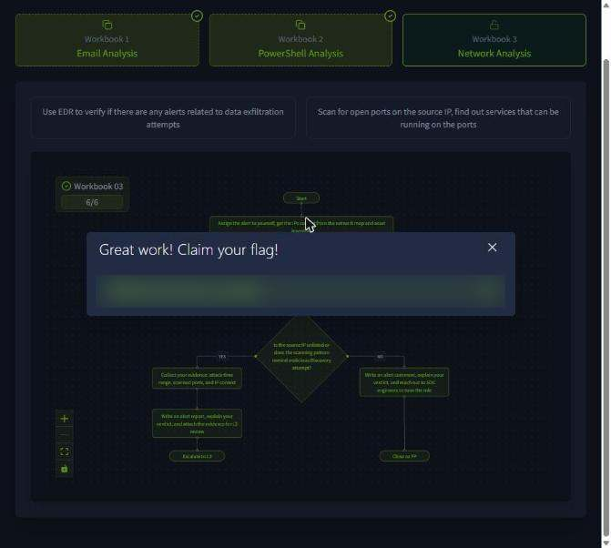

# SOC Workbooks and Lookups — Context Is Everything

| Item | Detail |
|------|--------|
| Platform | TryHackMe — SOC Level 1 path |
| Room | [SOC Workbooks and Lookups](https://tryhackme.com/room/socworkbookslookups) |
| Category | Blue Team · Enrichment · Playbooks |
| Difficulty | Easy |
| Date | 23 Nov 2026 |
| Status | ✅ Completed — 6/6 tasks |

> **Goal:** use corporate context — identity inventory, asset inventory and network diagrams — to triage alerts correctly, and build step-by-step **workbooks** for recurring alert types.

---

## 1. Identity inventory

A catalogue of users and service accounts with role, location and access. Sources: Active Directory / Entra ID, SSO (Okta, Google Workspace), HR systems (BambooHR, SAP, HiBob), or a custom CSV/Excel.

**Scenario:** G.Baker downloaded `Financial Report US 2024.xlsx` from `HQ-FINFS-02` and shared it with R.Lund.

| User | Role | Access |
|------|------|--------|
| G.Baker | Chief Financial Officer (UK) | VPN, HQ, FINANCE |
| R.Lund | **US Financial Adviser** (Texas) | VPN, FINANCE |

## 2. Asset inventory

| Host | Purpose |
|------|---------|
| HQ-FINFS-02 (172.16.15.89) | File server for **financial records** |
| HQ-ADDC-01 (172.16.15.10) | Primary AD domain controller |

➡️ A CFO sharing a US financial report with the US financial adviser is **expected** → legitimate.

## 3. Network diagrams

Firewall exposes web (80/443) and **VPN on TCP/10443**; behind it: Database subnet `172.16.15.0/24`, VPN subnet `10.10.0.0/16`, Office subnet `172.16.23.0/24`.

**Reconstructed attack:** `103.61.240.174` brute-forced the VPN → got VPN IP `10.10.0.53` → scanned the **Database Subnet** (blocked) → moved on to scan the Office subnet. ➡️ **True Positive.**

### Answers

| Task | Question | Answer |
|------|----------|--------|
| 2 | Role of R.Lund | `US Financial Adviser` |
| 2 | Data stored on HQ-FINFS-02 | `Financial Records` |
| 2 | Is the file sharing legitimate? | `Yea` |
| 3 | Service on TCP/10443 | `VPN` |
| 3 | Subnet of 172.16.15.99 | `Database Subnet` |
| 3 | Scenario verdict | `TP` |
| 4 | Role that uses workbooks most | `SOC L1 Analyst` |
| 4 | Gathering user/host/IP context via TI and lookups | `Enrichment` |
| 4 | Identity source in the workbook example | `BambooHR` |

---

## 4. Workbooks — practice (drag & drop builder)

Every workbook follows the same skeleton: **Enrichment → Investigation → Decision → Escalate (TP) or Close (FP)**. Distractor steps were intentionally wrong (over-reactions or steps outside L1 scope).

### Workbook 1 — External email with script/binary attachment
1. Take ownership; use identity inventory for recipient context
2. Analyse the email with an EML analyser (SPF/DKIM, content, sender reputation)
3. Attachment analysis: sandbox for binaries, manual review for scripts
4. **Malicious?** → Gather triage evidence → Write alert report for L2 → *Escalate*
5. **Benign?** → Short comment explaining why it is safe → *Close as FP*

❌ Rejected: "Notify all employees to stop using email" (panic), "Investigate logins of all recipients" (L2 scope).

### Workbook 2 — Executable downloaded with PowerShell
1. Assign to yourself; asset inventory for machine context
2. Threat intel on the URL + static analysis of the executable
3. Build a process tree (parent process, account that launched PowerShell)
4. **Malicious?** → Save `[WIN] Process Tree` and `[WIN] Login Timeline` searches → L2 report → *Escalate*
5. **Benign?** → Brief comment + ask SOC engineers to tune the rule → *Close as FP*

❌ Rejected: "Email the user to ask if they approve PowerShell" (tips off a possible attacker), "Assign to IT and set Critical".

### Workbook 3 — Port scanning from an internal IP
1. Assign to yourself; IP context from the network map and asset inventory
2. List the ports scanned and which services could run on them
3. If the source is a corporate scanner (Nessus/Zabbix), verify the pattern is expected
4. **Unlisted / malicious pattern?** → Collect evidence (time range, ports, IP context) → L2 report → *Escalate*
5. **Expected?** → Comment + ask engineers to tune → *Close as FP*

❌ Rejected: "Scan the source IP back", "Check EDR for exfiltration" (not part of this triage).

Flags: `THM{...}` ×3 *(redacted)*

---

## Key takeaways

1. **Never judge an alert without context** — the same file share is malicious or normal depending on *who* the users are.
2. **Asset inventory + network diagram** turn raw IPs into a story (VPN brute force → lateral scanning).
3. **Enrichment comes first**, then investigation, then the decision.
4. A good workbook makes triage consistent across analysts and shifts.
5. When closing as FP, **feed back to SOC engineers** so noisy rules get tuned.

## MITRE ATT&CK mapping

| Technique | ID | Seen in |
|-----------|----|---------|
| Brute Force | T1110 | VPN brute force |
| External Remote Services | T1133 | VPN access with stolen creds |
| Network Service Discovery | T1046 | Internal port scanning |
| Command and Scripting Interpreter: PowerShell | T1059.001 | Workbook 2 |
| Ingress Tool Transfer | T1105 | Executable download via PowerShell |
| Phishing: Spearphishing Attachment | T1566.001 | Workbook 1 |
