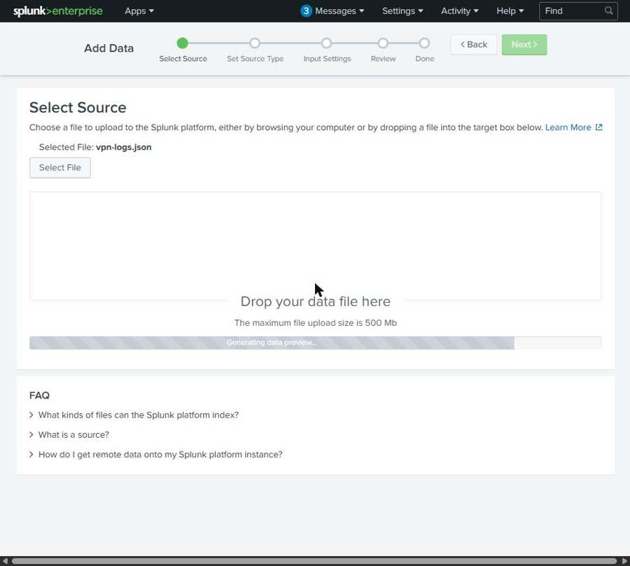
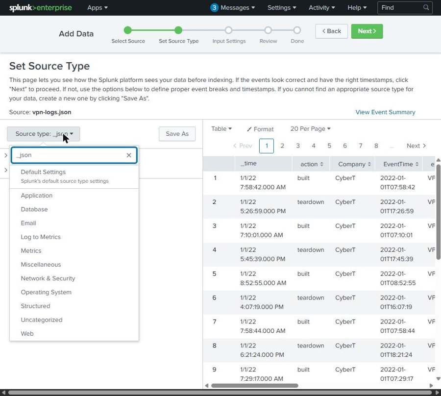
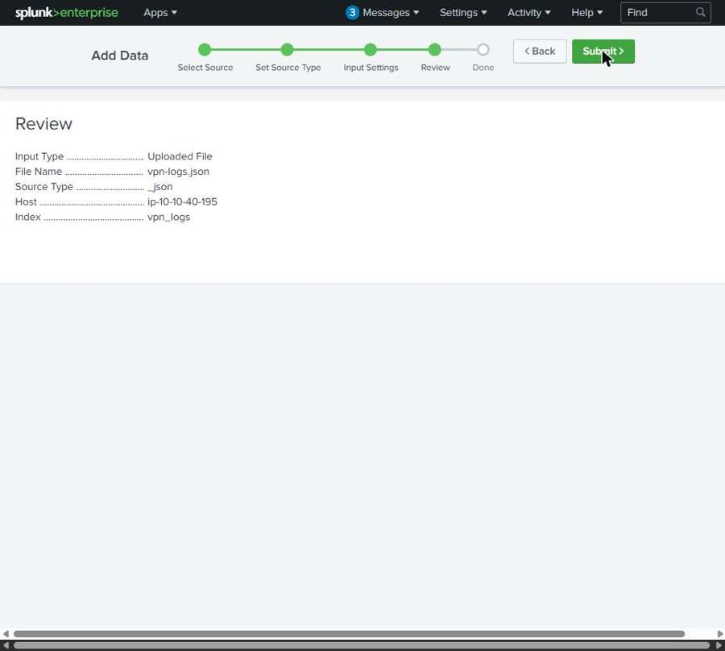
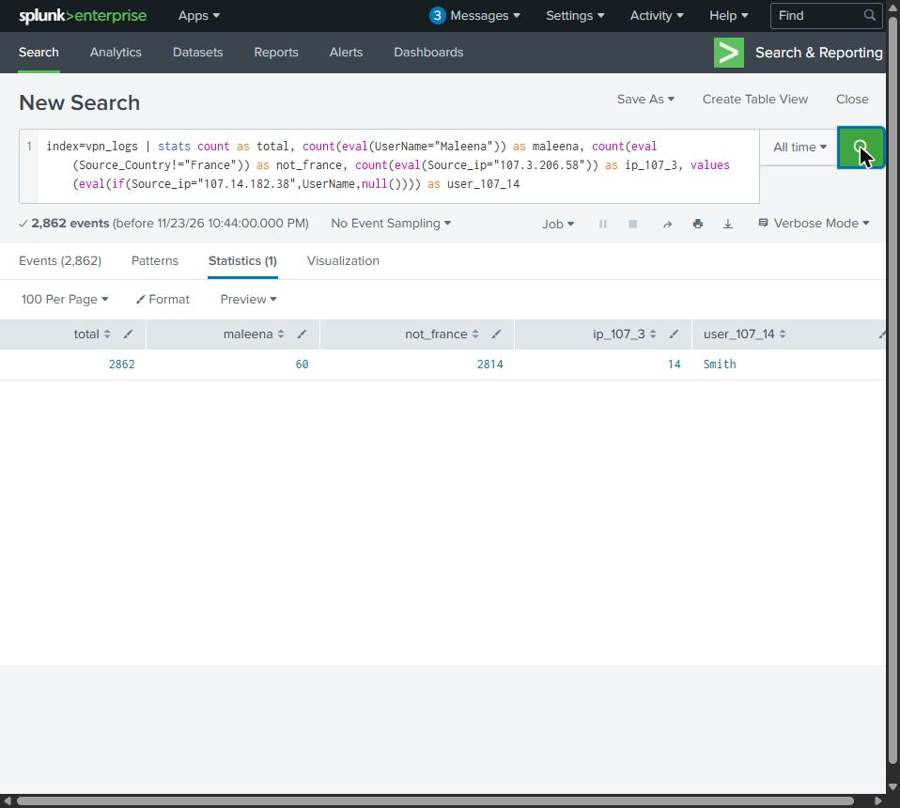

# Splunk: The Basics — Ingesting and Searching VPN Logs

| Item | Detail |
|------|--------|
| Platform | TryHackMe — SOC Level 1 path |
| Room | [Splunk: The Basics](https://tryhackme.com/room/splunk101) |
| Category | SIEM · Splunk · SPL |
| Difficulty | Easy |
| Date | 23 Nov 2026 |
| Status | ✅ Completed — 6/6 tasks |

> **Goal:** learn Splunk's components and interface, ingest a raw JSON log file into a new index, and answer investigation questions with SPL.

---

## 1. Splunk components

| Component | Role |
|-----------|------|
| **Forwarder** | Lightweight agent on endpoints that collects data and sends it to Splunk |
| **Indexer** | Parses, normalises and stores data as searchable events |
| **Search Head** | UI where analysts run SPL searches, build reports and dashboards |

**Add Data** options: *Upload* (one-off file), **Monitor** (files & ports, continuous), *Forward* (from forwarders).

| Question | Answer |
|----------|--------|
| Component that collects and sends data | `Forwarder` |
| Add Data option for files and ports | `Monitor` |

---

## 2. Lab — ingesting VPN logs

Lab: Splunk Enterprise 8.2.6 on a TryHackMe VM, reached through the browser.

**Step 1 – Upload.** *Settings → Add Data → Upload* → select `VPN-logs.json` (task file).



**Step 2 – Source type.** Splunk auto-detects **`_json`** and extracts fields (`UserName`, `Source_ip`, `Source_Country`, `action`, `EventTime`…). Check the timestamps look correct.



**Step 3 – Input settings.** *Create a new index* → `VPN_Logs` (Splunk stores index names in lowercase: `vpn_logs`) → **Review → Submit**.



**Step 4 – Search with SPL.** One `stats` query answers every question at once:

```spl
index=vpn_logs
| stats count as total,
        count(eval(UserName="Maleena"))           as maleena,
        count(eval(Source_Country!="France"))     as not_france,
        count(eval(Source_ip="107.3.206.58"))     as ip_107_3,
        values(eval(if(Source_ip="107.14.182.38", UserName, null()))) as user_107_14
```

Simpler one-question-at-a-time equivalents:

```spl
index=vpn_logs                                   | stats count
index=vpn_logs UserName="Maleena"                | stats count
index=vpn_logs Source_ip="107.14.182.38"         | table UserName | dedup UserName
index=vpn_logs Source_Country!="France"          | stats count
index=vpn_logs Source_ip="107.3.206.58"          | stats count
```



> 💡 Running the search immediately after *Submit* returned 2,812 events — Splunk was still indexing. Re-running a few seconds later returned the full 2,862. Always confirm ingestion is complete before trusting counts.

I also cross-checked the counts outside Splunk by parsing the JSON with Python — identical results.

| Question | Answer |
|----------|--------|
| Events in the log file | `2862` |
| Events for user Maleena | `60` |
| Username for IP 107.14.182.38 | `Smith` |
| Events from all countries except France | `2814` |
| VPN events for IP 107.3.206.58 | `14` |

---

## Key takeaways

1. Forwarder → Indexer → Search Head is the core Splunk data path.
2. Picking the right **source type** (`_json`) gives you field extraction for free.
3. Put each data source in its **own index** — scoped searches are faster and cleaner.
4. `stats count(eval(...))` lets one search answer several questions.
5. Validate results: wait for indexing to finish and cross-check when numbers matter.
