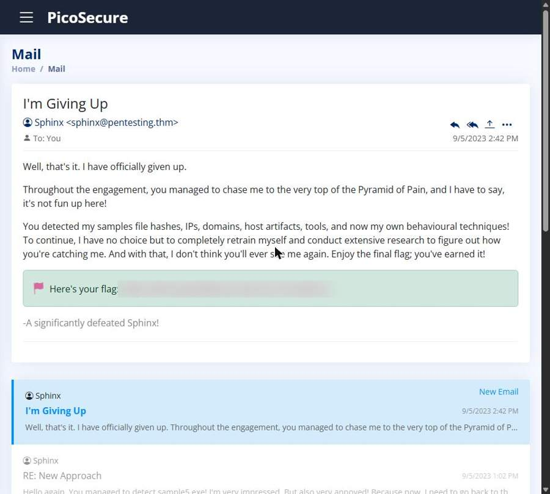

# Summit — Purple-Team Climb up the Pyramid of Pain

| Item | Detail |
|------|--------|
| Platform | TryHackMe — SOC Level 1 path (Cyber Defence Frameworks challenge) |
| Room | [Summit](https://tryhackme.com/room/summit) |
| Category | Detection engineering · Purple team · Sigma |
| Difficulty | Easy |
| Date | 23 Nov 2026 |
| Status | ✅ Completed — 6/6 flags |

> **Scenario:** a pentester ("Sphinx") runs malware samples on a PicoSecure workstation. After each sample I must use PicoSecure's tools (sandbox, hash blocklist, firewall, DNS filter, Sigma rule builder) to detect/prevent it. Each round forces me one level **higher** on the Pyramid of Pain.

---

## Round-by-round

### 1 · sample1.exe → **Hash values**
Sandbox report: Metasploit, PE32+ x64. **Manage Hashes → SHA256** `9c550591…efca8c`.
> Sphinx: *"I only need to alter a single bit… all I did was recompile."*

### 2 · sample2.exe → **IP addresses**
New hash (recompiled). Network activity: `GET http://154.35.10.113:4444/uvLk8YI32` (Intrabuzz Hosting).
**Firewall Manager → Egress | Source: Any | Destination: 154.35.10.113 | Deny.**
(The other connections went to Microsoft 40.97.128.x — legitimate, not blocked.)

### 3 · sample3.exe → **Domain names**
Attacker moved to cloud IPs, but the C2 domain stayed: `emudyn.bresonicz.info` (`:1337/kzn293la`, `/backdoor.exe`).
**DNS Filter → Category Malware | Domain `bresonicz.info` | Deny** — blocking the parent domain covers every subdomain.

### 4 · sample4.exe → **Host artifacts**
Registry activity: `HKLM\SOFTWARE\Microsoft\Windows Defender\Real-Time Protection` → `DisableRealtimeMonitoring = 1`.
**Sigma → Sysmon → Registry Modifications**
```yaml
detection:
  selection:
    ObjectName: 'HKEY_LOCAL_MACHINE\SOFTWARE\Microsoft\Windows Defender\Real-Time Protection'
    NewValue: 'DisableRealtimeMonitoring=1'
tags: [attack.ta0005]   # Defense Evasion
```

### 5 · sample5.exe → **Tools / network artifacts (behaviour)**
`outgoing_connections.log` showed a beacon: **97 bytes, every 30 min, port 443**, to 51.102.10.19 (other connections were random sizes/times).
Because IP/port/protocol can change, I matched the **beacon pattern**, not the destination:
```yaml
detection:
  selection:
    EventID: 3
    RemoteIP: '*'
    RemotePort: '*'
    Size: 97
    Frequency: 1800 seconds
tags: [attack.ta0011]   # Command and Control
```

### 6 · sample6.exe → **TTPs**
`commands.log`: every sample runs recon (`dir c:\`, `net localgroup administrator`, `systeminfo`, `ipconfig /all`, `netstat -ano`, `net start`…) and appends the output to **`%temp%\exfiltr8.log`** for exfiltration — a habit, not an artifact of one tool.
**Sigma → Sysmon → File Creation and Modification**
```yaml
detection:
  selection:
    EventID: 2
    TargetFilename: '*\exfiltr8.log'
    TargetPath: '*\AppData\Local\Temp\*'
tags: [attack.ta0010]   # Exfiltration
```



Flags: 6 × `THM{...}` *(redacted)*

---

## Lessons

| Level | My control | Cost for the attacker to evade |
|-------|-----------|--------------------------------|
| Hash | Blocklist | Recompile (seconds) |
| IP | Egress firewall rule | New VPS/cloud IP (minutes) |
| Domain | DNS sinkhole | Buy/register domain (hours) |
| Host artifact | Sigma registry rule | Change malware behaviour |
| Tool/network artifact | Beacon size + interval rule | Rebuild C2 tooling |
| TTP | Rule on attacker procedure | Retrain the operator |

The higher the detection, the more it **hurts** — exactly what Sphinx said: *"The reward no longer outweighs the cost."*
