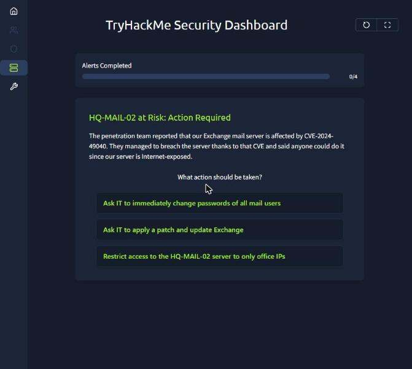
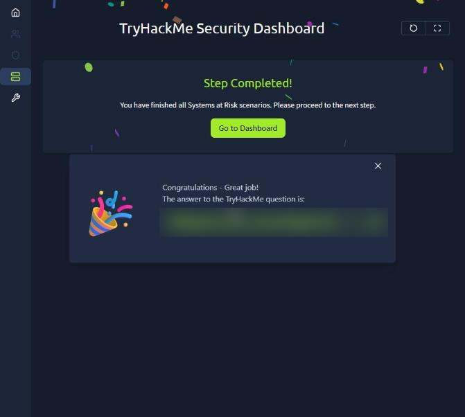
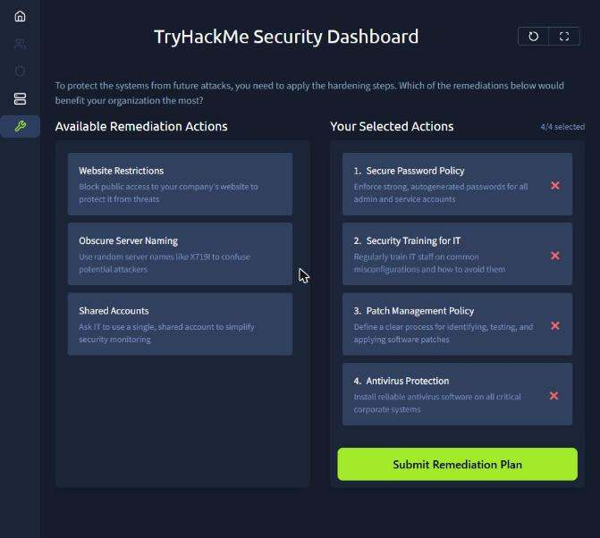
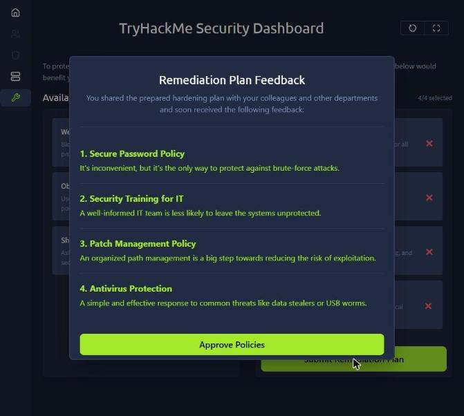

# Systems as Attack Vectors — Vulnerabilities, Misconfigurations & Remediation

| Item | Detail |
|------|--------|
| Platform | TryHackMe — SOC Level 1 path |
| Room | [Systems as Attack Vectors](https://tryhackme.com/room/systemsattackvectors) |
| Category | Blue Team · Vulnerability management · Hardening |
| Difficulty | Medium |
| Year | 2026 |
| Status | ✅ Completed — 7/7 tasks |

> **Goal:** understand how attackers exploit vulnerable or misconfigured systems (often with no victim interaction), and decide the right remediation for each case.

---

## Theory in one page

- **System** = any device or software the company runs (servers, laptops, websites, firewalls, cloud apps).
- Attacks on systems **can happen without any victim interaction** (e.g. an internet-exposed server with a known CVE), and **one breached system can be enough** for a disaster (ransomware, data theft).

| Attack surface | Example | Fix |
|----------------|---------|-----|
| **Vulnerability** (software flaw, tracked as CVE) | SharePoint "ToolShell" — `CVE-2025-53770` | **Patch** (vendor update) |
| **Misconfiguration** (human setup mistake) | Weak admin password, exposed admin panel, open share | Reconfigure — *a patch does not fix it* |
| **Supply chain** | Trusted app/library ships malware in an update | Investigate the update, contain, notify vendor |

Misconfigurations are found by **penetration testing** — an authorised attack against your own systems.

### Answers

| Task | Question | Answer |
|------|----------|--------|
| 2 | Can attacks happen without victim intervention? | `Yea` |
| 2 | Can a single breached system lead to disaster? | `Yea` |
| 3 | Term for a security flaw that can be exploited | `Vulnerability` |
| 3 | Attack where malware comes from a trusted app/library | `Supply Chain` |
| 4 | CVE of the SharePoint "ToolShell" vulnerability | `CVE-2025-53770` |
| 4 | How to respond to a detected vulnerability | `Patch` |
| 5 | Can a patch fix misconfigurations? | `Nay` |
| 5 | Authorised attack to detect misconfigurations | `Penetration Testing` |

---

## Task 6 — Practice: TryHackMe Security Dashboard

### Part 1 — Systems at Risk (4 alerts)

| # | Alert | Decision | Why |
|---|-------|----------|-----|
| 1 | Exchange server `HQ-MAIL-02` vulnerable to **CVE-2024-49040**, internet-exposed, pentesters breached it | **Ask IT to patch and update Exchange** | Root cause is a vulnerability → patch. Changing passwords or IP-restricting doesn't remove the flaw. Then hunt for anything that got in before the patch |
| 2 | WordPress admin panel **brute-forced**, homepage defaced | **Change the admin password to a strong one** | Root cause is a weak credential (misconfiguration). Restoring from backup alone lets the attacker straight back in |
| 3 | Threat intel: neighbour company hit by ransomware via an **old Cisco firewall** | **Ensure all corporate firewalls are patched and CVE-free** | Proactive patching; replacing vendors or disabling firewalls is excessive/dangerous |
| 4 | Trusted 3D design app starts running malicious CMD commands **right after an update** | **Investigate a supply chain attack** | Trusted software + sudden malicious behaviour after an update = supply chain compromise, not user error |

### Part 2 — Remediation Plan (choose 4)

| Selected ✅ | Rejected ❌ |
|------------|------------|
| Secure Password Policy — stops brute-force (alert 2) | Website Restrictions — blocking your public site breaks the business |
| Security Training for IT — fewer misconfigurations | Obscure Server Naming — security through obscurity, no real protection |
| Patch Management Policy — addresses alerts 1 and 3 | Shared Accounts — destroys accountability and auditability |
| Antivirus Protection — stops common commodity malware | |

| Question | Answer |
|----------|--------|
| Flag after "Systems at Risk" | `THM{...}` *(redacted)* |
| Flag after "Remediation Plan" | `THM{...}` *(redacted)* |

---

## Key takeaways

1. **Find the root cause** before choosing a fix: vulnerability → patch; misconfiguration → reconfigure; supply chain → investigate the vendor/update.
2. **Patching closes the door, it doesn't evict intruders** — always hunt for compromise that happened before the patch.
3. **Restoring a backup without fixing the cause** invites the same attack again.
4. **Obscurity and shared accounts are anti-patterns**; strong credentials and individual accountability are not.
5. Threat intelligence from peers is actionable: audit your own estate for the same exposure.

## MITRE ATT&CK mapping

| Technique | ID | Seen in |
|-----------|----|---------|
| Exploit Public-Facing Application | T1190 | Exchange CVE, old Cisco firewall |
| Brute Force | T1110 | WordPress admin panel |
| Defacement | T1491.002 | Replaced homepage |
| Supply Chain Compromise: Software Supply Chain | T1195.002 | Malicious 3D app update |
| Command and Scripting Interpreter: Windows Command Shell | T1059.003 | Malicious CMD commands |
