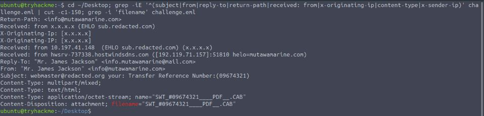
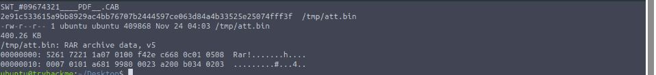

# The Greenholt Phish: Triage of a Business-Payment Phishing Email

| | |
|---|---|
| **Platform** | TryHackMe (SOC Level 1 › Phishing) |
| **Room** | [The Greenholt Phish](https://tryhackme.com/room/phishingemails5fgjlzxc) |
| **Year** | 2026 |
| **Difficulty** | Medium |
| **Tools** | Linux CLI (`grep`, Python `email`, `sha256sum`, `file`, `xxd`), WHOIS/IP lookup, SPF/DMARC lookup, VirusTotal |

## Scenario

A sales executive received an unexpected "Transfer Reference" email from a known customer, with a generic
greeting and an unsolicited attachment. The task is to triage `challenge.eml` the way an L1 SOC analyst would:
sender, routing, authentication and the attachment.

## 1. Header triage in one command

```bash
cd ~/Desktop
grep -iE '^(subject|from|reply-to|return-path|received: from|x-originating-ip|content-type)' challenge.eml | cut -c1-150
grep -i filename challenge.eml
```



| Indicator | Value | Why it matters |
|---|---|---|
| Subject | `Transfer Reference Number:(09674321)` | Payment lure creates urgency |
| Display name | Mr. James Jackson | Familiar-looking person |
| From | `info@mutawamarine.com` | Looks like the customer's domain |
| **Reply-To** | `info.mutawamarine@mail.com` | **Free mailbox.** Replies go to the attacker, not the customer |
| Originating IP | `192.119.71.157` (`hwsrv-737338.hostwindsdns.com`) | Hosting provider, not the customer's mail system |
| Attachment | `SWT_#09674321____PDF__.CAB` | "PDF" in the name, but `.CAB` extension |

## 2. Infrastructure checks

- **IP owner (WHOIS/ASN):** the hosting provider registered for the range today is **HostPapa** (AS54290). The PTR still points to `hostwindsdns.com`, so ownership changed after the email was sent. Always check the current registry.
- **SPF** of the Return-Path domain: `v=spf1 include:spf.protection.outlook.com -all`. Only Microsoft 365 may send for it, so a hosting-provider IP does **not** pass.
- **DMARC:** `v=DMARC1; p=quarantine; fo=1`. Failing mail should go to quarantine.

## 3. Attachment analysis (safely, without opening it)

```bash
python3 -c "import email;m=email.message_from_file(open('challenge.eml'))
for p in m.walk():
    f=p.get_filename()
    if f: open('/tmp/att.bin','wb').write(p.get_payload(decode=True)); print(f)"
sha256sum /tmp/att.bin
python3 -c "import os;print(round(os.path.getsize('/tmp/att.bin')/1024,2),'KB')"
file /tmp/att.bin; xxd /tmp/att.bin | head -2
```



- **SHA256:** `2e91c533615a9bb8929ac4bb76707b2444597ce063d84a4b33525e25074fff3f` (look this up on VirusTotal, don't upload)
- **Size:** 400.26 KB
- **Real type:** **RAR** (magic bytes `52 61 72 21` = `Rar!`), disguised as a `.CAB` "PDF"

## Answers

| Question | Answer |
|---|---|
| Transfer reference | 09674321 |
| Sender display name / address | Mr. James Jackson / info@mutawamarine.com |
| Reply-To | info.mutawamarine@mail.com |
| Originating IP / owner | 192.119.71.157 / HostPapa |
| SPF record | v=spf1 include:spf.protection.outlook.com -all |
| DMARC record | v=DMARC1; p=quarantine; fo=1 |
| Attachment / SHA256 | SWT_#09674321____PDF__.CAB / 2e91c533…fff3f |
| Size / real type | 400.26 KB / RAR |

## Analyst takeaways

- **A Reply-To that differs from From** (especially to a free mailbox) is a top business-email-compromise indicator.
- **Trust magic bytes, not extensions.** `file` and `xxd` reveal the real format in seconds.
- **WHOIS answers change.** Record the date of the lookup in your ticket.
- **Verdict:** malicious. Block the sender and the hash, search for other recipients, and warn the user not to reply.
