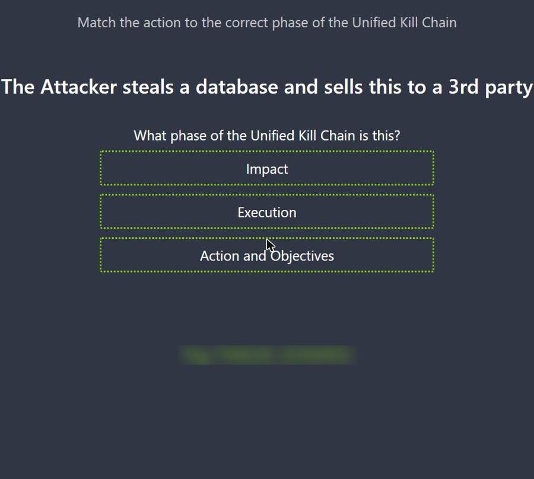

# Unified Kill Chain — 18 Phases In, Through and Out

| Item | Detail |
|------|--------|
| Platform | TryHackMe — SOC Level 1 path (Cyber Defence Frameworks) |
| Room | [Unified Kill Chain](https://tryhackme.com/room/unifiedkillchain) |
| Category | Threat modelling · Frameworks |
| Difficulty | Medium |
| Year | 2026 |
| Status | ✅ Completed — 9/9 tasks |

> **Goal:** understand the Unified Kill Chain (Paul Pols, **2017**), which merges the Lockheed Martin Kill Chain and MITRE ATT&CK into **18 phases** grouped in three goals.

---

## Why UKC?

- "Kill chain" is a **military** concept (structure of an attack).
- Threat modelling = identifying risks to an organisation's **assets** (any hardware/software in IT) and the attacker's likely path.
- The classic Kill Chain stops at the perimeter; UKC also covers what happens *inside* the network.

## The three goals

| Goal | Phases |
|------|--------|
| **IN** — Initial foothold | Reconnaissance, Weaponization, Social Engineering, Exploitation, Persistence, Defense Evasion, Command & Control, Pivoting |
| **THROUGH** — Network propagation | Pivoting, Discovery, Privilege Escalation, Execution, Credential Access, Lateral Movement |
| **OUT** — Action on objectives | Collection, Exfiltration, Impact, Objectives |

### Answers

| Question | Answer |
|----------|--------|
| Origin of the term "Kill Chain" | `Military` |
| Term for a piece of IT hardware/software | `Asset` |
| Year UKC was released | `2017` |
| Number of phases | `18` |
| Phase for evading detection | `Defense Evasion` |
| Phase for removing data from a network | `Exfiltration` |
| Phase where objectives are achieved | `Objectives` |
| Email-based foothold tactic | `Phishing` |
| Impersonating an employee for a password reset | `Social Engineering` |
| Setting up the C2 server | `Weaponization` |
| Exploiting a system vulnerability | `Exploitation` |
| Moving from one system to another | `Pivoting` |
| Malicious service to log back in | `Persistence` |
| Failed admin logins → attacker seeks | `Privilege Escalation` |
| Mimikatz dumping OS/user secrets | `Credential Access` |
| Big traffic spike to unknown IP | `Exfiltration` |
| CIA pillar hit by a PII leak | `Confidentiality` |

---

## Practical — match the action to the phase

| Action | Phase |
|--------|-------|
| Uses tools to gather information about a system | Reconnaissance |
| Installs a script for remote access at a later date | Persistence |
| Hacked machine controlled from the attacker's server | Command and Control |
| Uses the hacked machine to reach other servers | Pivoting |
| Steals a database and sells it to a 3rd party | Action on Objectives |

Flag: `THM{...}` *(redacted)*

## SOC relevance

UKC phases map neatly to alerts: failed admin logins → *Privilege Escalation*, Mimikatz → *Credential Access*, unusual outbound volume → *Exfiltration*. Knowing the phase tells you **how far along** the attacker is and how urgent the response must be.
