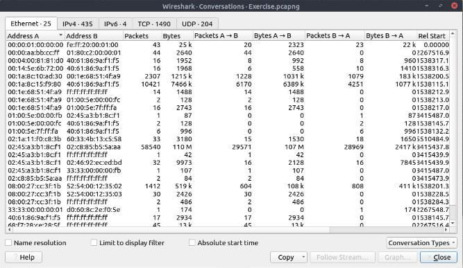
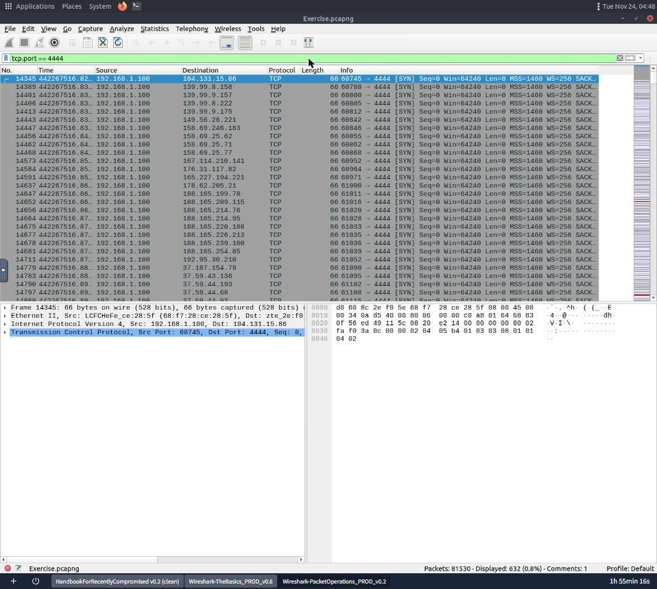
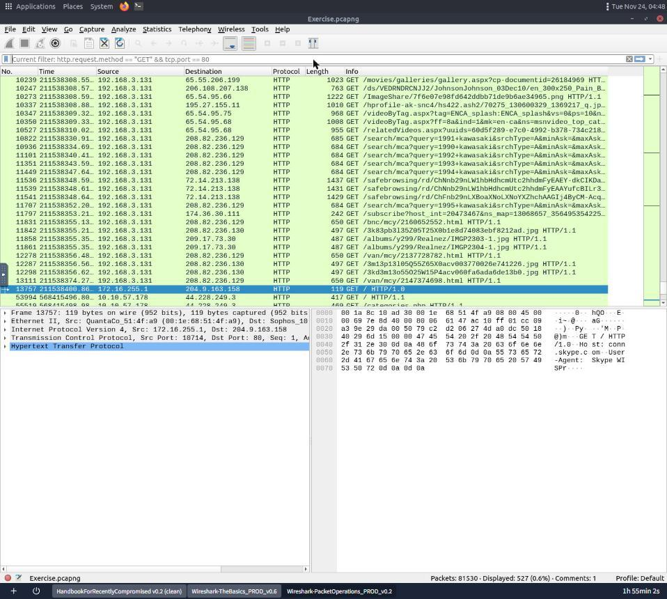
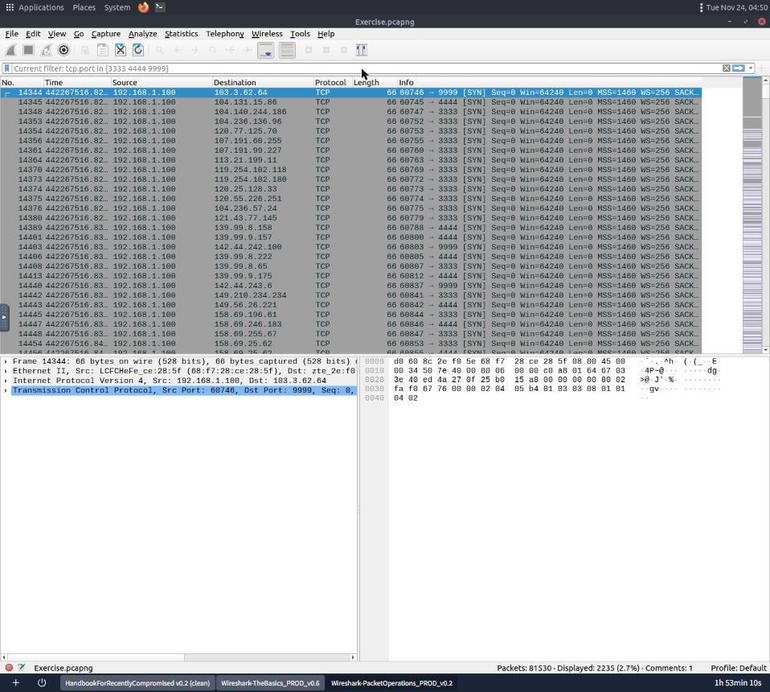

# Wireshark: Packet Operations: Statistics and Display Filters

| | |
|---|---|
| **Platform** | TryHackMe (SOC Level 1 › Network Traffic Analysis) |
| **Room** | [Wireshark: Packet Operations](https://tryhackme.com/room/wiresharkpacketoperations) |
| **Year** | 2026 |
| **Difficulty** | Medium |
| **Focus** | Statistics menus (summary + protocol details), display-filter syntax, protocol filters, advanced operators, profiles and filter buttons |

## Scenario

One capture (`Exercise.pcapng`, ~81k packets). The goal is to stop scrolling and start **asking questions of the traffic**: who talked to whom, how much, which services, and which packets match a hypothesis such as "is anything using a classic reverse-shell port?".

## Step 1: Statistics › Summary views

| Question | Menu | Answer |
|---|---|---|
| IP of the hostname starting with `bbc` | Statistics › Resolved Addresses | **199.232.24.81** |
| Number of IPv4 conversations | Statistics › Conversations › IPv4 tab | **435** |
| Bytes from the `Micro-St` MAC | Statistics › Endpoints › Ethernet (name resolution on) | **7474 k** |
| IPs linked to "Kansas City" | Statistics › Endpoints › IPv4 (GeoIP City column) | **4** |
| IP linked to the "Blicnet" AS organisation | Endpoints › IPv4 (AS Organization column) | **188.246.82.7** |



> Endpoints + GeoIP/ASN is the fastest way to spot an unexpected country or hosting provider before reading a single packet.

## Step 2: Statistics › Protocol details

| Question | Menu | Answer |
|---|---|---|
| Most used IPv4 destination | Statistics › IPv4 Statistics › Destinations and Ports | **10.100.1.33** |
| Max DNS service response time | Statistics › DNS | **0.467897** s |
| HTTP requests to `rad[.]msn[.]com` | Statistics › HTTP › Load Distribution | **39** |

## Step 3: Display-filter principles

Wireshark has two filter languages, and mixing them up is a classic mistake:

| | Capture filter (BPF) | Display filter |
|---|---|---|
| When | Before capture: packets not matched are never saved | After capture: hides, never deletes |
| Syntax | `tcp port 80`, `host 10.0.0.1` | `tcp.port == 80`, `ip.addr == 10.0.0.1` |

Operators: `==` `!=` `>` `<` `>=` `<=` (or `eq ne gt lt ge le`), logic `&&` `||` `!` (or `and or not`). The filter bar turns **green/red/yellow** for valid / invalid / valid-but-may-not-do-what-you-think.

## Step 4: Protocol filters

| Question | Filter | Answer |
|---|---|---|
| IP packets | `ip` | **81420** |
| Packets with TTL < 10 | `ip.ttl < 10` | **66** |
| Packets on TCP 4444 | `tcp.port == 4444` | **632** |
| HTTP GET requests to port 80 | `http.request.method == "GET" && tcp.port == 80` | **527** |
| Type A DNS answers | `dns.qry.type == 1 && dns.flags.response == 1` | **51** |





> **Lesson learned.** My first DNS count used `dns.flags.response == 0` (queries) and gave 55, which the room rejected. The expected count was the A-record **responses** (51). Always check whether a question means the request or the answer side of a protocol.

TCP 4444 is Metasploit's default listener port; 632 SYNs from one internal host (192.168.1.100) to many external IPs looks like scanning or beaconing, not a normal service.

## Step 5: Advanced filtering

| Question | Filter | Answer |
|---|---|---|
| IIS packets **not** from port 80 | `http.server contains "IIS" && !(tcp.srcport == 80)` | **21** |
| IIS packets with version 7.5 | `http.server contains "IIS/7.5"` | **71** |
| Packets on 3333, 4444 or 9999 | `tcp.port in {3333 4444 9999}` | **2235** |
| Packets with an even TTL | `string(ip.ttl) matches "[02468]$"` | **77289** |
| Bad TCP checksums (profile *Checksum Control*) | `tcp.checksum.status == "Bad"` | **34185** |
| Packets shown by the profile's filter button | *(saved button)* | **261** |



Useful advanced operators:

```text
contains        case-sensitive substring        http.server contains "Apache"
matches         case-insensitive regex          http.host matches "\.(php|html)"
in {...}        set membership                  tcp.port in {80 443 8080}
upper()/lower() normalise case first            lower(http.server) contains "apache"
string()        turn a number into text         string(frame.number) matches "[13579]$"
```

**Profiles** (Edit › Configuration Profiles) store coloring rules, columns and **filter buttons**, so a "Checksum Control" or "Malware Hunting" profile can be one click away during an incident.

## SOC takeaways

- **Statistics first, packets second.** Conversations, Endpoints and Protocol Hierarchy show where to look.
- **Port 4444/3333/9999** and other non-standard high ports from a single host are worth a hunt: reverse shells, miners or C2.
- **Bad checksums** in a capture are usually NIC offloading on the capture host, not an attack. Check before raising an alert.
- **Build a personal filter library** and keep it as profile buttons. It saves minutes on every case.

## Skills demonstrated

`Wireshark statistics` · `Display filter syntax` · `Protocol filters` · `Regex & set operators` · `GeoIP/ASN enrichment` · `Configuration profiles` · `Threat hunting hypotheses`
