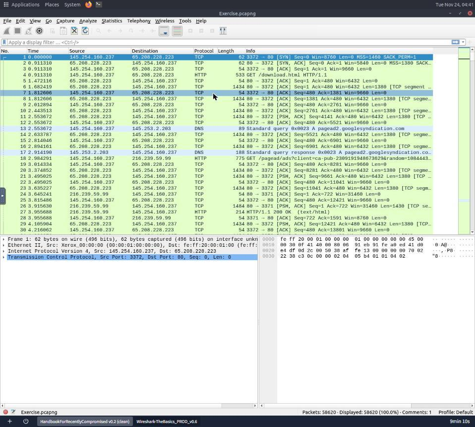
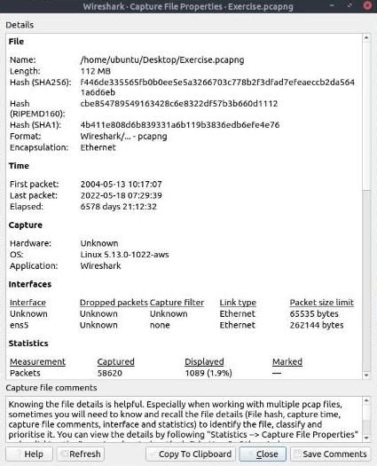
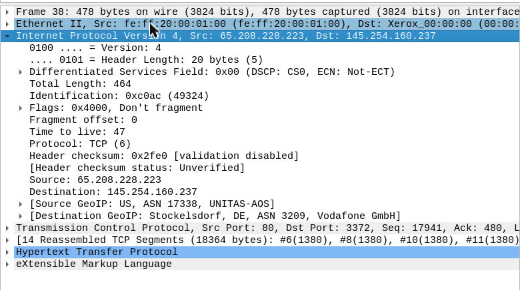
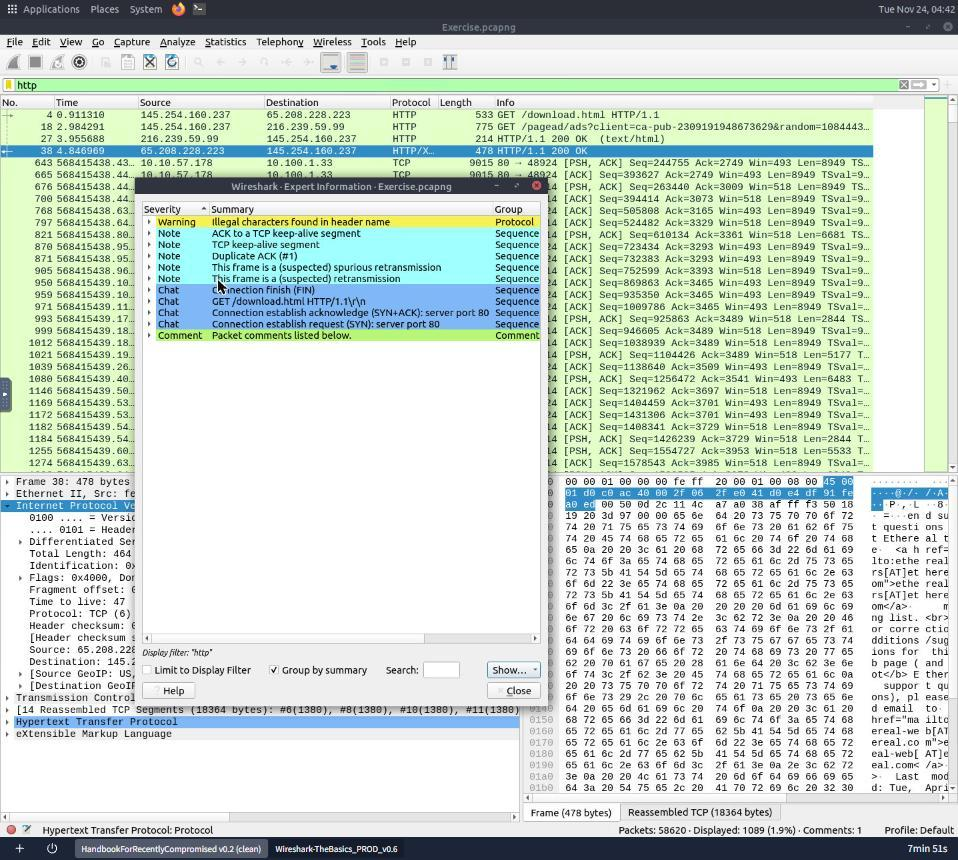
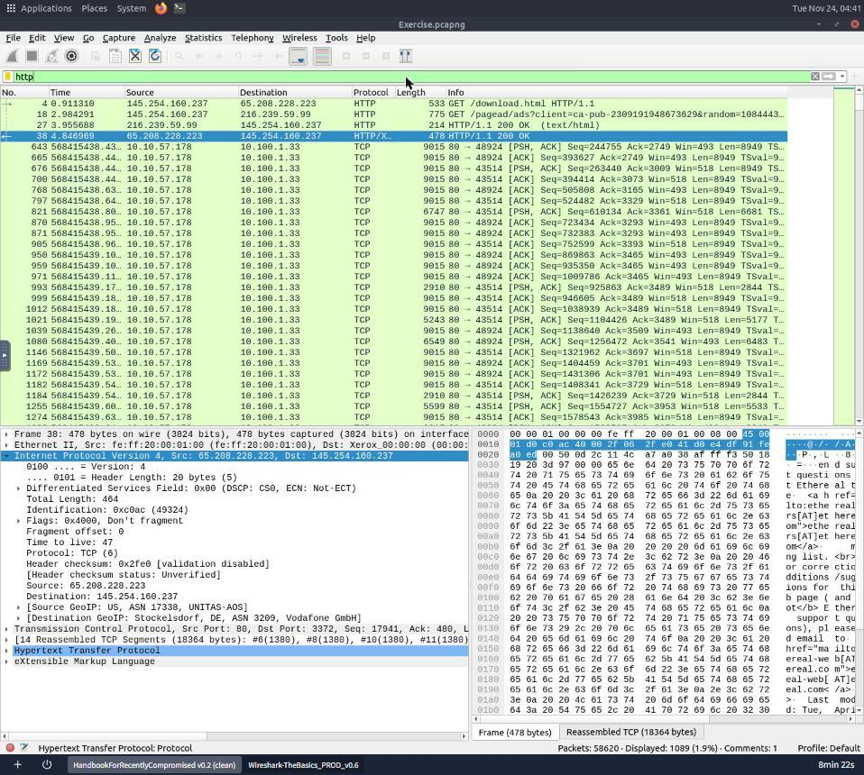

# Wireshark: The Basics: Reading a PCAP Like an Analyst

| | |
|---|---|
| **Platform** | TryHackMe (SOC Level 1 › Network Traffic Analysis) |
| **Room** | [Wireshark: The Basics](https://tryhackme.com/room/wiresharkthebasics) |
| **Year** | 2026 |
| **Difficulty** | Medium |
| **Focus** | Wireshark GUI, capture file properties, packet dissection, navigation, display filters, stream following |

## Scenario

A lab VM ships with two captures: `http1.pcapng` (used for the room's screenshots) and `Exercise.pcapng` (used for the questions). The goal is to get comfortable enough with Wireshark to answer the triage questions a SOC analyst asks first: *what is this file, what happened in packet N, and how do I narrow 58,000 packets down to the ones that matter?*



## Step 1: Know the file before reading it

`Statistics › Capture File Properties` gives the metadata you write into a case note: hashes, first/last packet, interfaces, packet totals and the analyst comments embedded in the file.



| Question | Answer |
|---|---|
| Flag in the capture file comments | `THM{...}` (redacted) |
| Total packets | **58620** |
| SHA256 of the capture | `f446de335565fb0b0ee5e5a3266703c778b2f3dfad7efeaeccb2da5641a6d6eb` |

> Why it matters: hashing the PCAP before analysis proves chain of custody: anyone can re-hash it and confirm they're looking at the same evidence.

## Step 2: Dissect a single packet (packet 38)

Jump with `Go › Go to Packet` (`Ctrl+G`) or the filter `frame.number == 38`, then expand each layer in the details pane. Wireshark shows the OSI stack bottom-up: Frame → Ethernet → IP → TCP → HTTP → payload.



| Question | Answer | Where |
|---|---|---|
| Markup language under HTTP | **eXtensible Markup Language** | Last layer in the details pane |
| Arrival date | **05/13/2004** | Frame layer › Arrival Time |
| TTL | **47** | IPv4 › Time to live |
| TCP payload size | **424** | TCP › TCP payload |
| ETag | **9a01a-4696-7e354b00** | HTTP › response headers |

## Step 3: Navigate and extract

| Task | How | Answer |
|---|---|---|
| Find the string `r4w` in packet details | `Edit › Find Packet` › *String* in *Packet details* | Artist 1: **r4w8173** |
| Read packet 12's comment | Packet comment instructs to export the embedded JPG, then `md5sum` it | `911cd574a42865a956ccde2d04495ebf` |
| Find the `.txt` file in the capture | `File › Export Objects › HTTP`, save and read it | Alien's name: **PACKETMASTER** |
| Warnings in Expert Info | `Analyze › Expert Information` | **1636** |



Expert Info is the fastest anomaly sweep in Wireshark: warnings (malformed headers, illegal characters), notes (retransmissions, duplicate ACKs) and chats (SYN, FIN, GET) are grouped by severity, so you see what's unusual before reading any packets.

## Step 4: Filter and follow streams

Right-click *Hypertext Transfer Protocol* in packet 4 › **Apply as Filter › Selected**. That writes the filter for you:

| Question | Answer |
|---|---|
| Filter query | `http` |
| Displayed packets | **1089** (of 58,620, 1.9%) |
| Artists in the server response (packet 33790 › Follow › HTTP Stream) | **3** |
| Second artist | **Blad3** |



## Filters I used

```text
frame.number == 38          # jump to a single packet
http                        # protocol filter (same as Apply as Filter on the HTTP layer)
ip.addr == 10.10.57.178     # everything to/from a host
tcp.stream eq 5             # one conversation (what Follow Stream applies)
frame contains "r4w"        # string search inside packet bytes
```

## SOC takeaways

- **Start with metadata, not packets.** Capture properties and Expert Info take a few seconds and tell you the time window, size and anomalies before you scroll.
- **Apply as Filter beats typing filters.** It builds the exact field syntax for you, and you can learn the filter language from it.
- **Follow Stream turns packets back into a conversation.** It's the quickest way to read what a client asked and what the server returned.
- **Export Objects = file carving.** Any file sent over clear-text HTTP/SMB can be recovered, hashed and checked on VirusTotal.
- **Packet comments** are how analysts hand findings to each other inside the evidence file itself.

## Skills demonstrated

`Wireshark` · `PCAP triage` · `Display filters` · `Packet dissection` · `Stream reassembly` · `Object export & hashing` · `Evidence integrity`
